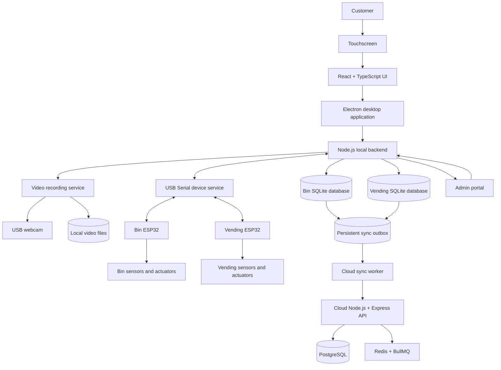
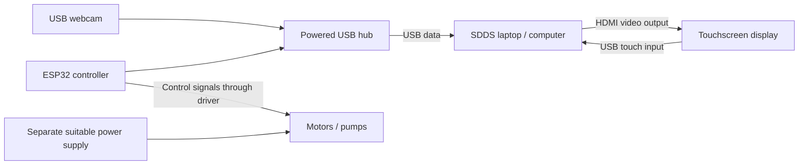
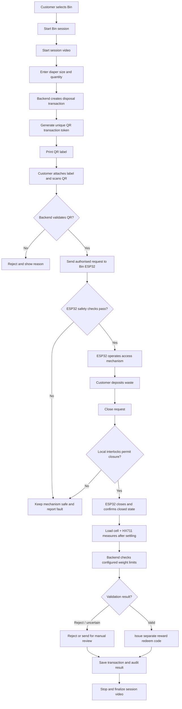
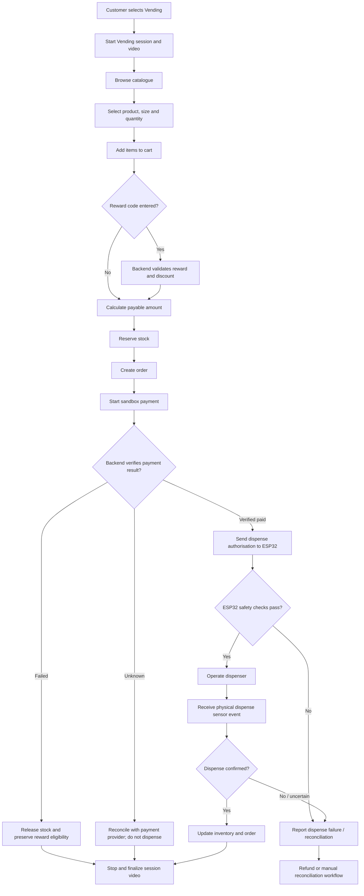
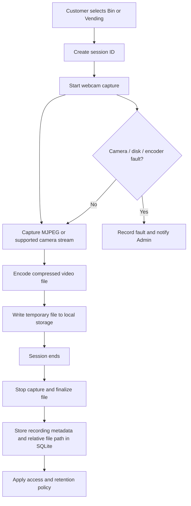
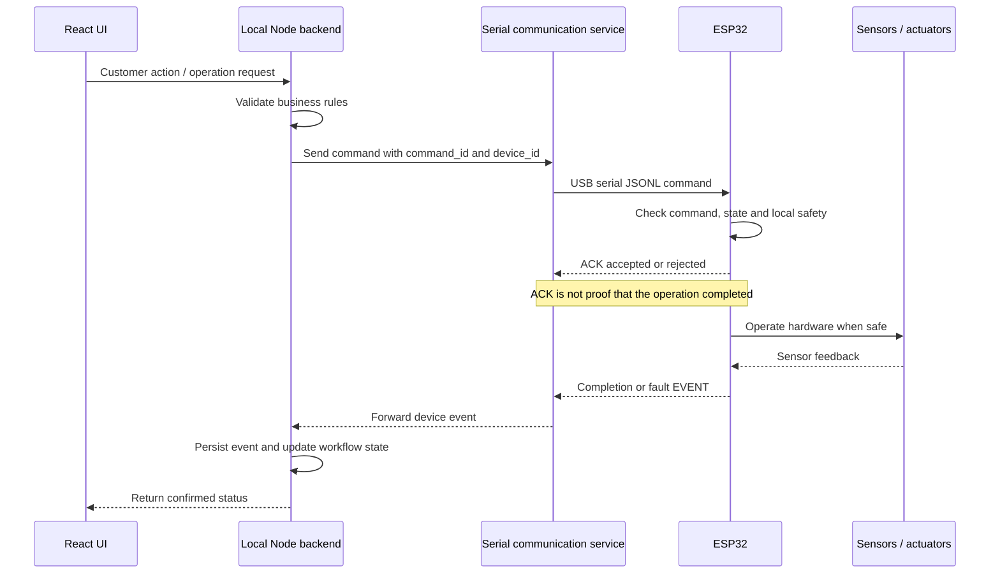
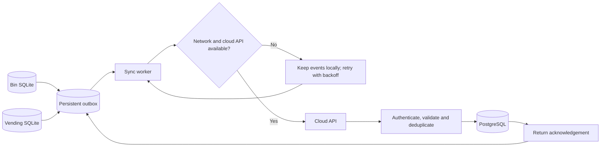
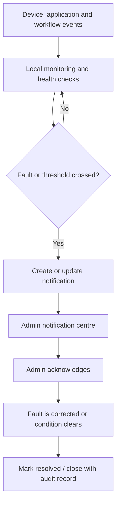
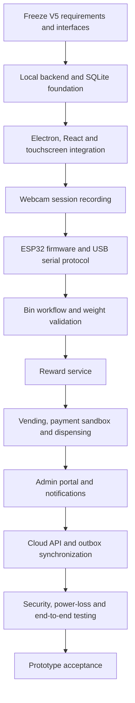

# SDDS V5 --- Plan of Action

**Status:** Working implementation plan based on the currently confirmed
V5 decisions.

## 1. Purpose

This plan defines the implementation order for the Smart Diaper Disposal
and Vending System (SDDS) V5. It covers the Bin application, Vending
application, Admin portal, laptop, touchscreen, USB hardware, ESP32,
local databases, session video, cloud services, and system testing.

V5 is the controlling baseline. Do not reintroduce V1--V4 features
unless explicitly approved.

## 2. Confirmed V5 baseline

-   Three applications: Bin, Vending, and Admin.
-   One laptop/computer runs the SDDS software.
-   A powered USB hub connects the USB webcam and ESP32 to the computer.
-   The computer connects to a large touchscreen through HDMI. The
    touchscreen normally also needs a separate USB touch connection.
-   The USB webcam records session video only. Computer vision, face
    detection, face recognition, mask detection, and object detection
    are removed.
-   Recording starts when the customer selects Bin or Vending and stops
    when that session ends.
-   Video is compressed and stored as CCTV-style video files. Database
    records store metadata and file references, not large video BLOBs.
-   Bin and Vending run on one computer and use separate, interconnected
    local databases.
-   Backend services validate business rules. The frontend displays
    backend results.
-   ESP32 firmware owns local sensor and actuator behaviour and safety
    checks.
-   A device communication service exchanges requests, acknowledgements,
    events, and status between the local software and ESP32. A database
    row alone cannot physically operate hardware.
-   Admin has a central notification area, including bin-full and
    product-stock notifications.
-   The client manages site infrastructure such as mains power and
    network provision. SDDS must still detect and report software,
    storage, and device faults.

## 3. Architecture

### 3.1 Components

  Component                      Responsibility
  ------------------------------ -----------------------------------------------------
  React + TypeScript             Customer and Admin UI
  Electron                       Desktop kiosk wrapper
  Node.js + TypeScript           Local backend and workflow coordination
  SQLite                         Durable local records
  Bounded local cache            Faster reads; not authoritative
  SQLite outbox                  Durable cloud synchronization
  USB webcam                     Session recording only
  Video service                  Record, compress, finalize, index, and retain video
  Powered USB hub                USB connection for webcam and ESP32
  HDMI touchscreen               Display and touch interaction
  ESP32 firmware                 Sensor reading, actuator control, local safety
  Device communication service   USB serial communication with ESP32
  Cloud Node.js + Express        Central API
  PostgreSQL                     Central business records
  Redis + BullMQ                 Cache and background jobs

### 3.2 Hardware connections

``` text
USB Webcam ─────┐
                │
ESP32 ──────────┤
                │
         Powered USB Hub
                │ USB
                ▼
             Laptop
                │
       ┌────────┴─────────┐
       │                  │
      HDMI             USB touch
       │                  │
       ▼                  ▼
  Touchscreen Display — Touch input
```

The exact touchscreen model determines its touch cable and driver. HDMI
normally carries display output; touch input commonly uses a separate
USB cable. Motors and pumps must use suitable separate power supplies.
Do not power them from the laptop or USB hub.

### 3.3 Software layout

``` text
Touchscreen UI
      |
React + Electron
      |
Node.js Local Backend
      |
      +---- Bin service -------- bin.db
      +---- Vending service ---- vending.db
      +---- Admin service ----- admin.db
      +---- Shared service ---- local.db
      +---- Video service ----- recordings/
      +---- Device service ---- USB serial ---- ESP32
      +---- Sync service ------ SQLite outbox ---- Cloud API
```

Separate SQLite files do not provide one atomic transaction across all
files. Cross-database operations require explicit ownership,
idempotency, and recovery rules.

## 4. Phased plan of action

### Phase 0 --- Requirements and interface freeze

**Tasks** - Freeze the confirmed V5 requirements. - Define Bin, Vending,
and Admin workflows. - Assign ownership to each database. - Define local
API contracts. - Define ESP32 communication messages and state
ownership. - Define video recording lifecycle and retention settings. -
Confirm exact hardware models. - Keep unconfirmed values as
configuration items.

**Deliverables:** Approved requirements, architecture diagram, hardware
interface list, API draft, serial protocol draft, open-decision
register.

**Exit criteria:** Every component has an owner; success, failure, and
recovery states are defined; no unapproved feature is added.

### Phase 1 --- Local software foundation

**Tasks** - Build React + TypeScript frontend. - Add Electron desktop
packaging. - Build Node.js + TypeScript local backend. - Add SQLite
schemas and migrations. - Create Bin, Vending, Admin, and shared
database ownership. - Add Zod validation and Pino structured logs. - Add
configuration loading, startup checks, health endpoints, and graceful
shutdown.

**Deliverables:** Working desktop app, local API, database migrations,
logs, health status.

**Exit criteria:** Committed data survives restart; migration failures
are visible; critical state is not held only in RAM.

### Phase 2 --- Touchscreen and USB integration

**Tasks** - Connect powered USB hub to the computer. - Connect webcam
and ESP32 to the hub. - Connect touchscreen through HDMI. - Connect the
display's USB touch cable if required. - Verify resolution, touch
calibration, orientation, and kiosk mode. - Verify webcam capture and
ESP32 serial connection. - Implement one serial-port owner. - Add device
IDs, firmware version, heartbeat, ACK, event, timeout, and reconnect
handling.

**Deliverables:** Touchscreen kiosk, webcam status, ESP32 communication
status, device diagnostics.

**Exit criteria:** Touch input works; webcam runs for long sessions;
ESP32 disconnect/reconnect is detected; computer software does not
replace ESP32 safety logic.

### Phase 3 --- CCTV-style session recording

**Tasks** - Start recording when a Bin or Vending session begins. -
Assign a unique session ID. - Continue recording for the session. - Stop
and finalize recording at session end. - Compress video and save it as a
file. - Store metadata and file reference in the database. - Detect
incomplete recordings after crash or power loss. - Monitor disk space
and recording faults. - Restrict playback and export. - Agree retention
and deletion policy with the client.

**Suggested folders**

``` text
SDDS/
  recordings/
    bin/YYYY/MM/
    vending/YYYY/MM/
  database/
    bin.db
    vending.db
    admin.db
    local.db
  logs/
```

**Recording metadata:** recording ID, session ID, type, relative path,
start/end time, duration, codec/container, file size, status, and
retention date if configured.

**Deliverables:** Session recorder, recording index, protected playback,
disk/recording alerts.

**Exit criteria:** Each session has a finalized recording or a recorded
failure; incomplete video is not marked saved; video is not stored as a
large database BLOB; capacity and recovery are tested.

### Phase 4 --- ESP32 firmware and communication

**Tasks** - Implement local Bin and Vending device state machines. -
Keep sensor reading and actuator control in ESP32 firmware. - Define
request, ACK, event, heartbeat, error, and firmware-version messages. -
Use unique command and event IDs. - Prevent duplicate requests from
repeating physical actions. - Add local safety checks and safe
startup/recovery. - Report actual device state separately from requested
state.

**Important:** A backend database update is not a physical action. A
communication service must transfer a request to the ESP32. ESP32 checks
its local safety conditions, decides whether it can act, operates the
hardware, and reports the result.

**Deliverables:** Firmware, device communication service, protocol
document, device event records.

**Exit criteria:** Duplicate commands do not cause repeated actuation;
lost acknowledgements can be reconciled; reset/power loss leads to a
defined safe state.

### Phase 5 --- Bin workflow

**Tasks** 1. Customer selects Bin and session recording starts. 2.
Capture diaper size and quantity. 3. Generate a unique QR transaction
token. 4. Print the QR label and record print status. 5. Customer
attaches and scans the label. 6. Backend validates token and transaction
state. 7. Request permitted lid operation through device service. 8.
ESP32 checks safety and reports physical events. 9. Read load cell
through HX711 after settling. 10. Compare weight with experimentally
validated configured limits. 11. Accept, reject, or send for manual
review. 12. Issue a separate reward code only after successful
validation. 13. Save transaction and outbox event durably. 14. Stop and
finalize session recording.

**Rules** - QR is a disposal transaction reference, not a reward. - QR
printing does not prove disposal. - Weight is a plausibility check, not
proof of diaper count or contents. - One eligible disposal can issue at
most one reward. - Do not invent weight thresholds; establish them
through testing.

**Deliverables:** Bin workflow, QR print/scan, weight validation, reward
issuance, event and fault records.

### Phase 6 --- Reward service

**Tasks** - Generate cryptographically random codes. - Store code hashes
where practical. - Make reward value, expiry, and discount cap
configurable. - Implement Available, Reserved, Redeemed, Expired, and
Cancelled states. - Enforce one-time redemption with an atomic backend
operation. - Do not consume a reward on failed payment. - Preserve
reward state through restart and sync failure.

**Exit criteria:** Concurrent redemption attempts cannot both succeed;
failed payment does not consume the reward; duplicate requests return
one logical result.

### Phase 7 --- Vending workflow

**Tasks** 1. Load product catalogue. 2. Select category, size, and
quantity. 3. Add products to cart. 4. Validate price and availability on
backend. 5. Optionally enter reward code. 6. Validate reward and
calculate discount on backend. 7. Reserve stock. 8. Create order. 9. Use
payment gateway sandbox. 10. Verify payment server-side, including
webhook signature, amount, currency, order reference, and idempotency.
11. Authorise ESP32 dispensing only after verified payment. 12. Receive
physical dispense event. 13. Update stock only after confirmed evidence.
14. Reconcile payment success with failed or uncertain dispensing. 15.
Stop and finalize session recording.

**Rules** - Do not trust frontend payment redirects. - Do not store card
number or CVV. - Do not dispense when payment state is unknown. - Do not
blindly retry uncertain physical dispensing. - Payment success with
dispense failure requires refund/reconciliation. - Online payment
checkout is unavailable when the required online service is unavailable.

### Phase 8 --- Admin portal and notifications

**Tasks** - Add role-based access. - Manage products, prices,
categories, sizes, slots, and stock. - Monitor Bin, Vending, webcam,
recording, printer, QR scanner, ESP32, load cell, motor, database, and
cloud sync. - Manage rewards and settings. - Add reports and audit
logs. - Add notification creation, deduplication, acknowledgement, and
resolution.

**Notification examples:** bin full, low/out-of-stock product, ESP32
disconnected, webcam/recording failure, printer fault, load-cell fault,
motor fault, payment failure, dispensing uncertainty, database/disk
fault, sync delay, security alert.

**Notification states:** `NEW`, `ACKNOWLEDGED`, `RESOLVED`, `CLOSED`.

### Phase 9 --- Cloud and synchronization

**Tasks** - Build cloud Node.js + Express API. - Use PostgreSQL for
central records. - Use Redis and BullMQ for cache and background jobs. -
Authenticate devices and use HTTPS. - Save local business record and
outbox event in the same database transaction. - Upload unique event
IDs. - Mark events synced only after cloud acknowledgement. - Make cloud
consumers idempotent. - Add bounded retries, exponential backoff with
jitter, and failed-job review. - Define conflict rules. - Add backup and
restore procedures.

**Exit criteria:** Local records survive network outages; duplicate sync
does not duplicate records; Redis failure does not lose authoritative
business data.

### Phase 10 --- Security and reliability testing

Test: - Power loss during recording and disposal. - USB hub, webcam,
ESP32, and touchscreen disconnect. - Printer and QR scanner failure. -
Load-cell drift, instability, and disconnection. - Duplicate QR scan and
reward redemption. - Payment timeout and duplicate webhook. - Payment
success with dispense failure. - Motor jam or obstruction. - Disk full
and database recovery. - Network/cloud/Redis outage. - Admin permission
violation and unauthorised video access.

**Deliverables:** Test reports, defect register, recovery procedures,
release checklist.

**Exit criteria:** Critical safety and transaction tests pass; recovery
is demonstrated; no critical security defect remains.

## 5. Cross-cutting engineering rules

### Data authority

-   SQLite is authoritative for committed local records.
-   PostgreSQL is authoritative for central cloud records.
-   Redis is cache/job infrastructure, not the only copy of a business
    transaction.
-   In-memory cache is not authoritative.

### Transaction safety

-   Use unique transaction, command, event, payment, and sync IDs.
-   Make APIs and workers idempotent.
-   Separate requested device state from reported physical state.
-   ACK means accepted, not completed.
-   Require a physical completion event.

### Video

-   Store video as files, not database BLOBs.
-   Store metadata and relative file reference in the database.
-   Restrict playback and export.
-   Define retention and deletion.
-   Monitor storage.
-   Test recovery after abrupt power loss.

### Hardware

-   ESP32 firmware performs local safety checks.
-   Physical interlocks and suitable motor protection are required.
-   Computer software must not bypass safety.
-   Motor/pump power is separate from USB data power.
-   Define reset and power-loss recovery.

### Security

-   HTTPS, device authentication, role-based Admin access, input
    validation, webhook verification, secret protection, private video
    storage, and audit logs.

## 6. Delivery order

    Order Work package                      Dependency
  ------- --------------------------------- ---------------
        1 Requirements and interfaces       Confirmed V5
        2 Local application foundation      1
        3 Touchscreen and USB integration   1, 2
        4 Video recording                   2, 3
        5 ESP32 protocol and firmware       1, 2, 3
        6 Bin workflow                      4, 5
        7 Reward service                    6
        8 Vending workflow                  5, 7
        9 Admin and notifications           2, 4, 5, 6, 8
       10 Cloud and synchronization         2, 6, 7, 8
       11 Security and reliability tests    3--10

## 7. Open decisions

Not fixed by current V5 discussion: - Laptop model, OS, RAM, and
storage. - Touchscreen and USB touch interface model. - Webcam model. -
Video resolution, frame rate, bitrate, codec, retention, and backup
policy. - Expected sessions per day and storage capacity. - Exact
database schemas and cross-database transaction ownership. - ESP32 model
and serial message schema. - Printer, scanner, load cell, HX711, motor
driver, and actuator models. - Payment gateway and sandbox details. -
Cloud provider, region, budget, and expected device count. - Reward
value, expiry, and discount policy. - Experimentally validated weight
limits.

## 8. Completion definition

The V5 prototype is ready for controlled acceptance when all three
applications work; touchscreen, webcam, USB hub, ESP32, and computer
operate together; Bin and Vending session recordings are saved and
protected; Bin and Vending workflows work end to end; reward and payment
operations are idempotent; ESP32 retains local hardware safety; Admin
notifications are actionable; offline sync is recoverable; and critical
failure tests pass.

Production deployment needs a separate review of machine safety,
electrical compliance, privacy/legal obligations, serviceability,
support, and operating cost.

## 9. Visual system pipelines and flowcharts

The diagrams below show the V5 system flow. They describe software data flow and control flow. They are not electrical wiring diagrams.

### 9.1 Overall SDDS system architecture



### 9.2 Physical connection and data path



Motors and pumps do not draw power from the laptop or USB hub. The ESP32 controls them through suitable driver hardware. Exact electrical ratings and wiring remain subject to the selected components.

### 9.3 Bin disposal workflow



### 9.4 Vending purchase and dispensing workflow



### 9.5 Session video recording pipeline



The exact capture format, encoder, bitrate, frame rate, retention period, and behaviour when recording fails must be verified or configured. The camera pipeline performs recording only; it does not perform computer vision.

### 9.6 ESP32 command and event pipeline



### 9.7 Local-to-cloud synchronization pipeline



Local records remain available until cloud acknowledgement and the applicable retention policy permits cleanup. Retries must be idempotent. A sync acknowledgement must refer to the specific event or batch accepted by the cloud.

### 9.8 Admin monitoring and notification pipeline



### 9.9 Build and integration pipeline



The sequence is an implementation order, not a claim that every phase is already complete. Each phase requires its own tests before integration proceeds.
