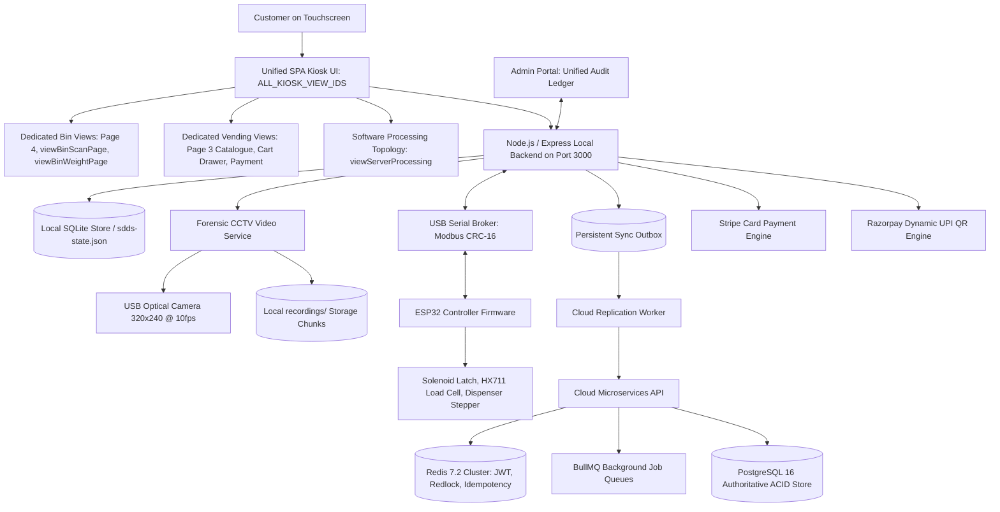
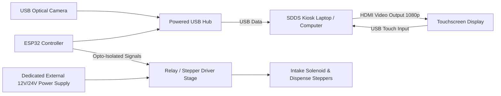
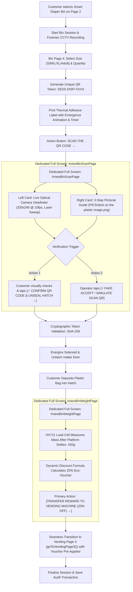
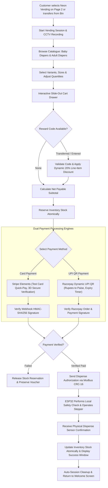
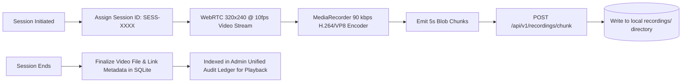
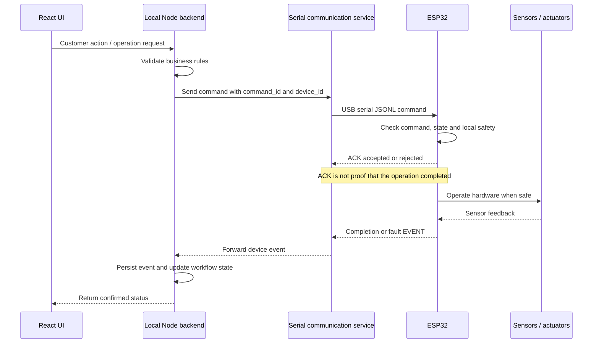
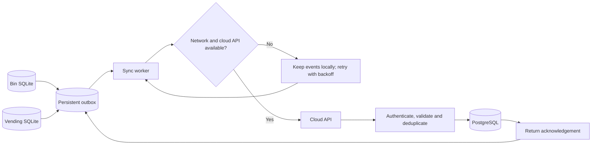
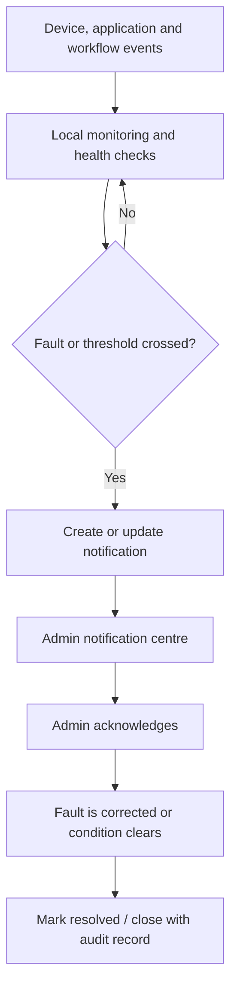
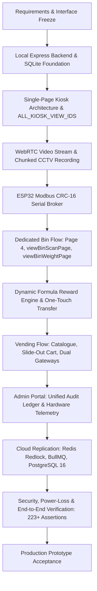

# SDDS V5 --- Plan of Action

**Status:** Working implementation plan based on the currently confirmed
V5 decisions.

## 1. Purpose

This plan defines the implementation order for the Smart Diaper Disposal
and Vending System (SDDS) V5. It covers the Bin application, Vending
application, Admin portal, laptop, touchscreen, USB hardware, ESP32,
local databases, session video, cloud services, and system testing.

V5 is the controlling baseline. Do not reintroduce V1--V4 features
unless explicitly approved.

## 2. Confirmed V5 baseline

-   Three applications: Bin, Vending, and Admin running on a unified Single-Page Application (SPA) kiosk state machine (`ALL_KIOSK_VIEW_IDS`).
-   One laptop/computer runs the SDDS software and Express backend.
-   A powered USB hub connects the USB optical camera and ESP32 controller to the computer.
-   The computer connects to a large touchscreen through HDMI with USB touch input (minimum 48px touch targets, 64px primary CTA).
-   The USB optical camera serves two non-conflicting operational functions:
    1.  **Live Optical QR Viewfinder**: Displayed directly on `#viewBinScanPage` (320x240 @ 10fps, laser reticle HUD) so customers visually align their adhesive QR tag.
    2.  **CCTV Forensic Session Recording**: MediaRecorder streams compressed chunks (`POST /api/v1/recordings/chunk` at 90 kbps) saved to local `recordings/`.
    *Facial biometrics, mask detection, and AI object classification are strictly excluded.*
-   Bin workflow utilizes dedicated full-page screens:
    -   `viewBinPage4`: Diaper sizing, steppers, and thermal adhesive QR ticket printing with live hold timer.
    -   `viewBinScanPage`: Dedicated optical QR scan view with live camera feed, 3-step pictorial guide (`PICS/stick on the plastic image.png`), customer manual confirmation button (`confirmAndVerifyBinQr()`), and simulation bypass (`simulateAcceptScanQr()`).
    -   `viewBinWeightPage`: Dedicated full-page HX711 mass settling, dynamic 20% Eco-Voucher generation, and direct transfer button to Vending.
-   Vending workflow incorporates dual payment gateways:
    -   Stripe: Credit/Debit Card with 3D Secure simulation and HMAC-SHA256 webhook verification.
    -   Razorpay: Instant dynamic UPI QR generation with paise conversion, order API, and signature verification.
-   Internal Software Processing Inspector (`viewServerProcessing`): Interactive 8-stage pure software topology on Page 2.
-   Admin portal features a **Unified Audit Ledger** integrating vending orders and bin disposals with filter chips and video playback.
-   Bin and Vending run on one computer and use SQLite (`data/sdds-state.json`) with persistent cloud outbox.
-   ESP32 firmware owns local sensor/actuator behavior, Modbus CRC-16 serial protocol, and hardware safety interlocks.

## 3. Architecture

### 3.1 Components

  Component                      Responsibility
  ------------------------------ -----------------------------------------------------
  Vanilla JS + Tailwind CSS      Customer Kiosk UI & Touchscreen State Machine
  Express + TypeScript           Local backend API server (`start-server.ps1`)
  SQLite / sdds-state.json       Durable local records & persistent outbox
  USB Optical Camera             Live QR viewfinder & CCTV chunked session recording
  MediaRecorder Video Service    320x240 @ 10fps, 90 kbps chunk streaming
  Powered USB hub                USB connection for camera and ESP32
  HDMI touchscreen               Display (1080p) and capacitive touch interaction
  ESP32 firmware                 Solenoid latch, HX711 load cell, stepper dispensing
  USB Serial Broker              Modbus CRC-16 frame checksums and serial protocol
  Stripe Payment Engine          Card processing with HMAC-SHA256 webhook verification
  Razorpay Payment Engine        Dynamic UPI QR generation with signature verification
  Cloudflare Edge CDN & WAF      TLS 1.3 termination, rate-limiting, and DDoS defense
  Redis 7.2 Cluster              JWT tokens, Redlock distributed locking, idempotency
  BullMQ Async Queue             Background video compression and cloud replication
  PostgreSQL 16                  Central authoritative ACID relational records

### 3.2 Hardware connections

``` text
USB Optical Camera ─────┐
                        │
ESP32 Controller ───────┤
                        │
                 Powered USB Hub
                        │ USB
                        ▼
                  Kiosk Laptop
                        │
               ┌────────┴─────────┐
               │                  │
              HDMI             USB touch
               │                  │
               ▼                  ▼
          Touchscreen Display — Touch input
```

External power supplies (12V/24V) power the intake solenoids and dispenser steppers with opto-isolation and flyback diodes. Peripherals never draw motor current from the USB bus.

### 3.3 Software layout

``` text
Touchscreen Kiosk UI (run-all.html)
      |
Atomic State Machine (ALL_KIOSK_VIEW_IDS: Zero View Overlap)
      |
Node.js / Express Local Backend (port 3000)
      |
      +---- Bin Service ------------ Dedicated views: Page 4, Scan, Weight
      +---- Vending Service -------- Catalogue, Cart Drawer, Dual Gateways
      +---- Payment Service -------- Stripe (Card) & Razorpay (UPI QR)
      +---- Video Service ---------- recordings/ chunk streaming (90 kbps)
      +---- Serial Broker ---------- Modbus CRC-16 ---- ESP32 Firmware
      +---- Local State Store ------ data/sdds-state.json (SQLite schema)
      +---- Cloud Sync Outbox ------ Redis 7.2 / BullMQ ---- Cloud API
```

Separate SQLite files do not provide one atomic transaction across all
files. Cross-database operations require explicit ownership,
idempotency, and recovery rules.

## 4. Phased plan of action

### Phase 0 --- Requirements and interface freeze

**Tasks** - Freeze the confirmed V5 requirements. - Define Bin, Vending,
and Admin workflows. - Assign ownership to each database. - Define local
API contracts. - Define ESP32 communication messages and state
ownership. - Define video recording lifecycle and retention settings. -
Confirm exact hardware models. - Keep unconfirmed values as
configuration items.

**Deliverables:** Approved requirements, architecture diagram, hardware
interface list, API draft, serial protocol draft, open-decision
register.

**Exit criteria:** Every component has an owner; success, failure, and
recovery states are defined; no unapproved feature is added.

### Phase 1 --- Local software foundation

**Tasks** - Build React + TypeScript frontend. - Add Electron desktop
packaging. - Build Node.js + TypeScript local backend. - Add SQLite
schemas and migrations. - Create Bin, Vending, Admin, and shared
database ownership. - Add Zod validation and Pino structured logs. - Add
configuration loading, startup checks, health endpoints, and graceful
shutdown.

**Deliverables:** Working desktop app, local API, database migrations,
logs, health status.

**Exit criteria:** Committed data survives restart; migration failures
are visible; critical state is not held only in RAM.

### Phase 2 --- Touchscreen and USB integration

**Tasks** - Connect powered USB hub to the computer. - Connect webcam
and ESP32 to the hub. - Connect touchscreen through HDMI. - Connect the
display's USB touch cable if required. - Verify resolution, touch
calibration, orientation, and kiosk mode. - Verify webcam capture and
ESP32 serial connection. - Implement one serial-port owner. - Add device
IDs, firmware version, heartbeat, ACK, event, timeout, and reconnect
handling.

**Deliverables:** Touchscreen kiosk, webcam status, ESP32 communication
status, device diagnostics.

**Exit criteria:** Touch input works; webcam runs for long sessions;
ESP32 disconnect/reconnect is detected; computer software does not
replace ESP32 safety logic.

### Phase 3 --- CCTV-style session recording & optical camera

**Tasks**
- Start optical camera capture when a Bin or Vending session begins.
- Assign a unique session ID (`SESS-XXXX`).
- Feed live camera stream (320x240 @ 10fps) directly to the `#viewBinScanPage` viewfinder with HUD laser sweep for optical QR bag alignment.
- Stream incremental compressed video chunks via `POST /api/v1/recordings/chunk` at 90 kbps (Rule 3) directly to the local `recordings/` directory.
- Stop capture and finalize recording at session end.
- Save metadata and relative file reference in SQLite (`data/sdds-state.json`).
- Index recordings in Admin Unified Audit Ledger for authorized playback.
- Detect incomplete recordings after crash or power loss.
- Monitor disk space and camera frame rate.

**Suggested folders**

``` text
SDDS/
  recordings/
    YYYY-MM/
      SESS-XXXX_chunk_0001.webm
  data/
    sdds-state.json (SQLite schema)
  logs/
```

**Deliverables:** Session recorder, chunked upload API, live viewfinder stream, protected playback in Unified Audit Ledger.

### Phase 4 --- ESP32 firmware and communication

**Tasks** - Implement local Bin and Vending device state machines. -
Keep sensor reading and actuator control in ESP32 firmware. - Define
request, ACK, event, heartbeat, error, and firmware-version messages. -
Use unique command and event IDs with Modbus CRC-16 frame checksums. -
Prevent duplicate requests from repeating physical actions. - Add local
safety checks and safe startup/recovery. - Report actual device state
separately from requested state.

**Important:** A backend database update is not a physical action. A
communication service must transfer a request to the ESP32. ESP32 checks
its local safety conditions, decides whether it can act, operates the
hardware, and reports the result.

**Deliverables:** Firmware, serial communication broker with Modbus CRC-16,
protocol document, device event records.

### Phase 5 --- Bin workflow & dedicated kiosk pages

**Tasks**
1. Customer selects Smart Diaper Bin on Page 2 and session recording starts.
2. **Bin Page 4 (`viewBinPage4`)**:
   - Collect diaper size (S, M, L, XL, Adult) and quantity via touchscreen steppers.
   - Generate unique cryptographic QR transaction token (`SESS-DISP-XXXX`).
   - Thermal printer simulation feeds adhesive label with emergence animation, session details, and live hold timer.
   - CTA button: `[SCAN THE QR CODE →]` transitions to `#viewBinScanPage`.
3. **Dedicated Optical QR Verification Screen (`viewBinScanPage`)**:
   - Atomic full-screen view (Zero View Overlap in `ALL_KIOSK_VIEW_IDS`).
   - Left Card: Live optical camera viewfinder (320x240 @ 10fps, laser reticle HUD).
   - Right Card: 3-step pictorial guide (`PICS/stick on the plastic image.png`, camera positioning 15-20cm, solenoid unseal latch).
   - **Manual Confirmation**: Customer visually aligns bag and taps `[✓ CONFIRM QR CODE & UNSEAL HATCH →]` calling `confirmAndVerifyBinQr()`. Auto-advance timers are eliminated.
   - **Simulation Bypass**: `[⚡ FAKE ACCEPT / SIMULATE SCAN QR]` calling `simulateAcceptScanQr()`.
4. **Hatch Solenoid Actuation**: Energize intake solenoid, unlatch door, and confirm open state.
5. Customer deposits plastic waste bag.
6. **Dedicated Mass Calculation Screen (`viewBinWeightPage`)**:
   - Atomic full-screen view.
   - Read HX711 load cell sensor reading after platform settles (e.g., 420g calibrated mass).
   - Dynamic formula discount calculation (generating 20% Eco-Voucher `ECO-20-XXXX`).
   - Primary Action CTA: `[TRANSFER REWARD TO VENDING MACHINE (20% OFF) →]` transitioning directly to Vending Page 3 (`goToVendingPage3()`) with the voucher auto-applied.
7. Save transaction and outbox event durably in SQLite.
8. Stop and finalize session recording.

### Phase 6 --- Reward service

**Tasks** - Generate cryptographically random codes (e.g. `ECO-20-XXXX`). -
Make reward value, expiry, and discount cap configurable. - Implement
Available, Reserved, Redeemed, Expired, and Cancelled states. - Enforce
one-time redemption with an atomic backend operation and Redlock mutex. -
Do not consume a reward on failed payment. - Support one-touch transfer from
Bin weight screen to Vending cart drawer.

### Phase 7 --- Vending workflow & dual payment gateways

**Tasks**
1. Load touch-optimized product catalogue (Baby Diapers & Adult Diapers, brand filtering, size badges, live stock pills).
2. Select category, size, and quantity.
3. Add products to slide-out interactive Cart drawer.
4. Validate price, availability, and dynamic discount vouchers server-side.
5. Reserve stock atomically before payment.
6. Create durable order in SQLite and queue cloud outbox event.
7. **Dual Payment Gateways**:
   - **Stripe**: Credit/Debit card with simulated 3D Secure verification, test card quick-pay, and HMAC-SHA256 webhook signature verification.
   - **Razorpay**: Instant dynamic UPI QR modal with live expiration timer, paise conversion (₹ to paise), UPI mobile app simulation, and signature verification.
8. Authorize ESP32 dispensing only after verified payment.
9. Dispense visualization: Stepper motor animation, physical dispense sensor confirmation.
10. Update inventory atomically only after confirmed physical dispensing.
11. Success window with item collection alert and auto-session cleanup countdown.
12. Stop and finalize session recording.

### Phase 8 --- Admin portal & Unified Audit Ledger

**Tasks**
- Add role-based access control (RBAC).
- Manage products, prices, categories, sizes, slots, and stock.
- **Unified Audit Ledger**: Combined audit table displaying both Vending machine sales orders and Bin disposal transactions with interactive filter chips (`All`, `Vending Only`, `Bin Disposals Only`).
- Hardware telemetry: Monitor camera stream status, HX711 calibration, ESP32 connection, and disk storage usage.
- Video chunk viewer: Direct playback of session CCTV recordings from `recordings/`.
- Notification centre: deduplication, acknowledgement, and resolution for bin-full, low-stock, and hardware faults.
- **Internal Software Processing Inspector (`viewServerProcessing`)**: Interactive 8-stage software architecture topology on Page 2 Option 3 with stage telemetry and auto-play walkthrough.

### Phase 9 --- Cloud & Enterprise Microservices

**Tasks**
- Cloudflare Edge CDN & WAF for TLS 1.3 termination, rate-limiting, and DDoS defense.
- Redis 7.2 Cluster for ephemeral JWT tokens, Redlock distributed locking, and idempotency cache.
- BullMQ Redis Queue for background video chunk compression and cloud replication.
- PostgreSQL 16 for central authoritative ACID business records with row-level locks.
- Persistent SQLite outbox on kiosk computer with bounded retries and exponential backoff jitter.

**Exit criteria:** Local records survive network outages; duplicate sync
does not duplicate records; Redis failure does not lose authoritative
business data.

### Phase 10 --- Security and reliability testing

Test: - Power loss during recording and disposal. - USB hub, webcam,
ESP32, and touchscreen disconnect. - Printer and QR scanner failure. -
Load-cell drift, instability, and disconnection. - Duplicate QR scan and
reward redemption. - Payment timeout and duplicate webhook. - Payment
success with dispense failure. - Motor jam or obstruction. - Disk full
and database recovery. - Network/cloud/Redis outage. - Admin permission
violation and unauthorised video access.

**Deliverables:** Test reports, defect register, recovery procedures,
release checklist.

**Exit criteria:** Critical safety and transaction tests pass; recovery
is demonstrated; no critical security defect remains.

## 5. Cross-cutting engineering rules

### Data authority

-   SQLite is authoritative for committed local records.
-   PostgreSQL is authoritative for central cloud records.
-   Redis is cache/job infrastructure, not the only copy of a business
    transaction.
-   In-memory cache is not authoritative.

### Transaction safety

-   Use unique transaction, command, event, payment, and sync IDs.
-   Make APIs and workers idempotent.
-   Separate requested device state from reported physical state.
-   ACK means accepted, not completed.
-   Require a physical completion event.

### Video

-   Store video as files, not database BLOBs.
-   Store metadata and relative file reference in the database.
-   Restrict playback and export.
-   Define retention and deletion.
-   Monitor storage.
-   Test recovery after abrupt power loss.

### Hardware

-   ESP32 firmware performs local safety checks.
-   Physical interlocks and suitable motor protection are required.
-   Computer software must not bypass safety.
-   Motor/pump power is separate from USB data power.
-   Define reset and power-loss recovery.

### Security

-   HTTPS, device authentication, role-based Admin access, input
    validation, webhook verification, secret protection, private video
    storage, and audit logs.

## 6. Delivery order

    Order Work package                      Dependency
  ------- --------------------------------- ---------------
        1 Requirements and interfaces       Confirmed V5
        2 Local application foundation      1
        3 Touchscreen and USB integration   1, 2
        4 Video recording                   2, 3
        5 ESP32 protocol and firmware       1, 2, 3
        6 Bin workflow                      4, 5
        7 Reward service                    6
        8 Vending workflow                  5, 7
        9 Admin and notifications           2, 4, 5, 6, 8
       10 Cloud and synchronization         2, 6, 7, 8
       11 Security and reliability tests    3--10

## 7. Open decisions

Not fixed by current V5 discussion: - Laptop model, OS, RAM, and
storage. - Touchscreen and USB touch interface model. - Webcam model. -
Video resolution, frame rate, bitrate, codec, retention, and backup
policy. - Expected sessions per day and storage capacity. - Exact
database schemas and cross-database transaction ownership. - ESP32 model
and serial message schema. - Printer, scanner, load cell, HX711, motor
driver, and actuator models. - Payment gateway and sandbox details. -
Cloud provider, region, budget, and expected device count. - Reward
value, expiry, and discount policy. - Experimentally validated weight
limits.

## 8. Completion definition

The V5 prototype is ready for controlled acceptance when all three
applications work; touchscreen, webcam, USB hub, ESP32, and computer
operate together; Bin and Vending session recordings are saved and
protected; Bin and Vending workflows work end to end; reward and payment
operations are idempotent; ESP32 retains local hardware safety; Admin
notifications are actionable; offline sync is recoverable; and critical
failure tests pass.

Production deployment needs a separate review of machine safety,
electrical compliance, privacy/legal obligations, serviceability,
support, and operating cost.

## 9. Visual system pipelines and flowcharts

The diagrams below show the V5 system flow. They describe software data flow and control flow. They are not electrical wiring diagrams.

### 9.1 Overall SDDS system architecture



### 9.2 Physical connection and data path



Motors and pumps do not draw power from the laptop or USB hub. The ESP32 controls them through suitable driver hardware. Exact electrical ratings and wiring remain subject to the selected components.

### 9.3 Bin disposal workflow (Current Kiosk Implementation)



### 9.4 Vending purchase and dispensing workflow (Dual Payment Gateways)



### 9.5 Session video recording pipeline



The optical camera provides live viewfinder bag alignment on `#viewBinScanPage` and CCTV forensic session recording. Facial biometrics, mask detection, and AI classification are excluded.

### 9.6 ESP32 command and event pipeline



### 9.7 Local-to-cloud synchronization pipeline



Local records remain available until cloud acknowledgement and the applicable retention policy permits cleanup. Retries must be idempotent. A sync acknowledgement must refer to the specific event or batch accepted by the cloud.

### 9.8 Admin monitoring and notification pipeline



### 9.9 Build and integration pipeline



### 9.10 Internal Software Processing Topology (`viewServerProcessing`)

```mermaid
flowchart LR
    STAGE1["1. Ingestion Gateway\n(Cloudflare Edge, WAF, TLS 1.3)"] --> STAGE2["2. Redis In-Memory\n(Cluster, JWT, Redlock)"]
    STAGE2 --> STAGE3["3. Security & Validation\n(FIPS SHA-256, Zod Schemas)"]
    STAGE3 --> STAGE4["4. Payment Engine\n(Stripe Cards & Razorpay UPI)"]
    STAGE4 --> STAGE5["5. PostgreSQL 16 ACID\n(Row Locks, WAL Durability)"]
    STAGE5 --> STAGE6["6. BullMQ Job Queue\n(Async Video & Replication)"]
    STAGE6 --> STAGE7["7. Hardware Broker\n(Modbus CRC-16, GPIO)"]
    STAGE7 --> STAGE8["8. Admin Telemetry\n(Unified Audit Ledger)"]
```



The sequence is an implementation order, not a claim that every phase is already complete. Each phase requires its own tests before integration proceeds.
