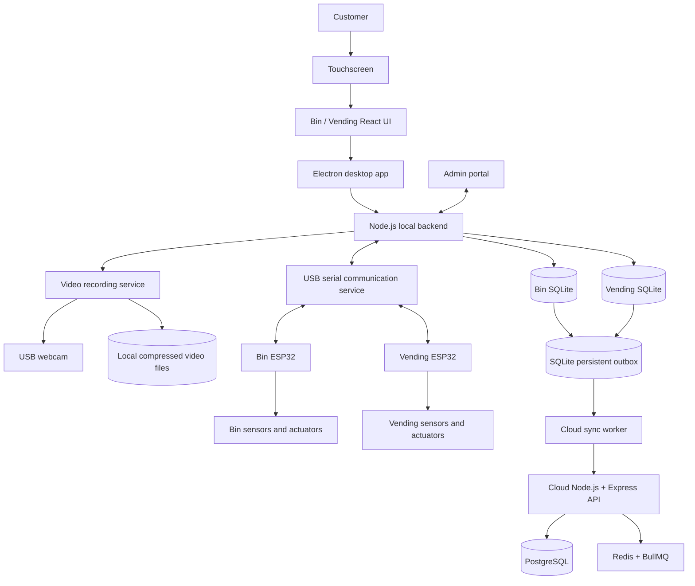
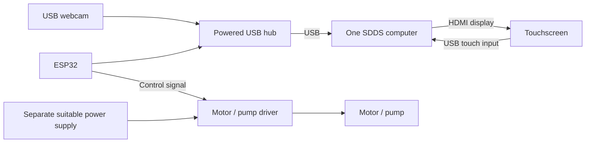
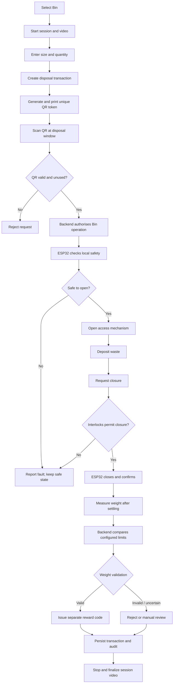
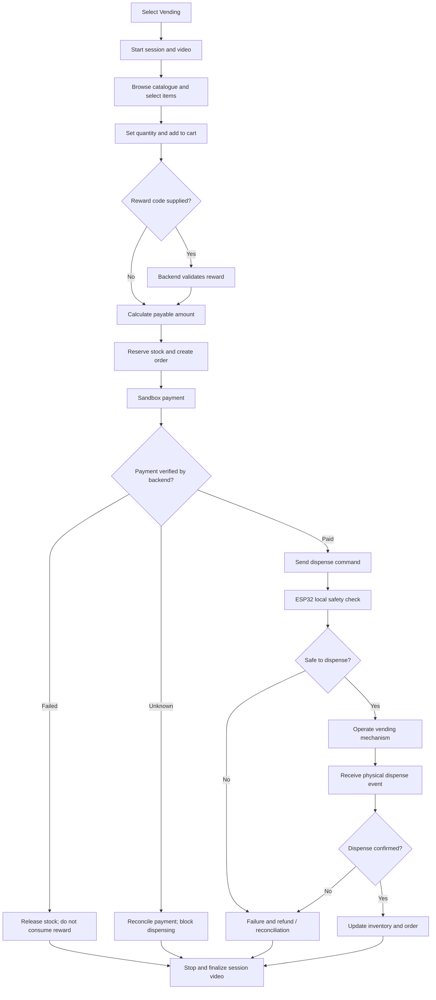
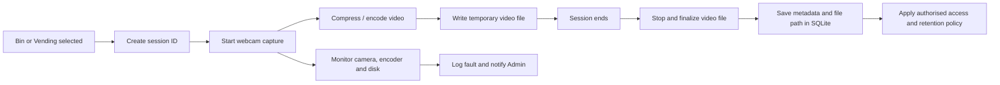
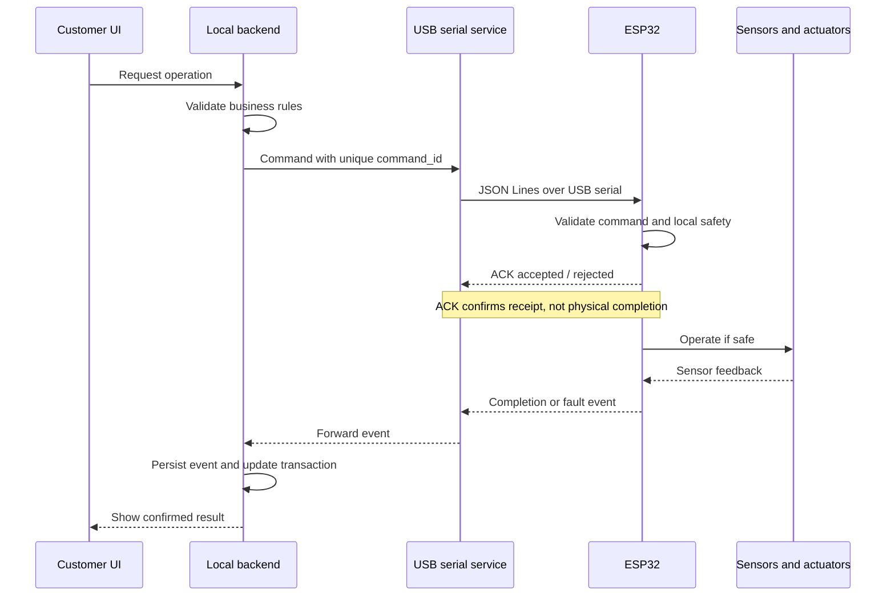
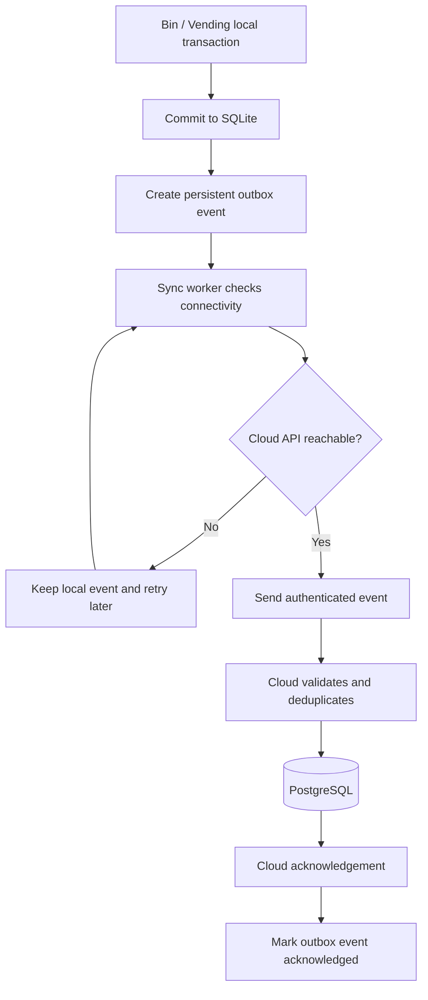
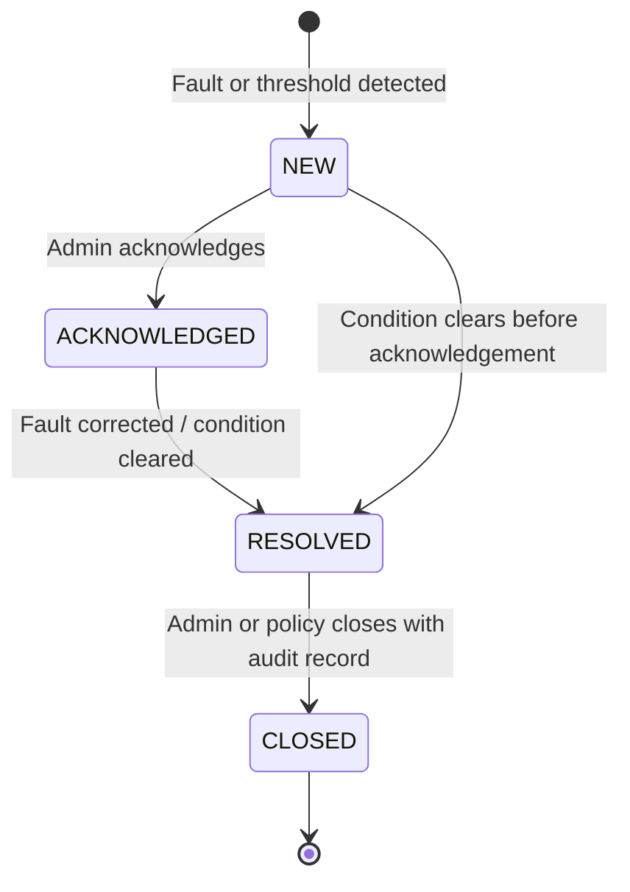
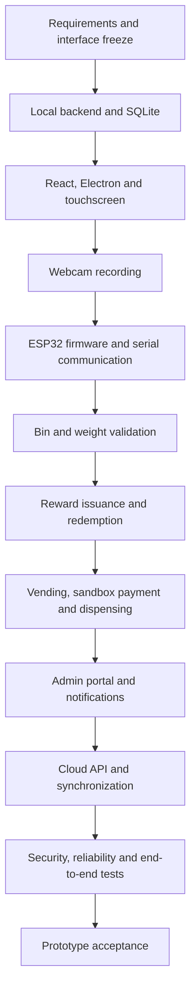

# SDDS V5 --- Product Requirements Document (PRD)

**Project:** Smart Diaper Disposal and Vending System (SDDS)\
**Version:** V5, incorporating decisions confirmed in the current
discussion\
**Status:** Working PRD\
**Stage:** Prototype with production-oriented engineering controls

------------------------------------------------------------------------

## 1. Product overview

SDDS combines a diaper disposal Bin, a product Vending machine, and an
Admin portal.

The Bin records a disposal transaction, validates a QR transaction
token, measures deposited weight, and issues a separate reward code
after successful validation.

The Vending application lets customers browse products, optionally use
an eligible reward, pay through a supported payment flow, and receive
products after payment verification and confirmed dispensing.

The Admin portal manages products, stock, settings, notifications,
users, reports, and system health.

One local computer runs the SDDS software. A large touchscreen provides
customer interaction. A USB webcam records session video only. ESP32
firmware controls local hardware and safety logic.

## 2. Product goals

1.  Provide a guided diaper disposal workflow.
2.  Record and validate disposal transactions.
3.  Issue a controlled reward after successful disposal validation.
4.  Support product selection and purchase.
5.  Verify payment before dispensing.
6.  Preserve eligible local operations during temporary network loss.
7.  Provide Admin visibility and actionable notifications.
8.  Record session video using CCTV-style file storage, without
    computer-vision analysis.
9.  Keep local hardware control and safety checks in ESP32 firmware.

## 3. Scope

### In scope

-   Bin, Vending, and Admin applications.
-   Laptop/computer kiosk.
-   HDMI touchscreen with touch input connection.
-   Powered USB hub.
-   USB webcam for session recording only.
-   ESP32 hardware controller.
-   Local Node.js backend and separate interconnected SQLite databases.
-   Compressed CCTV-style video files and database metadata.
-   QR generation, printing, and scanning.
-   Load cell and HX711 measurement.
-   Reward generation and redemption.
-   Product catalogue, cart, stock reservation, and inventory.
-   Sandbox payment integration.
-   Dispensing confirmation and reconciliation.
-   Cloud API, PostgreSQL, Redis, and BullMQ.
-   Offline outbox and synchronization.
-   Admin notifications, audit logs, and reports.

### Out of scope for current V5

-   Face detection or recognition.
-   Mask detection.
-   Object detection.
-   Any computer-vision decision.
-   Continuous cloud video streaming.
-   Raspberry Pi camera architecture.
-   Computer ownership of ESP32 motor, pump, or relay control.
-   Online payment checkout while required online payment services are
    unavailable.

These items must not be reintroduced without an explicit scope change.

## 4. Users and roles

  -----------------------------------------------------------------------
  Role                                Main actions
  ----------------------------------- -----------------------------------
  Customer                            Use Bin, scan QR, complete
                                      disposal, receive reward, browse
                                      and buy products

  Admin                               Manage products, prices, stock,
                                      settings, notifications, users, and
                                      reports

  ESP32/device                        Read sensors, control local
                                      hardware, enforce local safety,
                                      report events

  Backend                             Validate business rules, coordinate
                                      workflows, persist records, verify
                                      payment, process rewards

  Client/site operator                Provide and maintain site
                                      infrastructure as agreed
  -----------------------------------------------------------------------

## 5. Physical system and connections

``` text
USB Webcam ─────┐
                │
ESP32 ──────────┤
                │
         Powered USB Hub
                │ USB
                ▼
             Laptop
                │
       ┌────────┴─────────┐
       │                  │
      HDMI             USB touch
       │                  │
       ▼                  ▼
  Touchscreen Display — Touch input
```

The exact touchscreen model determines the touch cable and driver. HDMI
normally carries display output; touch input commonly uses a separate
USB connection.

Motors and pumps must use suitable separate power supplies. They must
not draw operating power from the laptop USB port or hub.

## 6. Functional requirements

Priority: - **Must:** Required for V5. - **Should:** Important for
reliable implementation. - **Configurable:** Must be set and tested; no
fixed value is assumed.

### 6.1 Session management

-   **FR-SES-01:** Create a unique session when a customer selects Bin
    or Vending.
-   **FR-SES-02:** Store session type.
-   **FR-SES-03:** Close the session on completion, cancellation, or
    defined fault termination.
-   **FR-SES-04:** Support the selected touchscreen and touch interface.
-   **FR-SES-05:** Backend is authoritative for business decisions.
    Frontend must not decide payment success, reward validity, stock
    availability, or disposal acceptance.

### 6.2 Session video recording

-   **FR-VID-01:** Start webcam recording when a Bin or Vending session
    begins.
-   **FR-VID-02:** Continue recording during the active session.
-   **FR-VID-03:** Stop recording when the session ends.
-   **FR-VID-04:** Do not perform face detection, face recognition, mask
    detection, object detection, or other computer vision in V5.
-   **FR-VID-05:** Save compressed recordings as video files using
    CCTV-style storage.
-   **FR-VID-06:** Store recording ID, session ID, type, file reference,
    start/end time, duration, file size, and status in the database.
-   **FR-VID-07:** Do not store large video files as ordinary database
    BLOBs. Store files separately and metadata in the database.
-   **FR-VID-08:** Detect and mark incomplete recordings after crash,
    disconnect, or power loss.
-   **FR-VID-09:** Monitor disk space and report recording faults to
    Admin.
-   **FR-VID-10:** Restrict video playback and export to authorised
    users.
-   **FR-VID-11:** Client must define retention and deletion policy
    before deployment.
-   **FR-VID-12:** Continuous cloud video upload is not in the current
    requirement. Any later backup or remote access needs explicit
    approval and a privacy/security review.

### 6.3 Bin application

-   **FR-BIN-01:** Allow customer to select Bin.
-   **FR-BIN-02:** Collect diaper size and quantity.
-   **FR-BIN-03:** Generate a unique QR transaction token.
-   **FR-BIN-04:** Print QR label and record print status.
-   **FR-BIN-05:** Scan and validate QR before the permitted disposal
    workflow.
-   **FR-BIN-06:** Reject invalid, expired, cancelled, reused, or
    ineligible tokens.
-   **FR-BIN-07:** Request device operations through the device
    communication service. ESP32 firmware makes local hardware and
    safety decisions.
-   **FR-BIN-08:** Read load-cell measurements through HX711 after the
    platform settles.
-   **FR-BIN-09:** Compare measured weight with configured limits for
    selected size and quantity.
-   **FR-BIN-10:** Reject or retry unstable readings according to a
    defined policy.
-   **FR-BIN-11:** Accept, reject, or send transaction for manual review
    using backend rules.
-   **FR-BIN-12:** Issue a separate reward code only after successful
    disposal validation.
-   **FR-BIN-13:** Issue at most one reward for one eligible disposal.
-   **FR-BIN-14:** Save transaction and sync-outbox event durably.
-   **FR-BIN-15:** Link the session recording to the Bin session and
    transaction where applicable.

### 6.4 QR token rules

The QR token identifies a disposal transaction. It is not the reward.

-   Use an opaque, unguessable token.
-   Do not encode personal or biometric data.
-   Validate token state on backend.
-   Prevent duplicate use.
-   Record creation, printing, scanning, authorisation, disposal,
    validation, reward, rejection, cancellation, expiry, and
    manual-review events as applicable.

Suggested lifecycle:

`Created → Printed → Awaiting Disposal → Authorised → Deposited → Validated → Rewarded`

Other states may include `Rejected`, `Cancelled`, `Expired`, and
`Manual Review`.

### 6.5 Weight measurement

-   **FR-WGT-01:** Load cell and HX711 connect to Bin ESP32.
-   **FR-WGT-02:** Use a mechanically stable weighing platform.
-   **FR-WGT-03:** Record before/after readings where required.
-   **FR-WGT-04:** Calculate deposited weight from valid readings.
-   **FR-WGT-05:** Wait for settling and reject unstable readings.
-   **FR-WGT-06:** Store calibration factor and calibration date.
-   **FR-WGT-07:** Detect overload, disconnection, and implausible
    readings.
-   **FR-WGT-08:** Use experimentally validated, Admin-configured
    thresholds.
-   **FR-WGT-09:** Treat weight as a plausibility check, not definitive
    proof of item count or contents.

### 6.6 Reward service

-   **FR-RWD-01:** Generate cryptographically random reward codes.
-   **FR-RWD-02:** Keep reward code separate from QR transaction token.
-   **FR-RWD-03:** Enforce single-use redemption.
-   **FR-RWD-04:** Support Available, Reserved, Redeemed, Expired, and
    Cancelled states.
-   **FR-RWD-05:** Make value, expiry, and discount cap configurable.
-   **FR-RWD-06:** Validate reward on backend.
-   **FR-RWD-07:** Do not permanently consume reward on failed payment.
-   **FR-RWD-08:** Audit issuance and redemption.

### 6.7 Vending application

-   **FR-VND-01:** Display available product catalogue.
-   **FR-VND-02:** Support selection by configured category, size, and
    quantity.
-   **FR-VND-03:** Support cart add, remove, and quantity update.
-   **FR-VND-04:** Calculate and validate prices on backend.
-   **FR-VND-05:** Allow optional reward-code entry.
-   **FR-VND-06:** Validate reward and calculate discount on backend.
-   **FR-VND-07:** Reserve stock before payment.
-   **FR-VND-08:** Create durable order record.
-   **FR-VND-09:** Use configured payment gateway in sandbox/test mode
    for prototype.
-   **FR-VND-10:** Verify payment server-side, including webhook
    signature, amount, currency, order reference, and idempotency.
-   **FR-VND-11:** Do not authorise dispensing before payment
    verification.
-   **FR-VND-12:** Record physical dispense event from device.
-   **FR-VND-13:** Update inventory only after confirmed dispensing
    evidence.
-   **FR-VND-14:** Reconcile uncertain payment or dispensing outcomes.
    Do not blindly repeat physical dispense.
-   **FR-VND-15:** Support refund/reconciliation if payment succeeds but
    dispensing fails.
-   **FR-VND-16:** Link session recording to Vending session and order
    where applicable.

### 6.8 Payment rules and states

Suggested states:

`Created`, `Pending`, `Authorized`, `Captured/Paid`, `Failed`,
`Cancelled`, `Unknown`, `Refund Pending`, `Refunded`.

Rules: - Frontend redirect is not proof of payment. - Backend verifies
gateway evidence. - Do not store card number or CVV. - Use idempotency
keys. - Do not dispense when payment state is unknown. - Reconcile
uncertain payment before retry. - Do not consume reward permanently on
failed payment. - Do not blindly retry uncertain physical dispensing. -
Online payment checkout is unavailable when the required online service
is unavailable.

### 6.9 ESP32 and device communication

-   **FR-DEV-01:** ESP32 firmware owns local sensor and actuator
    behaviour.
-   **FR-DEV-02:** ESP32 firmware performs local safety checks before
    actuation.
-   **FR-DEV-03:** Computer software must not replace ESP32 motor, pump,
    or relay logic.
-   **FR-DEV-04:** Device service exchanges requests, ACKs, events,
    heartbeats, and status.
-   **FR-DEV-05:** Use unique device and command IDs.
-   **FR-DEV-06:** ACK means accepted, not completed.
-   **FR-DEV-07:** Separate event reports physical result.
-   **FR-DEV-08:** Duplicate command IDs must not repeat physical
    action.
-   **FR-DEV-09:** Report firmware and protocol versions.
-   **FR-DEV-10:** Detect disconnect, timeout, and reconnect.
-   **FR-DEV-11:** Define safe state after reset, watchdog event, or
    power loss.
-   **FR-DEV-12:** A database state change is not proof that hardware
    changed state.

A communication service must transfer requests to the ESP32. ESP32
checks local safety, decides whether it can act, operates the hardware,
and reports the result. The serial message schema and state ownership
must be documented.

### 6.10 Admin portal

-   **FR-ADM-01:** Authenticate Admin users.
-   **FR-ADM-02:** Enforce role-based access.
-   **FR-ADM-03:** Add, edit, and deactivate products.
-   **FR-ADM-04:** Configure prices, categories, sizes, and vending
    slots.
-   **FR-ADM-05:** Monitor stock and reservations.
-   **FR-ADM-06:** Monitor Bin and Vending.
-   **FR-ADM-07:** Monitor webcam, recording, printer, QR scanner,
    ESP32, load cell, motor, database, and cloud sync.
-   **FR-ADM-08:** Manage rewards and settings.
-   **FR-ADM-09:** View reports and operational summaries.
-   **FR-ADM-10:** Provide actionable notification centre.
-   **FR-ADM-11:** Audit sensitive Admin actions.
-   **FR-ADM-12:** Restrict and log video playback/export access.

### 6.11 Admin notifications

  Type         Example
  ------------ --------------------------------------------------
  Bin          Bin full
  Product      Low stock or out of stock
  Device       ESP32 disconnected
  Camera       Webcam disconnected
  Recording    Recording failed or incomplete
  Printer      Printer unavailable or paper fault
  Weight       Load-cell fault
  Motor        Motor or actuator fault
  Payment      Payment failed or uncertain
  Dispensing   Dispensing failed or uncertain
  Database     Database or disk-space fault
  Sync         Cloud synchronization delayed
  Security     Repeated failed login or suspicious Admin action

Notification fields: - notification ID - device ID, if relevant - event
type - severity - creation time - description - status - acknowledged
user and time - resolution time - action guidance

Suggested states: `NEW`, `ACKNOWLEDGED`, `RESOLVED`, `CLOSED`.

Repeated alerts should be deduplicated or grouped. Critical alerts
remain visible until acknowledged and resolved.

## 7. Data architecture

### 7.1 Local databases

  -----------------------------------------------------------------------
  Database                            Responsibility
  ----------------------------------- -----------------------------------
  `bin.db`                            Disposal, QR, weight, Bin
                                      transactions

  `vending.db`                        Products, orders, order items,
                                      inventory, payments, dispensing

  `admin.db`                          Admin users, roles, settings,
                                      notifications, audit logs

  `local.db`                          Shared sessions, device registry,
                                      sync outbox, shared references
  -----------------------------------------------------------------------

The exact schema and cross-database transaction design must be defined
during implementation. Separate SQLite files do not provide one atomic
transaction across all files.

### 7.2 Cloud

-   PostgreSQL stores central business records.
-   Redis provides cache and job infrastructure.
-   BullMQ processes background jobs.
-   Cloud API handles authenticated synchronization and business
    endpoints.
-   Redis must not be the only copy of a critical transaction.

### 7.3 Cache and outbox

-   Cache improves repeated reads; it is not authoritative.
-   SQLite stores durable local records.
-   Outbox survives restart.
-   Save business record and outbox event in the same database
    transaction.
-   Mark event synced only after cloud acknowledgement.
-   Use unique event IDs and idempotent cloud processing.

### 7.4 Video storage

Store video files outside relational databases. Store metadata and
relative file reference in the database. Monitor free space. Detect
incomplete files. Restrict playback/export. Retention and backup are
open configuration decisions.

## 8. Non-functional requirements

### Reliability

-   Committed local records survive normal restart.
-   Device disconnects are detected.
-   Recording faults are visible.
-   Physical operations have explicit states and recovery paths.
-   Duplicate requests do not duplicate transactions or physical
    actions.
-   Cloud outage does not destroy eligible local records.

### Performance

-   UI remains responsive during recording and device communication.
-   Recording does not block business API processing.
-   Queues and buffers are bounded.
-   No unbounded video-frame or job queue in RAM.
-   Performance targets must be measured on the selected laptop.

### Security

-   HTTPS for cloud communication.
-   Device authentication.
-   Role-based Admin access.
-   Backend input validation.
-   Payment webhook verification.
-   Secret protection.
-   Private video storage and restricted playback.
-   Audit sensitive Admin actions.
-   No personal or biometric data in QR tokens.

### Maintainability

-   Versioned database migrations.
-   Versioned ESP32 firmware and communication protocol.
-   Structured logs.
-   Device fault register.
-   Recovery and replacement procedures.
-   Configuration separate from source code.

### Operational constraints

-   Client manages site power and network provision under the agreed
    boundary.
-   Software still detects power interruption, storage failure, device
    disconnect, and sync delay.
-   Test expected heat, humidity, dust, and network conditions.
-   Computer storage must support the configured video retention period.

## 9. Business rules

1.  QR label identifies a disposal transaction.
2.  Reward code is separate from QR label.
3.  Reward is issued only after successful disposal validation.
4.  One disposal issues at most one reward.
5.  A reward can be redeemed at most once.
6.  Failed payment does not permanently consume a reward.
7.  Stock is reserved before payment.
8.  Dispensing is authorised only after verified payment.
9.  Inventory is updated from confirmed physical dispensing evidence.
10. Uncertain payment or dispensing requires reconciliation.
11. Weight is a plausibility check, not definitive proof of diaper count
    or contents.
12. ESP32 firmware retains local hardware and safety responsibility.
13. Backend is authoritative for business rules.
14. Frontend display is not proof of a committed transaction.
15. Video is session evidence only; no computer-vision decision is made.

## 10. State models

### Disposal

`Created`, `Printed`, `Awaiting Disposal`, `Authorised`, `Deposited`,
`Weighing`, `Validated`, `Rewarded`, `Rejected`, `Cancelled`, `Expired`,
`Manual Review`, `Fault`.

### Reward

`Available`, `Reserved`, `Redeemed`, `Expired`, `Cancelled`.

### Order

`Created`, `Stock Reserved`, `Payment Pending`, `Paid`,
`Dispense Authorised`, `Dispensing`, `Dispensed`, `Dispense Uncertain`,
`Failed`, `Refund Pending`, `Refunded`, `Cancelled`.

### Recording

`Starting`, `Recording`, `Finalizing`, `Saved`, `Failed`, `Incomplete`,
`Deleted`.

### Device

`Offline`, `Connecting`, `Online`, `Busy`, `Fault`, `Recovering`.

Define exact transition guards during implementation.

## 11. Acceptance criteria

### Customer and touchscreen

-   Customer completes Bin and Vending flows through touchscreen.
-   Touch input works after restart.
-   Frontend shows backend-confirmed status.

### Video

-   Bin selection starts Bin session recording.
-   Vending selection starts Vending session recording.
-   Session end stops recording.
-   Recording is compressed and saved as a file.
-   Metadata links to correct session.
-   Failed/incomplete recording is not shown as saved.
-   Admin access is restricted.
-   Disk-full and webcam-disconnect faults are reported.

### Bin

-   QR token is unique.
-   Invalid or reused QR is rejected.
-   Weight is measured after settling.
-   Sensor fault or unstable reading is not accepted.
-   Reward is issued only after successful validation.
-   Duplicate requests do not issue duplicate rewards.

### Vending

-   Backend validates price, stock, and reward.
-   Stock is reserved before payment.
-   Dispensing is blocked until payment verification.
-   Duplicate payment events do not cause duplicate dispensing.
-   Uncertain dispensing is reconciled.
-   Inventory follows confirmed physical events.

### ESP32

-   Firmware controls local hardware.
-   Firmware checks local safety.
-   ACK differs from completion event.
-   Duplicate command IDs do not repeat physical action.
-   Disconnect and reset are handled.

### Admin

-   Admin sees bin-full and product-stock notifications.
-   Admin sees device and recording faults.
-   Notifications can be acknowledged and resolved.
-   Sensitive actions are audited.
-   Video access is restricted.

### Offline and sync

-   Local records survive network outage.
-   Outbox survives restart.
-   Cloud acknowledgement is required before sync completion.
-   Duplicate sync does not duplicate transactions.
-   Conflict handling is explicit.

## 12. Risks and mitigations

  -----------------------------------------------------------------------
  Risk                    Impact                  Mitigation
  ----------------------- ----------------------- -----------------------
  Disk fills with video   Recording stops         Capacity plan,
                                                  retention, disk alerts

  Power loss during       Incomplete file         Recovery and incomplete
  recording                                       status

  Webcam disconnect       No recording            Device monitoring and
                                                  fault state

  USB hub disconnect      Webcam/ESP32            Detect devices
                          unavailable             separately and recover

  Touch interface         Customer cannot         Detect display/touch
  disconnect              interact                fault

  ESP32 command           Repeated physical       Unique IDs and firmware
  duplication             action                  duplicate protection

  Multiple SQLite files   Partial cross-workflow  Explicit ownership and
                          update                  recovery

  Reward race             Duplicate redemption    Atomic backend
                                                  redemption

  Payment uncertainty     Incorrect dispensing    Gateway reconciliation

  Dispense uncertainty    Stock mismatch or       Physical event tracking
                          duplicate dispense      and manual
                                                  reconciliation

  Load-cell drift         Incorrect validation    Calibration and
                                                  stability checks

  Network outage          Cloud data delayed      Durable local outbox

  Admin compromise        Unauthorised changes    RBAC, MFA where
                                                  supported, audit

  Video access misuse     Privacy breach          Private storage, access
                                                  control, access audit
  -----------------------------------------------------------------------

## 13. Open decisions

Not fixed by current V5 discussion: 1. Laptop model, OS, RAM, and
storage. 2. Touchscreen model, HDMI mode, USB touch interface, and
driver. 3. Webcam model. 4. Video resolution, frame rate, bitrate,
codec, retention, and backup policy. 5. Expected sessions per day and
average duration. 6. Local storage capacity. 7. Database schemas and
cross-database transaction ownership. 8. ESP32 model and serial message
schema. 9. Printer and QR scanner models. 10. Load cell, HX711, motor
driver, actuator, and power-supply models. 11. Payment gateway and
sandbox details. 12. Cloud provider, region, budget, and device count.
13. Reward amount, expiry, and discount cap. 14. Experimentally
validated weight limits.

Do not treat example values as approved requirements.

## 14. Release definition

The V5 prototype is ready for controlled acceptance when: - Bin,
Vending, and Admin operate through the agreed local architecture. -
Touchscreen, webcam, USB hub, ESP32, and computer operate together. -
Bin and Vending session videos are saved, indexed, protected, and
recoverable. - Bin disposal and weight validation work. - Reward
issuance and redemption are single-use and idempotent. - Vending payment
and dispensing are reconciled safely. - ESP32 retains local hardware and
safety responsibility. - Admin notifications are actionable. - Offline
records synchronize without duplication. - Critical failure and recovery
tests pass.

Production deployment requires a separate review of machine safety,
electrical compliance, privacy/legal obligations, serviceability,
support, and operating cost.

## 15. Visual system representation

These diagrams are the visual companion to the functional and technical requirements above. They represent V5 behaviour. They are not electrical schematics and do not replace component datasheets or final wiring drawings.

### 15.1 System context and application architecture



### 15.2 Hardware connection view



The powered USB hub connects the webcam and ESP32 to the computer. HDMI carries the display signal. Touch input normally uses a separate USB connection. Motors and pumps use a separate suitable power supply and driver stage.

### 15.3 Bin transaction flowchart



### 15.4 Vending transaction flowchart



### 15.5 Session video pipeline



V5 records video only. It does not detect faces, identify people, detect masks, or make disposal decisions from images. The exact encoder, bitrate, frame rate, retention period, and failure policy require validation or configuration.

### 15.6 Device command and feedback flow



### 15.7 Offline and cloud synchronization flow



### 15.8 Admin notification lifecycle



Notification examples include Bin full, low stock, ESP32 disconnected, camera or recording failure, printer fault, load-cell fault, motor fault, payment failure, uncertain dispensing, disk/database fault, and sync delay.

### 15.9 V5 implementation pipeline



This is the planned build order. It does not indicate that these stages have already been implemented or tested.
