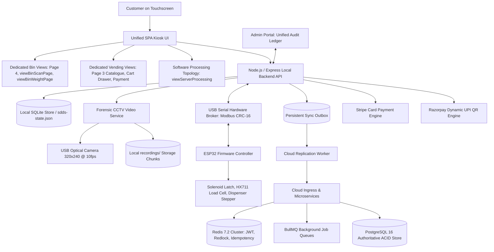
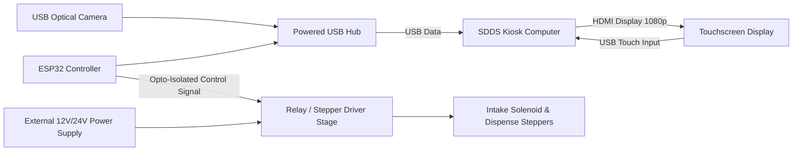
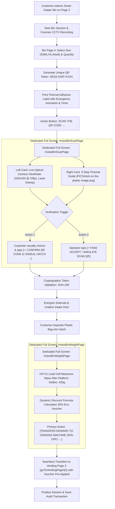
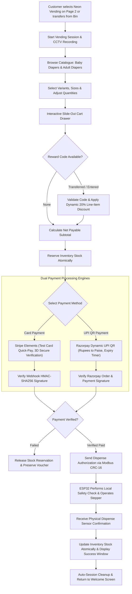
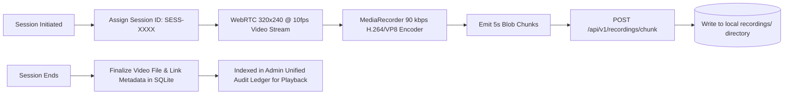
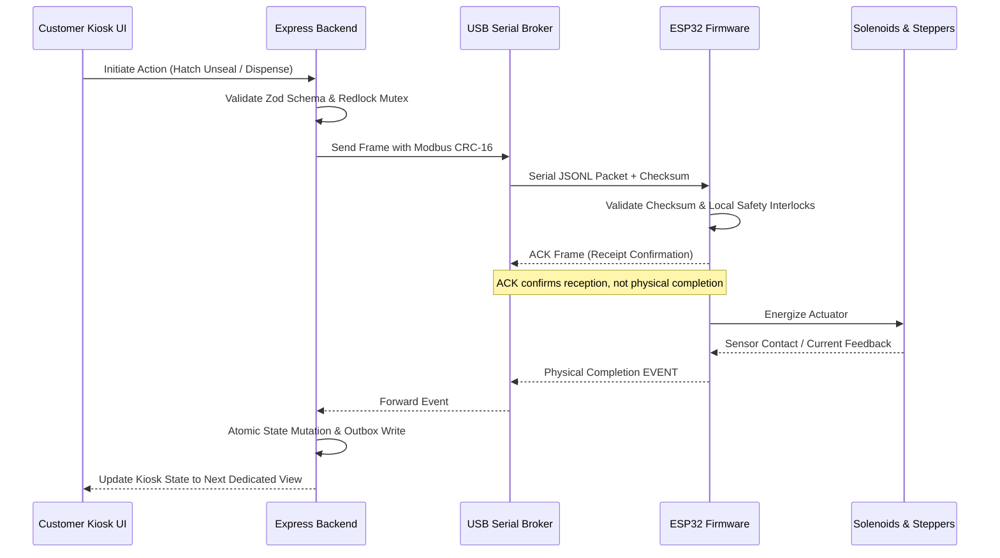
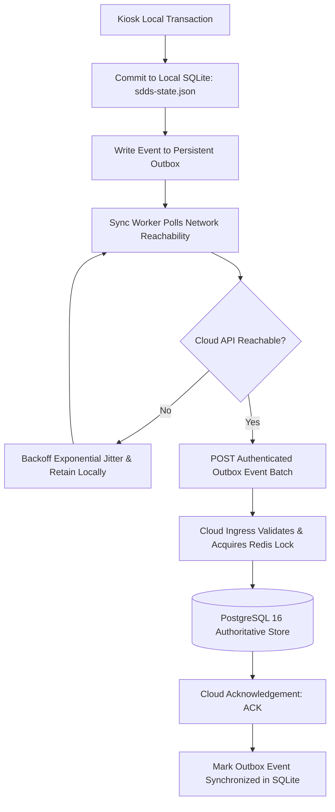
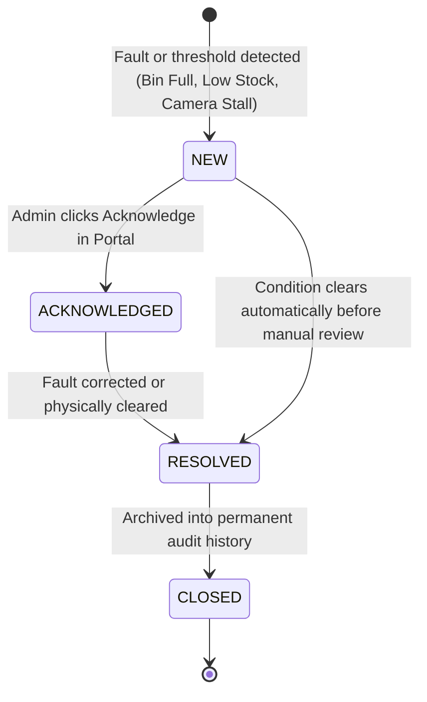
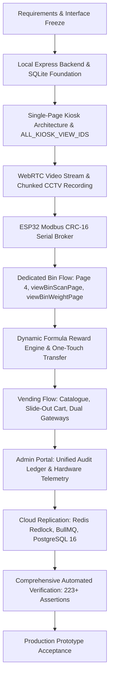

# SDDS V5 --- Product Requirements Document (PRD)

**Project:** Smart Diaper Disposal and Vending System (SDDS)\
**Version:** V5, incorporating decisions confirmed in the current
discussion\
**Status:** Working PRD\
**Stage:** Prototype with production-oriented engineering controls

------------------------------------------------------------------------

## 1. Product overview

SDDS combines a diaper disposal Bin, a product Vending machine, and an
Admin portal.

The Bin records a disposal transaction, generates an adhesive QR transaction
token, validates the token on a dedicated full-page optical camera verification
screen with pictorial guides and manual confirmation, measures deposited weight
on a dedicated full-page mass calculation screen, and issues a dynamic reward voucher
that can be transferred directly to Vending with one touch.

The Vending application lets customers browse products, redeem dynamic reward vouchers,
pay through dual payment gateways (Stripe Card with 3D Secure and Razorpay Dynamic UPI QR),
and receive products after server-side payment verification and confirmed dispensing.

The Admin portal manages products, stock, settings, actionable notifications,
users, reports, system health, and provides a Unified Audit Ledger integrating both
vending orders and bin disposal transactions with video playback from chunked storage.

One local computer runs the SDDS software. A large touchscreen provides
customer interaction. A USB optical camera provides live viewfinder display for QR tag
alignment and records CCTV forensic session video (320x240 @ 10fps, 90 kbps).
Facial biometrics, mask detection, and AI object classification are strictly excluded.
ESP32 firmware controls local hardware and safety logic.

## 2. Product goals

1.  Provide a guided diaper disposal workflow across dedicated full-page kiosk views (`viewBinPage4`, `viewBinScanPage`, `viewBinWeightPage`).
2.  Provide real-time camera viewfinder feedback with a 3-step pictorial guide and customer-driven manual verification on `#viewBinScanPage`.
3.  Record and validate disposal transactions using FIPS 180-4 SHA-256 and Modbus CRC-16 integrity checks.
4.  Calculate deposited mass and issue a dynamic formula reward voucher (e.g., 20% Eco-Voucher) with one-touch transfer to Vending Page 3.
5.  Support product selection, slide-out cart management, and instant coupon application in Vending.
6.  Support Dual Payment Gateways: Stripe (Credit/Debit Card with HMAC-SHA256 webhook verification) and Razorpay (Dynamic UPI QR with signature verification).
7.  Verify payment server-side before authorizing dispensing.
8.  Preserve eligible local operations during temporary network loss via persistent SQLite outbox.
9.  Provide Admin visibility through a Unified Audit Ledger, filter chips, and actionable notifications.
10. Provide an interactive Software Processing Inspector (`viewServerProcessing`) visualizing the 8-stage pure software pipeline.
11. Record session video using CCTV-style chunked file storage (`POST /api/v1/recordings/chunk` at 320x240 @ 10fps, 90 kbps) without facial biometrics or AI computer-vision classification.
12. Keep local hardware control and safety checks in ESP32 firmware.

## 3. Scope

### In scope

-   Bin, Vending, and Admin applications with dedicated full-page kiosk state machines (`ALL_KIOSK_VIEW_IDS`).
-   Laptop/computer kiosk with touchscreen display.
-   HDMI touchscreen with touch input connection (minimum 48px touch targets, 64px primary CTA).
-   Powered USB hub for peripherals.
-   USB optical camera for live QR viewfinder alignment and forensic CCTV session recording.
-   ESP32 hardware controller with Modbus CRC-16 serial protocol.
-   Local Node.js/Express backend and separate interconnected SQLite databases (`data/sdds-state.json`).
-   Compressed CCTV-style video chunk streaming (`POST /api/v1/recordings/chunk`) saved to `recordings/`.
-   Bin Page 4: Diaper variant sizing (S, M, L, XL, Adult) + quantity adjusters, thermal adhesive QR ticket printing with emergence animation and live hold timer.
-   Dedicated Full-Page Optical QR Verification Screen (`viewBinScanPage`): Live 320x240 camera viewfinder, HUD laser sweep, 3-step pictorial guide (`PICS/stick on the plastic image.png`, camera positioning, solenoid hatch latch), manual customer confirmation (`confirmAndVerifyBinQr()`), and simulation bypass (`simulateAcceptScanQr()`).
-   Dedicated Full-Page Mass Calculation Screen (`viewBinWeightPage`): HX711 load cell mass settling (420g calibrated net weight), dynamic formula reward discount (20% Eco-Voucher `ECO-20-XXXX`), and direct transfer button to Vending Page 3.
-   Vending Page 3: Product catalogue (Baby & Adult diapers, brand filtering, size badges, live stock pills), slide-out interactive cart drawer, and automatic coupon redemption.
-   Dual Payment Gateways:
    -   Stripe: Card payment with test card quick-pay, 3D Secure simulation, and webhook HMAC-SHA256 signature verification.
    -   Razorpay: Instant dynamic UPI QR generation with paise conversion, order creation API, UPI app scan simulation, and signature verification.
-   Dispensing confirmation, motor slot visualization, and automated session cleanup countdown.
-   Interactive Software Processing Inspector (`viewServerProcessing`) with 8-stage pure software topology.
-   Cloud API, PostgreSQL 16, Redis 7.2 Cluster with Redlock distributed locking, and BullMQ background queues.
-   Offline outbox and cloud synchronization.
-   Admin portal with Unified Audit Ledger, filter chips (`All`, `Vending Only`, `Bin Disposals Only`), and actionable notifications.

### Out of scope for current V5

-   Face detection, face recognition, or facial biometrics.
-   Mask detection.
-   Object detection or AI computer-vision classification.
-   Continuous raw video streaming to cloud (video is chunked locally for CCTV forensic auditing).
-   Raspberry Pi camera architecture.
-   Computer ownership of ESP32 motor, pump, or relay control.
-   Online payment checkout while required online payment services are unavailable.

These items must not be reintroduced without an explicit scope change.

## 4. Users and roles

  -----------------------------------------------------------------------
  Role                                Main actions
  ----------------------------------- -----------------------------------
  Customer                            Use Bin, scan QR, complete
                                      disposal, receive reward, browse
                                      and buy products

  Admin                               Manage products, prices, stock,
                                      settings, notifications, users, and
                                      reports

  ESP32/device                        Read sensors, control local
                                      hardware, enforce local safety,
                                      report events

  Backend                             Validate business rules, coordinate
                                      workflows, persist records, verify
                                      payment, process rewards

  Client/site operator                Provide and maintain site
                                      infrastructure as agreed
  -----------------------------------------------------------------------

## 5. Physical system and connections

``` text
USB Webcam ─────┐
                │
ESP32 ──────────┤
                │
         Powered USB Hub
                │ USB
                ▼
             Laptop
                │
       ┌────────┴─────────┐
       │                  │
      HDMI             USB touch
       │                  │
       ▼                  ▼
  Touchscreen Display — Touch input
```

The exact touchscreen model determines the touch cable and driver. HDMI
normally carries display output; touch input commonly uses a separate
USB connection.

Motors and pumps must use suitable separate power supplies. They must
not draw operating power from the laptop USB port or hub.

## 6. Functional requirements

Priority: - **Must:** Required for V5. - **Should:** Important for
reliable implementation. - **Configurable:** Must be set and tested; no
fixed value is assumed.

### 6.1 Session management

-   **FR-SES-01:** Create a unique session when a customer selects Bin
    or Vending.
-   **FR-SES-02:** Store session type.
-   **FR-SES-03:** Close the session on completion, cancellation, or
    defined fault termination.
-   **FR-SES-04:** Support the selected touchscreen and touch interface.
-   **FR-SES-05:** Backend is authoritative for business decisions.
    Frontend must not decide payment success, reward validity, stock
    availability, or disposal acceptance.

### 6.2 Session video recording & optical camera

-   **FR-VID-01:** Start optical camera capture when a Bin or Vending session begins.
-   **FR-VID-02:** Continue active video stream during the session lifecycle.
-   **FR-VID-03:** Stop capture and finalize recording when the session ends.
-   **FR-VID-04:** Facial biometrics, face recognition, mask detection, and AI object classification are strictly excluded from V5.
-   **FR-VID-05:** The optical camera serves two distinct, non-conflicting operational functions:
    1.  **Live Optical QR Viewfinder Display**: On the dedicated `#viewBinScanPage`, the camera feeds a live 320x240 @ 10fps video stream directly onto the customer touchscreen, complete with HUD telemetry and vertical laser reticle sweep, allowing customers to visually align the adhesive QR tag on their plastic bag.
    2.  **CCTV Forensic Session Recording**: MediaRecorder packages compressed video chunks (`POST /api/v1/recordings/chunk`) at a resource-efficient 90 kbps (Rule 3) to the local `recordings/` directory for security auditing.
-   **FR-VID-06:** Save recordings as compressed video files (WebM / MP4) using CCTV-style storage.
-   **FR-VID-07:** Store recording ID, session ID, type, relative file reference, start/end time, duration, file size, and status in the database.
-   **FR-VID-08:** Do not store large video files as database BLOBs. Store physical files in `recordings/` and metadata in SQLite.
-   **FR-VID-09:** Detect and mark incomplete recordings after crash, disconnect, or power loss.
-   **FR-VID-10:** Monitor disk space, camera frame rate, and report recording faults to Admin.
-   **FR-VID-11:** Restrict video playback and export to authorized Admin users.
-   **FR-VID-12:** Client defines retention and deletion policy before deployment.
-   **FR-VID-13:** Continuous cloud raw video streaming is excluded. Forensic chunked files are retained locally.

### 6.3 Bin application & sequential state machine

-   **FR-BIN-01:** Allow customer to select Smart Diaper Bin from Page 2 option cards.
-   **FR-BIN-02 (Bin Page 4 - Diaper Sizing & Thermal Ticket):**
    -   Display category and size selector cards (Small, Medium, Large, XL, Adult) with +/- quantity steppers.
    -   Generate a unique cryptographic QR transaction token (`SESS-DISP-XXXX`).
    -   Simulate thermal printer adhesive label emergence with paper-feed animation, session ID, and live hold timer.
    -   Provide clear CTA: `[SCAN THE QR CODE →]` routing to `#viewBinScanPage`.
-   **FR-BIN-03 (Dedicated Full-Page Optical QR Verification - `#viewBinScanPage`):**
    -   Transition atomically to `#viewBinScanPage` within `ALL_KIOSK_VIEW_IDS` (Zero View Overlap, no popups).
    -   Render split-card layout optimized for touch kiosk ergonomics:
        -   **Left Card (Live Optical Viewfinder)**: Direct video stream from webcam (`<video id="binScanCameraFeed">`), laser sweep animation, live telemetry HUD (`CAM: ACTIVE @ 10FPS • RESOLUTION: 320x240 • DETECTOR: READY`), and `[⚡ FAKE ACCEPT / SIMULATE SCAN QR]` button for instant demonstration.
        -   **Right Card (Pictorial Step Guide & Manual Confirmation)**:
            -   Step 1: Visual card featuring `PICS/stick on the plastic image.png` showing how to stick the printed QR tag onto the plastic bag.
            -   Step 2: Graphic camera aperture illustration instructing 15-20cm camera alignment.
            -   Step 3: Solenoid unseal diagram illustrating hatch opening.
    -   **Manual Customer Confirmation (Customer-Driven)**: Customer visually verifies camera alignment and explicitly taps `[✓ CONFIRM QR CODE & UNSEAL HATCH →]` via `confirmAndVerifyBinQr()`. Automatic timer auto-advances are eliminated.
-   **FR-BIN-04 (Hatch Solenoid Actuation):**
    -   On verification (manual confirmation or simulation button), energize intake hatch solenoid, unlatch door, and display verified feedback indicator.
-   **FR-BIN-05 (Dedicated Full-Page Mass Calculation - `#viewBinWeightPage`):**
    -   Transition atomically to `#viewBinWeightPage` without modal overlays.
    -   Read HX711 load cell sensor reading after platform settles (e.g., 420g calibrated mass).
    -   Execute dynamic formula discount computation (yielding 20% Eco-Voucher `ECO-20-XXXX`).
    -   Display primary CTA button: `[TRANSFER REWARD TO VENDING MACHINE (20% OFF) →]` which switches kiosk state directly to Vending Page 3 (`goToVendingPage3()`) with the voucher pre-applied in the cart drawer.
-   **FR-BIN-06:** Reject invalid, expired, cancelled, reused, or ineligible tokens.
-   **FR-BIN-07:** Request device operations through device communication service with Modbus CRC-16 frame integrity. ESP32 firmware enforces local safety.
-   **FR-BIN-08:** Save transaction and sync-outbox event durably in SQLite.
-   **FR-BIN-09:** Link session recording metadata to Bin disposal transaction.

### 6.4 QR token rules

The QR token identifies a disposal transaction. It is not the reward.

-   Use an opaque, unguessable token.
-   Do not encode personal or biometric data.
-   Validate token state on backend.
-   Prevent duplicate use.
-   Record creation, printing, scanning, authorisation, disposal,
    validation, reward, rejection, cancellation, expiry, and
    manual-review events as applicable.

Suggested lifecycle:

`Created → Printed → Awaiting Disposal → Authorised → Deposited → Validated → Rewarded`

Other states may include `Rejected`, `Cancelled`, `Expired`, and
`Manual Review`.

### 6.5 Weight measurement

-   **FR-WGT-01:** Load cell and HX711 connect to Bin ESP32.
-   **FR-WGT-02:** Use a mechanically stable weighing platform.
-   **FR-WGT-03:** Record before/after readings where required.
-   **FR-WGT-04:** Calculate deposited weight from valid readings.
-   **FR-WGT-05:** Wait for settling and reject unstable readings.
-   **FR-WGT-06:** Store calibration factor and calibration date.
-   **FR-WGT-07:** Detect overload, disconnection, and implausible
    readings.
-   **FR-WGT-08:** Use experimentally validated, Admin-configured
    thresholds.
-   **FR-WGT-09:** Treat weight as a plausibility check, not definitive
    proof of item count or contents.

### 6.6 Reward service

-   **FR-RWD-01:** Generate cryptographically random reward codes.
-   **FR-RWD-02:** Keep reward code separate from QR transaction token.
-   **FR-RWD-03:** Enforce single-use redemption.
-   **FR-RWD-04:** Support Available, Reserved, Redeemed, Expired, and
    Cancelled states.
-   **FR-RWD-05:** Make value, expiry, and discount cap configurable.
-   **FR-RWD-06:** Validate reward on backend.
-   **FR-RWD-07:** Do not permanently consume reward on failed payment.
-   **FR-RWD-08:** Audit issuance and redemption.

### 6.7 Vending application

-   **FR-VND-01:** Display touch-optimized product catalogue (Baby Diapers and Adult Diapers with brand filtering, size badges S/M/L/XL, and live stock pills).
-   **FR-VND-02:** Support product selection and quantity steppers with large touch targets (minimum 48px, primary action 64px+).
-   **FR-VND-03:** Slide-out interactive Cart drawer displaying itemized subtotal, quantity adjusters, and empty-state messaging.
-   **FR-VND-04:** Calculate and validate prices and discounts server-side.
-   **FR-VND-05:** Support dynamic reward voucher entry and one-touch auto-population transferred from `#viewBinWeightPage`.
-   **FR-VND-06:** Validate reward codes and calculate dynamic percentage/rupee discount line items.
-   **FR-VND-07:** Reserve stock atomically before initiating payment.
-   **FR-VND-08:** Create durable order record in SQLite and queue cloud outbox event.
-   **FR-VND-09 (Dual Payment Gateway - Stripe Card):**
    -   Support Credit/Debit card checkout with simulated 3D Secure verification and quick-pay test card shortcuts.
    -   Verify server-side webhook signature with HMAC-SHA256.
-   **FR-VND-10 (Dual Payment Gateway - Razorpay UPI QR):**
    -   Generate dynamic UPI QR modal with live expiration countdown.
    -   Convert currency units (Rupees to Paise, e.g., ₹250.00 -> 25000 paise).
    -   Support instant simulated UPI app approval and verify payment signature with HMAC-SHA256.
-   **FR-VND-11:** Authorize dispensing only after server-side cryptographic payment verification.
-   **FR-VND-12:** Stepper motor slot visualization, real-time dispensing progress tracker, and physical dispense event capture.
-   **FR-VND-13:** Update inventory atomically only after confirmed physical dispensing evidence.
-   **FR-VND-14:** Reconcile uncertain payment or dispensing outcomes without duplicate physical dispensing.
-   **FR-VND-15:** Support automated refund/reconciliation if payment succeeds but dispensing hardware faults.
-   **FR-VND-16:** Link CCTV session recording chunk metadata to the vending order.

### 6.8 Payment rules, security and states

Suggested states:

`Created`, `Stock Reserved`, `Payment Pending`, `Authorized`, `Captured/Paid`,
`Dispense Authorized`, `Dispensing`, `Dispensed`, `Failed`, `Cancelled`,
`Unknown`, `Refund Pending`, `Refunded`.

Rules:
- Frontend redirect or UI state is not proof of payment.
- Backend independently verifies gateway cryptographic signature (HMAC-SHA256).
- Dual payment gateways supported: Stripe (Card) and Razorpay (Dynamic UPI QR).
- Strict PCI compliance: Zero raw credit card numbers or CVVs stored in SDDS databases.
- Idempotent order processing to prevent duplicate charges or dispensing.
- Failed payment does not consume reward voucher.
- Dispensing is strictly blocked if payment state is unconfirmed or unknown.
- Offline payment checkout is disabled when payment gateways are unreachable.

### 6.9 ESP32 and device communication

-   **FR-DEV-01:** ESP32 firmware owns local sensor reading and actuator behavior.
-   **FR-DEV-02:** ESP32 firmware performs local safety checks before actuation.
-   **FR-DEV-03:** Computer software must not replace ESP32 motor, pump, or relay logic.
-   **FR-DEV-04:** Device service exchanges requests, ACKs, events, heartbeats, and status over USB serial.
-   **FR-DEV-05:** Use unique device and command IDs with Modbus CRC-16 frame checksums.
-   **FR-DEV-06:** ACK confirms receipt and validation, not physical completion.
-   **FR-DEV-07:** Separate event message reports physical sensor result.
-   **FR-DEV-08:** Duplicate command IDs must not repeat physical action.
-   **FR-DEV-09:** Report firmware version and serial protocol version.
-   **FR-DEV-10:** Detect disconnect, timeout, and reconnect automatically.
-   **FR-DEV-11:** Define deterministic safe state after reset, watchdog trigger, or power loss.
-   **FR-DEV-12:** A database state change is not physical proof of hardware state.

### 6.10 Admin portal & Unified Audit Ledger

-   **FR-ADM-01:** Authenticate Admin users with role-based access control (RBAC).
-   **FR-ADM-02:** Manage product catalogue, pricing, diaper categories, size variants, and vending slot assignments.
-   **FR-ADM-03:** Real-time stock monitor with reservation indicators.
-   **FR-ADM-04 (Unified Audit Ledger):**
    -   Combined audit table displaying both Vending machine sales orders and Bin disposal transactions in a single unified ledger.
    -   Interactive filter chips: `All`, `Vending Only`, `Bin Disposals Only`.
    -   Full status pills (`DISPOSED`, `PAID`, `DISPENSED`, `VERIFIED`).
    -   Direct playback of associated CCTV forensic video recordings from local `recordings/` storage.
-   **FR-ADM-05:** Real-time hardware telemetry and health monitors:
    -   Camera stream status and frame-rate monitor.
    -   HX711 load cell tare/calibration monitor.
    -   ESP32 serial connection status.
    -   Local disk storage usage and recording retention monitor.
-   **FR-ADM-06:** Cloud synchronization controls and outbox queue inspector.
-   **FR-ADM-07:** Audit log for sensitive admin operations.

### 6.11 Internal Software Processing Inspector (`viewServerProcessing`)

-   **FR-SRV-01:** Interactive software architecture topology accessible from Page 2 Option 3.
-   **FR-SRV-02:** Displays the 8-stage pure software pipeline without hardware sensors:
    1.  *Ingestion Gateway*: Cloudflare Edge CDN, TLS 1.3, Rate-Limiting.
    2.  *Redis In-Memory Layer*: Redis 7.2 cluster, JWT session tokens, Redlock distributed locking.
    3.  *Security & Validation Engine*: FIPS 180-4 SHA-256 integrity, Zod runtime schema validation.
    4.  *Payment Processing Engine*: Dual gateways (Stripe Card Elements & Razorpay Dynamic UPI QR).
    5.  *PostgreSQL ACID Store*: Row-level locked transactions, write-ahead logging.
    6.  *BullMQ Async Job Queue*: Background video chunk encoding, cloud replication.
    7.  *Hardware Broker*: Modbus CRC-16 checksums, debounced GPIO/serial control.
    8.  *Admin Audit & Telemetry*: Unified audit ledger and real-time telemetry.
-   **FR-SRV-03:** Interactive node selection allowing operators to inspect live telemetry and contracts for each stage.
-   **FR-SRV-04:** Auto-Play simulation walkthrough animating packet traversal across all 8 software stages.

### 6.11 Admin notifications

  Type         Example
  ------------ --------------------------------------------------
  Bin          Bin full
  Product      Low stock or out of stock
  Device       ESP32 disconnected
  Camera       Webcam disconnected
  Recording    Recording failed or incomplete
  Printer      Printer unavailable or paper fault
  Weight       Load-cell fault
  Motor        Motor or actuator fault
  Payment      Payment failed or uncertain
  Dispensing   Dispensing failed or uncertain
  Database     Database or disk-space fault
  Sync         Cloud synchronization delayed
  Security     Repeated failed login or suspicious Admin action

Notification fields: - notification ID - device ID, if relevant - event
type - severity - creation time - description - status - acknowledged
user and time - resolution time - action guidance

Suggested states: `NEW`, `ACKNOWLEDGED`, `RESOLVED`, `CLOSED`.

Repeated alerts should be deduplicated or grouped. Critical alerts
remain visible until acknowledged and resolved.

## 7. Data architecture

### 7.1 Local databases

  -----------------------------------------------------------------------
  Database                            Responsibility
  ----------------------------------- -----------------------------------
  `bin.db`                            Disposal, QR, weight, Bin
                                      transactions

  `vending.db`                        Products, orders, order items,
                                      inventory, payments, dispensing

  `admin.db`                          Admin users, roles, settings,
                                      notifications, audit logs

  `local.db`                          Shared sessions, device registry,
                                      sync outbox, shared references
  -----------------------------------------------------------------------

The exact schema and cross-database transaction design must be defined
during implementation. Separate SQLite files do not provide one atomic
transaction across all files.

### 7.2 Cloud & Enterprise Microservices Architecture

-   **Cloudflare Edge CDN & WAF**: TLS 1.3 termination, DDoS protection, edge caching, and strict IP rate-limiting (e.g., 60 req/min for public endpoints).
-   **API Gateway & Ingress**: Kong / NGINX Ingress managing reverse proxying, JWT authentication, and SSL offloading.
-   **Core Microservices**:
    -   *Disposal Ingestion Service*: Validates QR tokens, ingests load cell telemetry, mints dynamic discount vouchers.
    -   *Payment Engine*: Manages dual payment gateway lifecycle (Stripe Elements + Razorpay UPI QR) and verifies webhook cryptographic signatures.
    -   *Inventory & Vending Service*: Manages slot mapping, reservations, atomic stock deductions, and dispense reconciliation.
-   **Redis 7.2 Cluster**:
    -   High-availability Redis in-memory data store.
    -   Ephemeral JWT session management with auto-expiring TTLs.
    -   Distributed Mutex Locking via **Redlock** algorithm to prevent double-spending of reward vouchers and simultaneous dispensing commands.
    -   Idempotency key caching with 24-hour expiration.
-   **BullMQ Redis Queue**:
    -   Dedicated asynchronous worker queues for CCTV video chunk compression/indexing, cloud telemetry synchronization, and analytics pipelines.
    -   Configured with exponential backoff retries and dead-letter queues (DLQ).
-   **PostgreSQL 16**:
    -   Authoritative ACID relational database with Write-Ahead Logging (WAL) and row-level locking (`SELECT FOR UPDATE`).
    -   Stores permanent order records, customer audit logs, and synchronized outbox transactions.

### 7.3 Cache and outbox

-   Redis cache accelerates read operations; PostgreSQL remains the authoritative source of truth.
-   SQLite stores durable local records on the kiosk computer (`data/sdds-state.json`).
-   Persistent outbox survives unexpected power loss or operating system reboot.
-   Business transaction records and outbox events are committed in the same database transaction.
-   Outbox events are marked as synced only after explicit cloud acknowledgment.
-   Every event carries a unique UUIDv4 identifier and is processed idempotently by cloud workers.

### 7.4 Forensic Video Chunk Storage

-   Session video is captured at 320x240 @ 10fps and encoded at 90 kbps (Rule 3 memory-aligned constraint).
-   MediaRecorder streams incremental chunks via `POST /api/v1/recordings/chunk` directly to the local `recordings/` storage directory.
-   Raw binary video data is stored strictly on the filesystem, never as SQL database BLOBs.
-   SQLite / PostgreSQL stores lightweight metadata references (recording ID, session ID, filename, duration, file size, SHA-256 integrity hash).
-   Admin portal provides authorized video streaming directly from disk storage.

## 8. Non-functional requirements

### Reliability

-   Committed local records survive normal restart.
-   Device disconnects are detected.
-   Recording faults are visible.
-   Physical operations have explicit states and recovery paths.
-   Duplicate requests do not duplicate transactions or physical
    actions.
-   Cloud outage does not destroy eligible local records.

### Performance

-   UI remains responsive during recording and device communication.
-   Recording does not block business API processing.
-   Queues and buffers are bounded.
-   No unbounded video-frame or job queue in RAM.
-   Performance targets must be measured on the selected laptop.

### Security

-   HTTPS for cloud communication.
-   Device authentication.
-   Role-based Admin access.
-   Backend input validation.
-   Payment webhook verification.
-   Secret protection.
-   Private video storage and restricted playback.
-   Audit sensitive Admin actions.
-   No personal or biometric data in QR tokens.

### Maintainability

-   Versioned database migrations.
-   Versioned ESP32 firmware and communication protocol.
-   Structured logs.
-   Device fault register.
-   Recovery and replacement procedures.
-   Configuration separate from source code.

### Operational constraints

-   Client manages site power and network provision under the agreed
    boundary.
-   Software still detects power interruption, storage failure, device
    disconnect, and sync delay.
-   Test expected heat, humidity, dust, and network conditions.
-   Computer storage must support the configured video retention period.

## 9. Business rules

1.  QR label identifies a disposal transaction.
2.  Reward code is separate from QR label.
3.  Reward is issued only after successful disposal validation.
4.  One disposal issues at most one reward.
5.  A reward can be redeemed at most once.
6.  Failed payment does not permanently consume a reward.
7.  Stock is reserved before payment.
8.  Dispensing is authorised only after verified payment.
9.  Inventory is updated from confirmed physical dispensing evidence.
10. Uncertain payment or dispensing requires reconciliation.
11. Weight is a plausibility check, not definitive proof of diaper count
    or contents.
12. ESP32 firmware retains local hardware and safety responsibility.
13. Backend is authoritative for business rules.
14. Frontend display is not proof of a committed transaction.
15. Video is session evidence only; no computer-vision decision is made.

## 10. State models

### Disposal

`Created`, `Printed`, `Awaiting Disposal`, `Authorised`, `Deposited`,
`Weighing`, `Validated`, `Rewarded`, `Rejected`, `Cancelled`, `Expired`,
`Manual Review`, `Fault`.

### Reward

`Available`, `Reserved`, `Redeemed`, `Expired`, `Cancelled`.

### Order

`Created`, `Stock Reserved`, `Payment Pending`, `Paid`,
`Dispense Authorised`, `Dispensing`, `Dispensed`, `Dispense Uncertain`,
`Failed`, `Refund Pending`, `Refunded`, `Cancelled`.

### Recording

`Starting`, `Recording`, `Finalizing`, `Saved`, `Failed`, `Incomplete`,
`Deleted`.

### Device

`Offline`, `Connecting`, `Online`, `Busy`, `Fault`, `Recovering`.

Define exact transition guards during implementation.

## 11. Acceptance criteria

### Customer and touchscreen

-   Customer completes Bin and Vending flows through touchscreen.
-   Touch input works after restart.
-   Frontend shows backend-confirmed status.

### Video

-   Bin selection starts Bin session recording.
-   Vending selection starts Vending session recording.
-   Session end stops recording.
-   Recording is compressed and saved as a file.
-   Metadata links to correct session.
-   Failed/incomplete recording is not shown as saved.
-   Admin access is restricted.
-   Disk-full and webcam-disconnect faults are reported.

### Bin

-   QR token is unique.
-   Invalid or reused QR is rejected.
-   Weight is measured after settling.
-   Sensor fault or unstable reading is not accepted.
-   Reward is issued only after successful validation.
-   Duplicate requests do not issue duplicate rewards.

### Vending

-   Backend validates price, stock, and reward.
-   Stock is reserved before payment.
-   Dispensing is blocked until payment verification.
-   Duplicate payment events do not cause duplicate dispensing.
-   Uncertain dispensing is reconciled.
-   Inventory follows confirmed physical events.

### ESP32

-   Firmware controls local hardware.
-   Firmware checks local safety.
-   ACK differs from completion event.
-   Duplicate command IDs do not repeat physical action.
-   Disconnect and reset are handled.

### Admin

-   Admin sees bin-full and product-stock notifications.
-   Admin sees device and recording faults.
-   Notifications can be acknowledged and resolved.
-   Sensitive actions are audited.
-   Video access is restricted.

### Offline and sync

-   Local records survive network outage.
-   Outbox survives restart.
-   Cloud acknowledgement is required before sync completion.
-   Duplicate sync does not duplicate transactions.
-   Conflict handling is explicit.

## 12. Risks and mitigations

  -----------------------------------------------------------------------
  Risk                    Impact                  Mitigation
  ----------------------- ----------------------- -----------------------
  Disk fills with video   Recording stops         Capacity plan,
                                                  retention, disk alerts

  Power loss during       Incomplete file         Recovery and incomplete
  recording                                       status

  Webcam disconnect       No recording            Device monitoring and
                                                  fault state

  USB hub disconnect      Webcam/ESP32            Detect devices
                          unavailable             separately and recover

  Touch interface         Customer cannot         Detect display/touch
  disconnect              interact                fault

  ESP32 command           Repeated physical       Unique IDs and firmware
  duplication             action                  duplicate protection

  Multiple SQLite files   Partial cross-workflow  Explicit ownership and
                          update                  recovery

  Reward race             Duplicate redemption    Atomic backend
                                                  redemption

  Payment uncertainty     Incorrect dispensing    Gateway reconciliation

  Dispense uncertainty    Stock mismatch or       Physical event tracking
                          duplicate dispense      and manual
                                                  reconciliation

  Load-cell drift         Incorrect validation    Calibration and
                                                  stability checks

  Network outage          Cloud data delayed      Durable local outbox

  Admin compromise        Unauthorised changes    RBAC, MFA where
                                                  supported, audit

  Video access misuse     Privacy breach          Private storage, access
                                                  control, access audit
  -----------------------------------------------------------------------

## 13. Open decisions

Not fixed by current V5 discussion: 1. Laptop model, OS, RAM, and
storage. 2. Touchscreen model, HDMI mode, USB touch interface, and
driver. 3. Webcam model. 4. Video resolution, frame rate, bitrate,
codec, retention, and backup policy. 5. Expected sessions per day and
average duration. 6. Local storage capacity. 7. Database schemas and
cross-database transaction ownership. 8. ESP32 model and serial message
schema. 9. Printer and QR scanner models. 10. Load cell, HX711, motor
driver, actuator, and power-supply models. 11. Payment gateway and
sandbox details. 12. Cloud provider, region, budget, and device count.
13. Reward amount, expiry, and discount cap. 14. Experimentally
validated weight limits.

Do not treat example values as approved requirements.

## 14. Release definition

The V5 prototype is ready for controlled acceptance when: - Bin,
Vending, and Admin operate through the agreed local architecture. -
Touchscreen, webcam, USB hub, ESP32, and computer operate together. -
Bin and Vending session videos are saved, indexed, protected, and
recoverable. - Bin disposal and weight validation work. - Reward
issuance and redemption are single-use and idempotent. - Vending payment
and dispensing are reconciled safely. - ESP32 retains local hardware and
safety responsibility. - Admin notifications are actionable. - Offline
records synchronize without duplication. - Critical failure and recovery
tests pass.

Production deployment requires a separate review of machine safety,
electrical compliance, privacy/legal obligations, serviceability,
support, and operating cost.

## 15. Visual system representation

These diagrams are the visual companion to the functional and technical requirements above. They represent V5 behaviour. They are not electrical schematics and do not replace component datasheets or final wiring drawings.

### 15.1 System context and application architecture



### 15.2 Hardware connection view



The powered USB hub connects the optical camera and ESP32 to the computer. HDMI carries the display signal. Touch input uses a separate USB connection. Solenoids, motors, and actuators use an external dedicated power supply with flyback and opto-isolation protection.

### 15.3 Bin transaction flowchart (Current Kiosk Implementation)



### 15.4 Vending transaction flowchart (Dual Payment Gateways)



### 15.5 Session video recording pipeline



### 15.6 Device command and feedback flow



### 15.7 Offline and cloud synchronization flow



### 15.8 Admin notification lifecycle



### 15.9 V5 implementation pipeline



### 15.10 Internal Software Processing Topology (`viewServerProcessing`)

```mermaid
flowchart LR
    STAGE1["1. Ingestion Gateway\n(Cloudflare Edge, WAF, TLS 1.3)"] --> STAGE2["2. Redis In-Memory\n(Cluster, JWT, Redlock)"]
    STAGE2 --> STAGE3["3. Security & Validation\n(FIPS SHA-256, Zod Schemas)"]
    STAGE3 --> STAGE4["4. Payment Engine\n(Stripe Cards & Razorpay UPI)"]
    STAGE4 --> STAGE5["5. PostgreSQL 16 ACID\n(Row Locks, WAL Durability)"]
    STAGE5 --> STAGE6["6. BullMQ Job Queue\n(Async Video & Replication)"]
    STAGE6 --> STAGE7["7. Hardware Broker\n(Modbus CRC-16, GPIO)"]
    STAGE7 --> STAGE8["8. Admin Telemetry\n(Unified Audit Ledger)"]
```



This is the planned build order. It does not indicate that these stages have already been implemented or tested.
