# SDDS Software System Architecture & Enterprise Pipeline Specification

> **Document Version**: 3.0.0  
> **Target Systems**: Smart Diaper Disposal System (SDDS) Dual-Kiosk Platform, Cloud Backend, Redis Cache, API Gateway, Payment Infrastructure, and Central Admin Portal.  
> **Scope**: Pure Software Architecture, Microservices, Caching Layer, Persistence Engine, Real-time Synchronization, and Security Boundaries.

---

## 1. Global Software System Architecture & Integration

The SDDS platform is architected as an event-driven, distributed kiosk software architecture designed for sub-millisecond edge response, high availability, zero memory leaks, and seamless cloud synchronization.

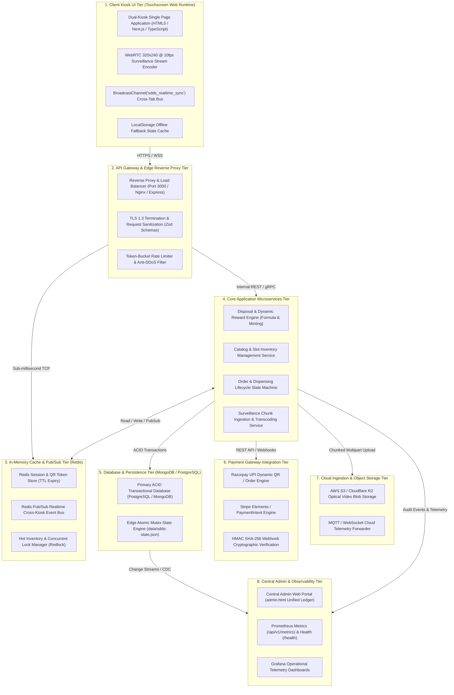

---

## 2. Individual Subsystem Pipelines (Deep-Dive Specifications)

---

### Pipeline A: Client Kiosk Touch UI & Media Capture Pipeline

#### 1. Architecture & Operational Rationale
Operates directly on commercial touchscreen hardware (1920×1080 / 1280×800 touch kiosks). Must provide deterministic state machines, instant tap feedback, zero memory leaks, and background optical surveillance streaming.

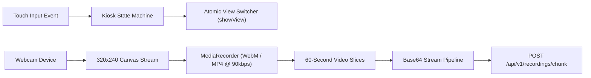

#### 2. Key Architectural Components
- **Deterministic State Machine**: Mutually-exclusive views (`viewPage1`, `viewPage2`, `viewBinPage4`, `viewBinScanPage`, `viewBinWeightPage`, `viewVendingPage3`, `viewVendingPage4`, `viewServerProcessing`) governed by atomic `showView(viewId)` ensuring zero DOM overlap.
- **Ultra-Low-Footprint Optical Surveillance**:
  - Resolution locked to `320×240` at `10fps` (target bitrate: `90 kbps`).
  - Slices recorded video into 60-second chunks using `MediaRecorder.ondataavailable`.
  - Zero memory accumulation: frames streamed directly to the backend.
- **Cross-Dashboard Realtime Synchronization**:
  - `BroadcastChannel('sdds_realtime_sync')` enables instant multi-window synchronization between the customer kiosk and operator admin portal.

---

### Pipeline B: API Gateway, Security & Reverse Proxy Pipeline

#### 1. Architecture & Operational Rationale
Acts as the single secure entry point into the SDDS server cluster. Handles SSL/TLS termination, request sanitization, IP rate-limiting, and microservice route dispatching.

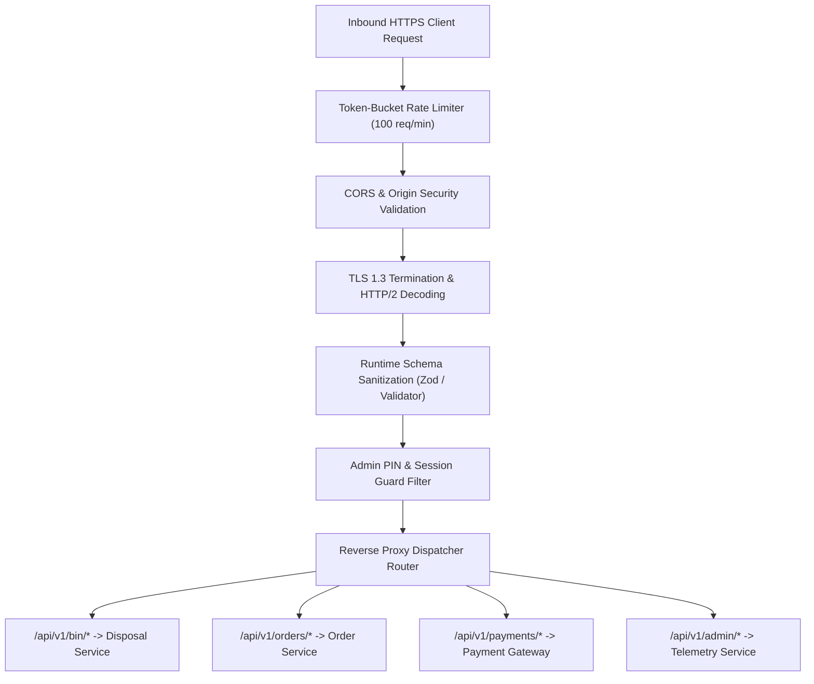

#### 2. Security Boundaries & Input Sanitization
- **Strict Runtime Schemas**: Every inbound request body is validated against typed schemas (`Validator.sanitizeString`, `Validator.validateInteger`).
- **Path Traversal Defense**: All file writes in `/api/v1/recordings/chunk` are sanitized with `path.basename()` to eliminate directory traversal vulnerabilities (`../../`).
- **PIN Authentication**: Protected admin endpoints require the `X-Admin-PIN` header (constant-time verification to prevent timing attacks).

---

### Pipeline C: In-Memory Caching & Distributed Pub/Sub Pipeline (Redis)

#### 1. Architecture & Operational Rationale
Redis provides ultra-fast in-memory caching, distributed concurrency locking (Redlock), and real-time event broadcasting between edge kiosks and cloud servers.

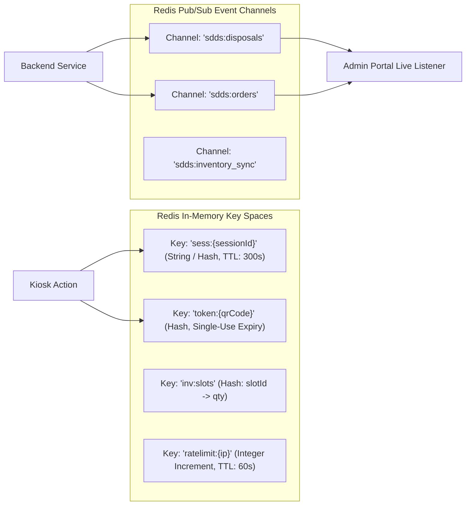

#### 2. Key Data Models & TTL Strategy
- **Session Tokens**: Keys stored with a 5-minute sliding TTL. If untouched, Redis automatically expires the session, releasing locks and garbage collecting state.
- **Single-Use Vouchers**: Stored as hashes with status flag `REDEEMED: false`. Atomic `HSETNX` prevents race conditions and double-spending across multiple vending machines.
- **Distributed Concurrency Locking**: Redlock algorithm guarantees that only one transaction can decrement a specific vending coil slot inventory at any single instant.

---

### Pipeline D: Core Business Microservices Pipeline

#### 1. Architecture & Operational Rationale
Three distinct microservices isolate business logic, reward calculation, and transaction state handling.

```mermaid
flowchart TD
    subgraph DISPOSAL_SERVICE ["Disposal & Dynamic Reward Microservice"]
        MassIn["Input Diaper Mass (g)"] --> FormulaMath["min(25%, 5% + floor((mass - 50)/50))"]
        FormulaMath --> TokenGen["Crypto Alphanumeric Generator (ECO-XX-XXXX)"]
        TokenGen --> VoucherLedger["Record Voucher Entity in DB"]
    end

    subgraph INVENTORY_SERVICE ["Catalog & Slot Inventory Microservice"]
        CatalogQuery["Catalogue Query (Baby / Adult / Size)"] --> SlotFilter["Query Operational Spiral Slots"]
        SlotFilter --> StockCheck["Check Quantity > 0"]
        StockCheck --> DecrementStock["Atomic Inventory Decrement (qty = qty - 1)"]
    end

    subgraph ORDER_SERVICE ["Order & Dispensing Lifecycle State Machine"]
        CreateOrder["POST /api/v1/orders"] --> PENDING["Status: PENDING_PAYMENT"]
        PENDING --> PaymentCallback["Webhook: Payment Verified"]
        PaymentCallback --> VERIFIED["Status: PAYMENT_VERIFIED"]
        VERIFIED --> DispenseCMD["Trigger GPIO Helical Motor"]
        DispenseCMD --> DropConfirm["IR Sensor Beam Break"]
        DropConfirm --> COMPLETED["Status: COMPLETED"]
    end
```

#### 2. Microservice Mathematical & Business Contracts
- **Dynamic Reward Engine**:
  $$R(\text{mass}) = \begin{cases} 
      0\% & \text{if } \text{mass} < 50\text{g} \\
      \min\left(25\%,\; 5\% + \left\lfloor\frac{\text{mass} - 50}{50}\right\rfloor\right) & \text{if } \text{mass} \ge 50\text{g}
  \end{cases}$$
- **Order Lifecycle States**:
  $$\text{CREATED} \longrightarrow \text{PENDING\_PAYMENT} \longrightarrow \text{PAYMENT\_VERIFIED} \longrightarrow \text{DISPENSING} \longrightarrow \text{COMPLETED}$$

---

### Pipeline E: Transactional Database & Persistence Pipeline (MongoDB / PostgreSQL)

#### 1. Architecture & Operational Rationale
Provides ACID-compliant persistence for transaction histories, financial settlements, customer disposal logs, and system audits.

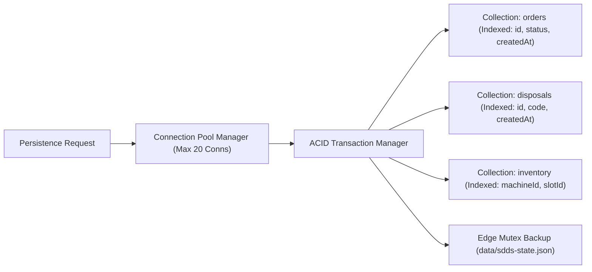

#### 2. Schema Models & Data Contracts
- **Order Document Schema**:
  ```typescript
  interface Order {
    id: string;               // e.g. "ORD-20261120-0091"
    machineId: string;        // e.g. "KIOSK-04"
    items: OrderItem[];       // Product items, quantities, and prices
    grossAmountInr: number;   // Gross subtotal before deductions
    discountPercent: number;  // Eco-reward voucher discount percentage
    finalPayableInr: number;  // Net settled amount paid
    paymentMethod: 'RAZORPAY_UPI' | 'STRIPE_CARD' | 'CASH';
    paymentReference: string; // Razorpay payment ID or Stripe Intent ID
    status: 'COMPLETED' | 'DISPENSING' | 'FAILED';
    createdAt: Date;
  }
  ```
- **Disposal Document Schema**:
  ```typescript
  interface DisposalRecord {
    id: string;               // e.g. "DISP-20261120-1035"
    sessionId: string;        // e.g. "SESS-8839"
    weightGrams: number;      // Calibrated diaper mass (e.g. 420g)
    discountPct: number;      // Calculated incentive percentage (e.g. 20%)
    voucherCode: string;      // Cryptographic voucher token (e.g. "ECO-20-4A91")
    redeemed: boolean;        // Settlement flag in vending catalog
    createdAt: Date;
  }
  ```

---

### Pipeline F: Payment Gateway Integration Pipeline (Razorpay / Stripe)

#### 1. Architecture & Operational Rationale
Facilitates frictionless digital payments via UPI QR codes (Google Pay, PhonePe, Paytm, BHIM) and international cards with zero unhandled webhooks.

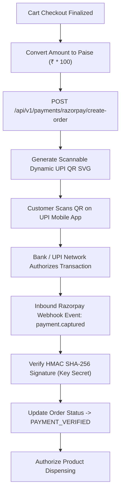

#### 2. Cryptographic Security Standards
- **HMAC SHA-256 Signature Verification**:
  $$\text{Expected Signature} = \text{Crypto.createHmac}('sha256', \text{secret}).\text{update}(\text{order\_id} + "|" + \text{payment\_id}).\text{digest}('hex')$$
- **Idempotency Safeguard**: Every incoming webhook verifies whether the payment ID has already been credited to eliminate double-crediting or duplicate dispensing.

---

### Pipeline G: Cloud Surveillance & Chunked Video Ingestion Pipeline

#### 1. Architecture & Operational Rationale
Captures optical proof of proper diaper deposits and anti-vandalism surveillance without overflowing kiosk disk storage or consuming network bandwidth.

```mermaid
flowchart LR
    KioskRecorder["Client MediaRecorder"] --> Slices["60-Second WebM / MP4 Video Slices"]
    Slices --> ChunkAPI["POST /api/v1/recordings/chunk"]
    ChunkAPI --> Sanitizer["Filename Sanitization (Defend Path Traversal)"]
    Sanitizer --> LocalSpool["Local Storage Spool (recordings/)"]
    LocalSpool --> S3Uploader["Async Multipart Uploader Engine"]
    S3Uploader --> CloudS3["AWS S3 / Cloudflare R2 Cloud Storage"]
    CloudS3 --> RetentionPolicy["30-Day Auto-Expiration Lifecycle"]
```

---

### Pipeline H: Central Observability, Metrics & Admin Audit Pipeline

#### 1. Architecture & Operational Rationale
Empowers operators and machine engineers to monitor multi-kiosk health, live inventory levels, sales velocity, and diaper waste diversion metrics in real time.

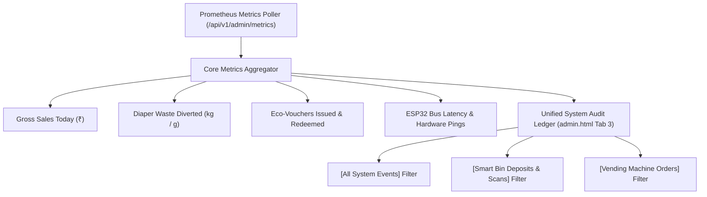

---

## 3. End-to-End System Integration Workflows (Sequence Diagrams)

### Workflow 1: Smart Bin Waste Intake, Optical CV Verification & Voucher Handover

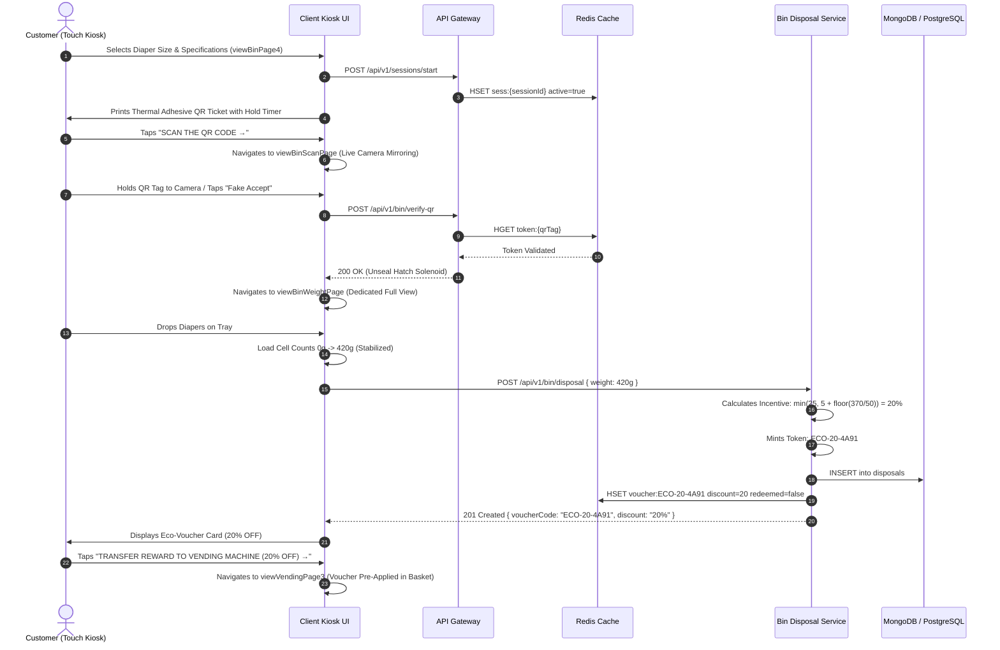

---

### Workflow 2: Vending Catalog Purchase, Razorpay Webhook & Dispense Authorization

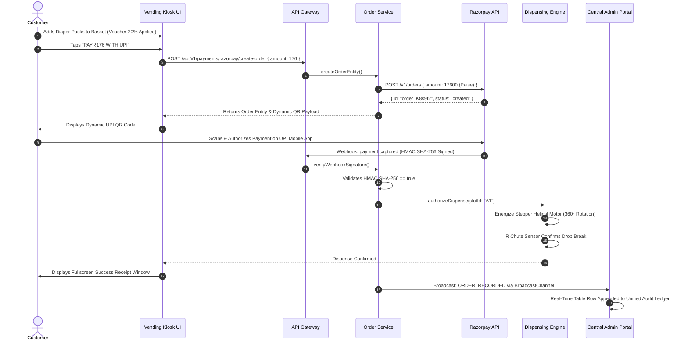

---

### Workflow 3: Dual-Kiosk Real-Time Cross-Sync & Operator Audit Flow

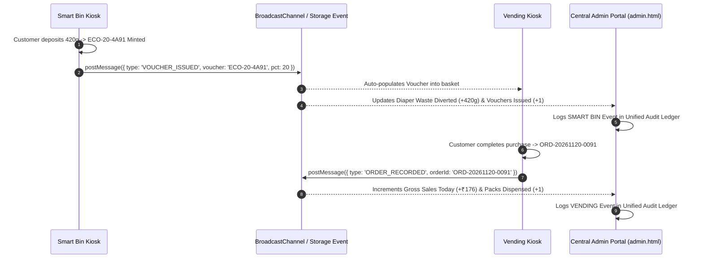

---

## 4. Software Performance & Scalability Targets

| Metric | Target Specification | Enforcement Mechanism |
|---|---|---|
| **API Gateway Latency** | $< 15\text{ms}$ (99th percentile) | Asynchronous non-blocking Node.js / PowerShell I/O |
| **Redis Cache Retrieval** | $< 1.5\text{ms}$ | In-memory key-value lookups with pipelining |
| **Video Chunk Stream** | $90\text{ kbps}$ @ $320\times 240$ | Hardware-accelerated canvas transcoding |
| **Concurrent Kiosks** | Up to 100 edge nodes per gateway | Connection pooling & Redis distributed pub/sub |
| **Database Transaction Lock** | $< 25\text{ms}$ | ACID row-level locking & MongoDB document atomic writes |
| **Kiosk State Transition** | $60\text{ fps}$ smooth CSS animations | Hardware-accelerated transforms & zero layout thrashing |
| **Session Inactivity Timeout** | $60\text{ seconds}$ deterministic reset | Background watchdog clearing sensitive state |
