# SDDS End-to-End System Pipeline & Architecture Specification

> **Document Version**: 2.0.0  
> **Target System**: Smart Diaper Disposal System (SDDS) Dual-Kiosk Platform  
> **Scope**: Smart Diaper Collection Bin, Optical Computer Vision Scanner, HX711 Load Cell, Dispensing Vending Machine, Razorpay UPI Gateway, Local Storage, and Central Admin Portal.

---

## 1. Executive Pipeline Architecture

The SDDS Dual-Kiosk operates as a tightly integrated, deterministic cyber-physical system. The entire physical-to-digital lifecycle consists of **8 deterministic pipeline stages**:

```mermaid
flowchart TD
    subgraph STAGE_1 ["Stage 1: Bin Waste Intake & Tag Printing"]
        A["Customer Selects Diaper Size/Type"] --> B["Pure-JS ISO/IEC 18004 Engine"]
        B --> C["Thermal Printer: Adhesive QR Emerges with Session & Held Timer"]
    end

    subgraph STAGE_2 ["Stage 2: Dedicated Optical QR & CV Verification"]
        C --> D["Action: SCAN THE QR CODE →"]
        D --> E["viewBinScanPage: Live Camera Viewfinder (320x240 @ 10fps)"]
        E --> F["Optical Reticle & Animated Laser Sweep"]
        F --> G["Optical Matching / Fast 'Fake Accept' Bypass"]
        G --> H["✓ Cryptographic Match • Solenoid Energized • Hatch Unsealed"]
    end

    subgraph STAGE_3 ["Stage 3: HX711 Load Cell Tare & Mass Weighing"]
        H --> I["Hatch Door Unlatches"]
        I --> J["Customer Drops Diapers on Scale Tray"]
        J --> K["HX711 24-bit ADC Samples 0g → 420g with Anti-Jitter Filtering"]
        K --> L["Mass Stabilized & Intake Door Auto-Sealed"]
    end

    subgraph STAGE_4 ["Stage 4: Dynamic Eco-Voucher Minting"]
        L --> M["Formula Engine: min(25%, 5% + floor((mass - 50) / 50))"]
        M --> N["Mint Alphanumeric Voucher: ECO-20-XXXX"]
        N --> O["POST /api/v1/bin/disposal (Local State & Server Persist)"]
    end

    subgraph STAGE_5 ["Stage 5: Dual-Kiosk Secure Voucher Handover"]
        O --> P["CTA: TRANSFER REWARD TO VENDING MACHINE (20% OFF) →"]
        P --> Q["BroadcastChannel('sdds_realtime_sync')"]
        Q --> R["Neon Vending Screen: Voucher Pre-Filled & 20% Auto-Applied"]
    end

    subgraph STAGE_6 ["Stage 6: Razorpay UPI Payment Gateway"]
        R --> S["Checkout: Customer selects UPI QR / Card"]
        S --> T["POST /api/v1/payments/razorpay/create-order"]
        T --> U["Dynamic UPI QR Generated (Paise conversion)"]
        U --> V["HMAC SHA-256 Webhook Verification on Payment"]
    end

    subgraph STAGE_7 ["Stage 7: GPIO Helical Dispenser Stepper Motors"]
        V --> W["Hardware Driver Energizes Steppers (Slots A1–B4)"]
        W --> X["Helical Spiral Rotates 360° to Drop Diaper Pack"]
        X --> Y["High-Speed IR Beam Break Confirms Physical Drop"]
    end

    subgraph STAGE_8 ["Stage 8: Local Storage & Central Admin Sync"]
        Y --> Z["POST /api/v1/recordings/chunk (60s chunks saved to recordings/)"]
        Z --> AA["Atomic State Commit in data/sdds-state.json"]
        AA --> AB["Central Admin Portal (admin.html): Unified Audit Ledger"]
    end
```

---

## 2. Stage-by-Stage Detailed Breakdown

### Stage 1: Bin Waste Intake & Thermal Tag Generation
- **Upstream Caller**: Customer touchscreen interaction on `viewPage2` selecting "Smart Diaper Collection Bin", followed by diaper size and quantity specification on `viewBinPage4`.
- **Hardware Peripherals**:
  - Embedded thermal printer mechanism with paper feed motor.
- **Software Logic**:
  - Native JavaScript QR matrix generator produces pure SVG ISO/IEC 18004 2D matrix.
  - Generates unique Session ID (`SESS-XXXX`) and adhesive ticket token (`TKN-XXXX`).
  - Measures user session elapsed time and total paper held duration in seconds (`binPage4HeldSeconds`).
  - Animates realistic thermal ticket emergence (`@keyframes printEmerge`).
- **REST Endpoints**:
  - `POST /api/v1/sessions/start` with payload `{ terminal: 'BIN', timestamp: ISO8601 }`.

---

### Stage 2: Dedicated Optical QR & Computer Vision Verification Screen
- **Upstream Caller**: Customer taps `SCAN THE QR CODE →` on Bin Page 4.
- **Kiosk View**: Dedicated full-screen view `#viewBinScanPage` (`goToBinScanPage()`).
- **Hardware Peripherals**:
  - Optical USB/MIPI CMOS camera aperture located adjacent to the bin intake hatch.
  - 12V DC Solenoid door strike latch.
- **Software Logic**:
  - Webcam stream bound to high-visibility `<video id="binScanCameraFeed">` with CSS mirror transform (`scaleX(-1)`).
  - Stream constrained to low memory footprint: 320×240 resolution @ 10fps (90 kbps).
  - Vertical laser scanline sweep animation (`@keyframes laserSweep`) within corner targeting reticles.
  - Optical computer vision decoder detects ticket barcode/QR tag.
  - **Client Demo & Test Feature**: Includes high-contrast `[⚡ FAKE ACCEPT / SIMULATE SCAN QR]` touch button for rapid one-touch verification.
  - Upon verification: Status flashes green `✓ TAG VERIFIED • SOLENOID ENERGIZED`, actuates solenoid, and transitions smoothly to Stage 3.

---

### Stage 3: HX711 24-bit ADC Load Cell Tare & Mass Weighing
- **Upstream Caller**: Intake hatch solenoid release event.
- **Hardware Peripherals**:
  - 4-wire strain gauge load cell mounted beneath stainless steel intake tray.
  - HX711 24-bit Analog-to-Digital Converter (ADC) chip with dual-channel differential inputs.
- **Software Logic**:
  - Automatic zero-tare baseline calibration upon hatch opening.
  - Continuous 10Hz sampling as diapers are deposited onto the scale tray.
  - Digital low-pass filtering eliminates vibrational noise and mechanical jitter.
  - Weight settles deterministically (simulated default: 420g; customized per bag content).
  - Hatch automatically seals upon weight stability confirmation.

---

### Stage 4: Dynamic Eco-Reward Discount Engine
- **Upstream Caller**: Stabilized mass reading from HX711 ADC.
- **Business Incentive Formula**:
  $$\text{Discount \%} = \min\left(25\%,\; 5\% + \left\lfloor\frac{\text{Mass (g)} - 50}{50}\right\rfloor\right)$$
  - Mass $< 50\text{g}$: Disqualified ($0\%$).
  - Mass $= 50\text{g}$: Base reward ($5\%$).
  - Mass $= 150\text{g}$: $7\%$.
  - Mass $= 280\text{g}$: $9\%$.
  - Mass $= 420\text{g}$: $12\%$.
  - Mass $\ge 1050\text{g}$: Maximum capped incentive ($25\%$).
- **Voucher Generation**:
  - Mints cryptographically verifiable alphanumeric token: `ECO-<PCT>-<4HEX>` (e.g. `ECO-20-4A91`).
- **REST Endpoints**:
  - `POST /api/v1/bin/disposal` with `{ weightGrams: 420, rewardPercentage: 20, redeemCode: "ECO-20-4A91" }`.

---

### Stage 5: Dual-Kiosk Secure Handover to Vending Machine
- **Upstream Caller**: Customer taps `TRANSFER REWARD TO VENDING MACHINE (20% OFF) →` on the weighing card.
- **Sequence**:
  - Transfer is **only accessible after weight calculation is verified**.
  - Closes weighing view and executes `goToVendingPage3()`.
  - Dispatches cross-dashboard synchronization event via `BroadcastChannel('sdds_realtime_sync')` and `localStorage` fallback.
  - Pre-fills `neonRedeemCodeInput` with minted voucher code and invokes `applyNeonRedeemCode()`.
  - Basket recalculates line items, showing explicit gross amount, percentage discount deduction, and net payable total.

---

### Stage 6: Razorpay UPI Payment Gateway & Cryptographic Verification
- **Upstream Caller**: Customer clicks `PAY ₹XXX WITH UPI / CARD` on `viewVendingPage3` or `viewVendingPage4`.
- **Currency Transformation**:
  $$\text{Paise} = \text{Amount (₹)} \times 100$$
- **REST Endpoints**:
  - `POST /api/v1/payments/razorpay/create-order` creates order entity with unique receipt ID.
  - Returns live `keyId`, `orderId`, and currency metadata.
  - Dynamic UPI QR SVG generated on-screen with embedded payment URI.
  - Webhook listener validates signature via HMAC SHA-256:
    $$\text{HMAC-SHA256}(\text{order\_id} + "|" + \text{payment\_id},\; \text{secret})$$

---

### Stage 7: GPIO Helical Dispenser Stepper Motors & IR Drop Sensor
- **Upstream Caller**: Verified payment transaction confirmation.
- **Hardware Peripherals**:
  - ESP32-WROOM-32D Microcontroller via UART/Serial bus (`COM3` / 115200 baud).
  - 8-Channel ULN2803A Darlington Transistor Array driving 24V DC helical coil motors (Slots A1 to B4).
  - High-speed Infrared (IR) emitter-receiver phototransistor beam across retrieval chute.
- **Execution Logic**:
  - Sequentially addresses designated slots.
  - Pulses stepper motor through a full 360-degree helical revolution.
  - Product pack unseats from spiral and falls through retrieval chute.
  - IR optical beam break confirms physical product departure (100% anti-theft drop detection).
  - Decrements slot stock inventory atomically.

---

### Stage 8: Local Storage & Central Admin System Audit Logging
- **Upstream Caller**: Session completion and dispense confirmation.
- **Persistence Layer**:
  - Video chunks flushed incrementally to disk via `POST /api/v1/recordings/chunk` into `recordings/`.
  - Atomic JSON persistence in `data/sdds-state.json` with file-locking mutex.
- **Central Admin Portal (`admin.html`)**:
  - Tab 3 ("Unified System Audit Ledger") aggregates both Smart Bin disposals and Vending Machine orders into a single real-time ledger.
  - Filter pills allow instant auditing:
    - `[All System Events]`
    - `[Smart Bin Deposits & QR Scans]`
    - `[Vending Machine Orders]`
  - Displays Module badge (`BIN` / `VEND`), Event ID, Timestamp, Diaper Mass / Item detail, Gross / Mass, Discount / Voucher, and Net Action.

---

## 3. Hardware Pinout & Interconnect Table

| Subsystem | Peripheral Component | Controller Pin | Electrical Interface | Protocol / Timing |
|---|---|---|---|---|
| **Smart Bin** | HX711 Load Cell DT (Data) | GPIO 21 | Digital Input | 24-bit Serial Bit-Bang |
| **Smart Bin** | HX711 Load Cell SCK (Clock) | GPIO 22 | Digital Output | 50kHz Shift Clock |
| **Smart Bin** | Intake Solenoid Hatch Strike | GPIO 26 | Open-Collector Driver | 12V DC 800mA Pulse (300ms) |
| **Smart Bin** | Optical Camera Lens | USB 2.0 / UVC | Differential USB | 320x240 @ 10fps (90 kbps) |
| **Smart Bin** | Thermal Ticket Printer | UART2 TX (GPIO 17) | Serial TTL | 9600 baud, 8N1 |
| **Vending** | Coil Stepper Motors A1–A4 | GPIO 13, 14, 27, 33 | Darlington Driver Array | 24V DC Unipolar Stepper Pulse |
| **Vending** | Coil Stepper Motors B1–B4 | GPIO 25, 32, 18, 19 | Darlington Driver Array | 24V DC Unipolar Stepper Pulse |
| **Vending** | Chute IR Beam Detector | GPIO 35 (ADC1_CH7) | Analog / Comparator Interrupt | Low-active Drop Detect (< 5ms) |
| **System** | Status & Heartbeat LED | GPIO 2 | Digital Output | 1Hz Heartbeat Blink |

---

## 4. REST API Endpoint Catalog

| Method | Path | Description | Security / Auth |
|---|---|---|---|
| `GET` | `/api/v1/health` | Service health, camera telemetry, load cell calibration | Public |
| `POST` | `/api/v1/sessions/start` | Initializes user session & tracking ID | Session Guard |
| `POST` | `/api/v1/sessions/end` | Closes active session, logs optical snapshot | Session Guard |
| `POST` | `/api/v1/bin/disposal` | Logs diaper mass intake & voucher token | Schema Validated |
| `GET` | `/api/v1/bin/metrics` | Returns total weight (kg/g) and vouchers issued | Public |
| `GET` | `/api/v1/inventory` | Returns active 8-slot quantity matrix | Public |
| `POST` | `/api/v1/payments/razorpay/create-order` | Creates Razorpay order in INR Paise | Rate Limited |
| `POST` | `/api/v1/payments/razorpay/verify` | HMAC SHA-256 signature verification | Cryptographic |
| `POST` | `/api/v1/recordings/chunk` | Flushes base64 video chunk to local storage | Path-Traversal Defense |
| `GET` | `/api/v1/admin/orders` | Unified transaction ledger (Orders & Bin Disposals) | Admin PIN / Session |
| `POST` | `/api/v1/admin/inventory/restock` | Replenishes slot capacity up to max | Admin PIN (8888) |
| `POST` | `/api/v1/admin/diagnostics/dispense-test` | Diagnostic stepper coil motor pulse test | Admin PIN (8888) |

---

## 5. Reliability & Fallback Architecture
1. **Camera Loss Fallback**: If physical webcam access is denied or unavailable on the kiosk display, the system falls back to the high-contrast `[⚡ FAKE ACCEPT / SIMULATE SCAN QR]` button, ensuring uninterrupted customer progression and zero blocking errors.
2. **Offline Local Resilience**: All voucher minting, load cell math, and cart deductions operate client-side and commit to local JSON state (`data/sdds-state.json`), enabling uninterrupted operation during network drops.
3. **Session Hygiene**: 60-second inactivity watchdog resets abandoned sessions to the idle ad screen, automatically sealing all hatch solenoids and clearing temporary cart buffers.
