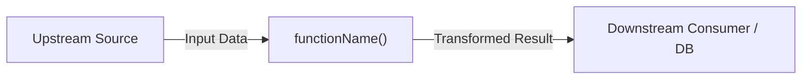

# Function: `<functionName>`

- **Module / File**: `path/to/source/file.ts`
- **Component**: `Collection Bin | Vending Machine | Shared Backend`
- **Author / Agent**: `Antigravity`
- **Date Created**: `YYYY-MM-DD`

---

## 1. Why Was This Function Added? (Rationale)
> Explain the root problem this function solves, why it was introduced, and what task requires it.

## 2. Importance & Criticality
- **System Role**: (e.g., Core financial transaction, hardware actuation, reward issuance, user auth)
- **Impact of Failure**: What happens if this function throws an error or fails?
- **SLA / Performance Requirement**: Execution time limits, memory considerations.

## 3. Function Signature & Contracts

```typescript
export async function functionName(
  param1: ParamType,
  param2: ParamType
): Promise<ReturnType>
```

### Parameters
| Name | Type | Required | Description | Constraints / Validation |
| :--- | :--- | :--- | :--- | :--- |
| `param1` | `string` | Yes | ... | Sanitized, non-empty, regex ... |
| `param2` | `number` | Yes | ... | Memory-aligned, range: [0, 1000] |

### Return Value
- **Type**: `ReturnType`
- **Description**: Detailed description of returned data structure.

### Thrown Exceptions / Errors
- `ValidationError`: When parameters violate preconditions.
- `HardwareTimeoutError`: When the peripheral fails to respond within timeout.

---

## 4. Pipeline Integration & Connection

### Upstream Callers & Data Source
- **Trigger**: (e.g. API endpoint `POST /api/v1/rewards/generate`, Load Cell GPIO interrupt)
- **Preceding Function**: `upstreamFunction()`

### Downstream Targets & Consumers
- **Next Stage**: `downstreamFunction()`, Database write, motor driver signal
- **Payload Forwarded**: What is delivered to the next step.

### Integration Flow Diagram


---

## 5. Memory Alignment & Resource Optimization
- Memory allocation pattern (buffers, typed arrays, stream usage).
- Teardown & cleanup (listeners unregistered, cursors closed, timers cleared).
- Complexity:
  - **Time Complexity**: $O(...)$
  - **Space Complexity**: $O(...)$

---

## 6. Security Analysis
- Input validation & schema check mechanism.
- Tamper-resistance & authorization requirements.
- Injection / replay attack mitigations.

---

## 7. Edge Cases & Recovery Logic
1. **Edge Case 1**: ...
2. **Edge Case 2**: ...
3. **Fallback Behavior**: ...

