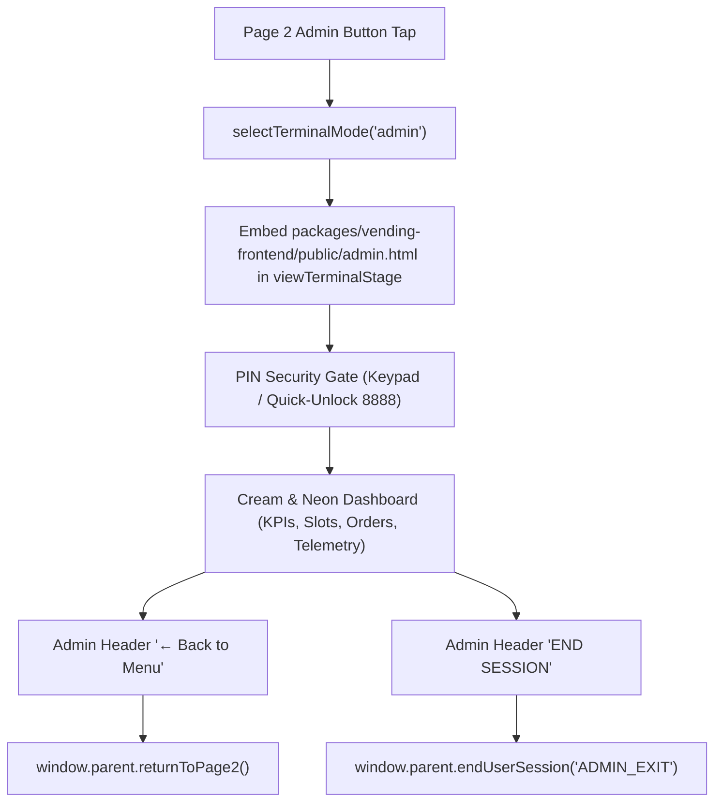

# Function Documentation: `AdminPortal_renderCreamNeonInterface`

## 1. Why Added
Overhauls the administrative telemetry and maintenance portal (`packages/vending-frontend/public/admin.html`) to align seamlessly with the Cream & Neon Stitch design system established by Page 1 (`viewPage1`) and Page 2 (`viewPage2`).

Replaces dark `#0b0f19` styling with a warm natural cream background (`#faf3dd`), ambient dot matrix pattern, deep forest green typography (`#0f2c1c`), translucent frosted glass cards, vibrant neon lime accents (`#9ef01a`), and an organic green wave grounding layer (`PICS/intoimage.png`).

## 2. Importance & Criticality
- **Visual Continuity**: Eliminates harsh aesthetic discordance when field technicians or showroom demonstrators open the administration interface from Page 2.
- **Rule 11 Kiosk Standards**: Provides high-contrast, touch-optimized interactive targets (minimum 48px, 60px numeric keypad buttons) for effortless touchscreen operation.
- **Seamless Frame Integration**: Directly wires "← Back to Menu" and "END SESSION" buttons in the admin header to parent window controller methods (`window.parent.returnToPage2()` and `window.parent.endUserSession()`).

## 3. Signature & Contracts
```typescript
function handleReturnToKiosk(): void
function handleEndSession(): void
```
- **Inputs**: None.
- **Outputs**: None. Interacts with `window.parent` messaging or window navigation.

## 4. Behavior & Logic
1. **Theming Architecture**: Uses CSS custom properties `--bg-main: #faf3dd`, `--primary: #153e28`, `--secondary: #9ef01a`, `--text-main: #0f2c1c`.
2. **Grounding Layer**: Renders `PICS/intoimage.png` at the bottom of the viewport with multiply blend mode and vertical gradient mask.
3. **PIN Security Gate**: Features a frosted glass modal with a large 3x4 numeric keypad (PIN: 8888) and 1-tap engineer quick-unlock.
4. **Header Navigation**:
   - `handleReturnToKiosk()`: checks `if (window.parent && window.parent.returnToPage2) window.parent.returnToPage2();` else falls back to `run-all.html`.
   - `handleEndSession()`: calls `window.parent.endUserSession('ADMIN_EXIT')` to guarantee full kiosk reset to Page 1.

## 5. Pipeline Integration & Flow Mapping


