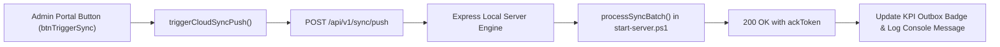

# Function Documentation: `triggerCloudSyncPush`

## 1. Why Added
To allow administrators and field engineers to manually trigger an immediate synchronization flush from the local outbox queue to the cloud backend directly from the Admin Portal interface.

## 2. Importance & Criticality
During routine maintenance, restocking, or network recovery inspection, field technicians need an explicit, on-demand mechanism to verify that all cached orders, disposals, and telemetry records are committed to the central cloud database without waiting for the background polling interval.

## 3. Signature & Contracts
- **Scope**: Client-side JavaScript function in `packages/vending-frontend/public/admin.html`.
- **Inputs**: None (triggered by user button tap on `btnTriggerSync`).
- **Outputs**: None directly (updates DOM KPI elements and logs terminal feedback).
- **HTTP Invocation**: Calls `POST /api/v1/sync/push`.
- **Errors Handled**:
  - Network timeouts (displays informative error log in diagnostic terminal).
  - Button state management (disables button and updates text to prevent double-clicks).

## 4. Behavior & Logic
1. Disables the `btnTriggerSync` button and sets label to `Syncing to Cloud...`.
2. Sends asynchronous HTTP POST request to `/api/v1/sync/push`.
3. Checks response status:
   - On success (200 OK): Parses JSON containing `syncedCount` and `ackToken`, appends a timestamped confirmation message to the admin diagnostic console, and triggers `loadDataFromBackend()` to refresh KPI counters.
   - On error: Displays warning message in the diagnostic terminal.
4. Restores button state and label (`⚡ Sync Now to Cloud`) in a `finally` block.

## 5. Pipeline Integration & Flow

