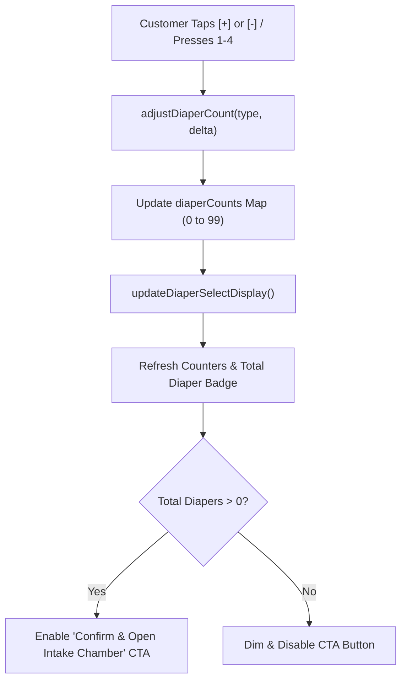

# Function: `adjustDiaperCount`

- **Module / File**: `packages/bin-frontend/public/bin-kiosk.html`
- **Component**: `Collection Bin Touchscreen Kiosk UI Subsystem`
- **Author / Agent**: `Antigravity`
- **Date Created**: `2026-11-15`

---

## 1. Why Was This Function Added? (Rationale)
Replaces the deprecated mobile/OTP verification stages by allowing customers to itemize the exact diapers they are depositing into the bin. `adjustDiaperCount` handles real-time increments (`+`) and decrements (`-`) for individual diaper size categories (Small, Medium, Large, Adult), bounding values between `0` and `99`, and updating the UI counter displays and submission state.

## 2. Importance & Criticality
- **System Role**: Primary input handler for user itemization on the collection kiosk.
- **Impact of Failure**: If this fails, users cannot adjust diaper counts, preventing deposit confirmation and voucher issuance.

## 3. Function Signature & Contracts

```javascript
function adjustDiaperCount(type: 'small' | 'medium' | 'large' | 'adult', delta: number): void
```

### Parameters
| Name | Type | Required | Description | Constraints |
| :--- | :--- | :--- | :--- | :--- |
| `type` | `string` | Yes | Target diaper category key | One of `'small'`, `'medium'`, `'large'`, `'adult'` |
| `delta` | `number` | Yes | Count adjustment value | Typically `+1` or `-1` |

### Return Value
- **Type**: `void`.

### State Mutations & DOM Changes
- Mutates `diaperCounts[type] = Math.max(0, Math.min(99, diaperCounts[type] + delta))`.
- Updates DOM count label `lblCount_${type}`.
- Toggles decrement button disabled state when count reaches `0`.
- Updates total count pill `lblTotalDiapers` and enables/disables the confirmation CTA button `btnConfirmDiapers`.

---

## 4. Pipeline Integration & Connection

### Upstream Callers & Data Source
- **Trigger**: Customer taps `[+]` or `[-]` touch buttons on the diaper selection cards, or presses keys `1`, `2`, `3`, `4` on the physical keyboard.
- **Caller**: `button.onclick`, `handleKioskKeydown()`.

### Downstream Targets & Consumers
- **Next Stage**: Triggers `updateDiaperSelectDisplay()` to synchronize DOM states; feeds final counts to `confirmDiapersAndOpenHatch()` upon confirmation.

### Integration Flow Diagram


---

## 5. Memory Alignment & Resource Optimization
- Operates on a compact plain JavaScript object dictionary with 4 numeric fields.
- Direct element ID lookups cached or accessed without memory allocations.
- Zero garbage collection pressure in high-frequency touch interactions.

