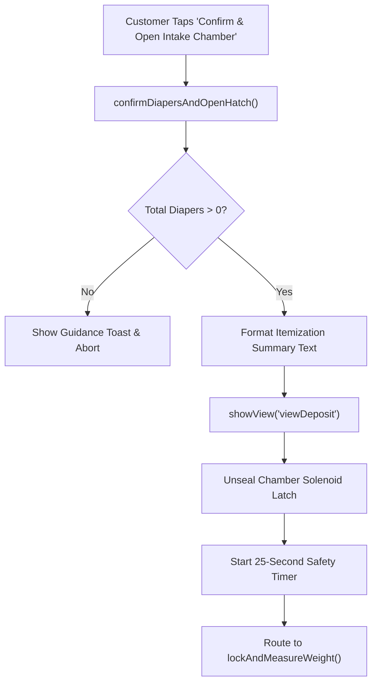

# Function: `confirmDiapersAndOpenHatch`

- **Module / File**: `packages/bin-frontend/public/bin-kiosk.html`
- **Component**: `Collection Bin Touchscreen Kiosk UI Subsystem`
- **Author / Agent**: `Antigravity`
- **Date Created**: `2026-11-15`

---

## 1. Why Was This Function Added? (Rationale)
Transitions the collection bin kiosk from the itemization screen (`viewDiaperSelect`) to the active intake chamber deposit screen (`viewDeposit`). It verifies that at least one diaper has been selected, generates the visual itemization prompt for customer guidance, unseals the physical solenoid hatch latch, and arms the 25-second auto-seal countdown timer.

## 2. Importance & Criticality
- **System Role**: Hardware-to-software gatekeeper connecting user item selection with solenoid latch release.
- **Impact of Failure**: If this fails, the hatch door will not unseal, blocking physical diaper disposal.

## 3. Function Signature & Contracts

```javascript
function confirmDiapersAndOpenHatch(): void
```

### Parameters
None. Reads active state from `diaperCounts`.

### Return Value
- **Type**: `void`.

### State Mutations & DOM Changes
- Validates `totalDiapers > 0`; aborts safely if zero.
- Populates `#depositItemsSummary` with readable itemization text (e.g., `"2x Small Diaper, 1x Adult Diaper"`).
- Transitions active view to `#viewDeposit` via `showView('viewDeposit')`.
- Arms 25-second countdown timer `hatchInterval` updating `#hatchTimerDisplay`.
- Triggers `lockAndMeasureWeight()` upon countdown expiration ($t \le 0$) or manual user tap on *"Deposit Completed (Seal & Weigh) →"*.

---

## 4. Pipeline Integration & Connection

### Upstream Callers & Data Source
- **Trigger**: Customer taps `btnConfirmDiapers` on `#viewDiaperSelect` or presses `Enter` key.
- **Caller**: `btnConfirmDiapers.onclick`, `handleKioskKeydown(Enter)`.

### Downstream Targets & Consumers
- **Next Stage**: Displays `#viewDeposit`, initiates solenoid latch release, and routes to `lockAndMeasureWeight()` upon item placement.

### Integration Flow Diagram


---

## 5. Memory Alignment & Resource Optimization
- Single-pass string reduction for item summary formatting.
- Explicit clearance of existing interval timers before arming new intervals to prevent timer leaks.
- Zero unnecessary DOM tree allocations.

