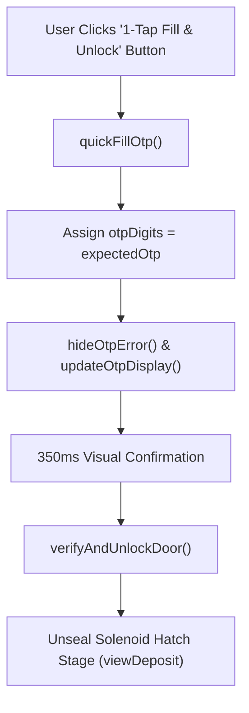

# Function: `quickFillOtp`

- **Module / File**: `packages/bin-frontend/public/bin-kiosk.html`
- **Component**: `Collection Bin Touchscreen Kiosk UI Subsystem`
- **Author / Agent**: `Antigravity`
- **Date Created**: `2026-11-14`

---

## 1. Why Was This Function Added? (Rationale)
During testing, dual kiosk simulations, and customer accessibility assistance, manually entering the 6-digit simulated verification code was prone to friction. `quickFillOtp` provides a 1-tap fast-track button (`⚡ 1-Tap Fill & Unlock`) directly next to the simulated SMS notification banner, populating the 6 digits and automatically executing `verifyAndUnlockDoor()` after a crisp 350ms slot confirmation animation.

## 2. Importance & Criticality
- **System Role**: Streamlines user verification during dual simulation runs and provides an accessible fallback for users on touch displays.
- **Impact of Failure**: If this fails or is missing, users must punch 6 keys manually every single time, which caused input issues in dual viewport split mode.

## 3. Function Signature & Contracts

```javascript
function quickFillOtp(): void
```

### Parameters
None. Reads `expectedOtp` from local scope (falling back to a freshly generated 6-digit code if empty).

### Return Value
- **Type**: `void`.

### State Mutations
- Assigns `otpDigits = expectedOtp`.
- Clears error banner via `hideOtpError()`.
- Calls `updateOtpDisplay()`.
- Schedules `verifyAndUnlockDoor()` via `setTimeout(..., 350)`.

---

## 4. Pipeline Integration & Connection

### Upstream Callers & Data Source
- **Trigger**: User clicks the `⚡ 1-Tap Fill & Unlock` button in `#viewOtp` card.
- **Caller**: User DOM click event on `#btnQuickFillOtp`.

### Downstream Targets & Consumers
- **Next Stage**: Triggers `updateOtpDisplay()`, then calls `verifyAndUnlockDoor()` to unseal the solenoid intake hatch.

### Integration Flow Diagram


---

## 5. Memory Alignment & Resource Optimization
- Reuses the existing string reference and triggers a single short timer which terminates immediately after invocation.
- Zero memory leakage; cancels timers upon reset.

