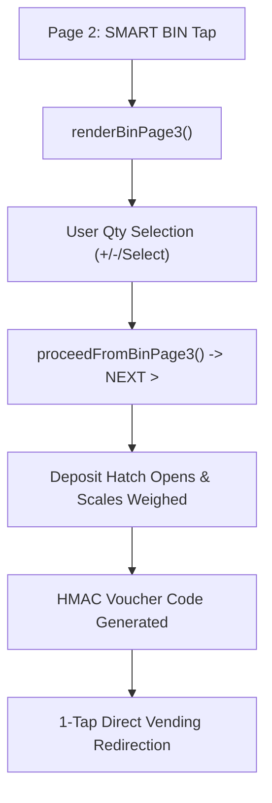

# Function: `BinKiosk_renderPage3DiaperSelector`

- **Module / File**: `run-all.html` / `index.html`
- **Component**: `Collection Bin Frontend / Master Kiosk Host`
- **Author / Agent**: `Antigravity`
- **Date Created**: `2026-11-16` (Updated for Centered Layout & Direct Voucher Pass)

---

## 1. Why Was This Function Added? (Rationale)
Provides the customer-facing Page 3 selection interface for the Diaper Collection Unit, centered on the kiosk display. Allows users to specify `SMALL` or `LARGER` counts, or select the `I DON'T KNOW` fallback, and automatically forwards the generated voucher into the vending machine checkout.

---

## 2. Importance & Criticality
- **System Role**: Core intake categorizer and voucher generation trigger.
- **Impact of Failure**: Customers cannot record deposits or receive discounts.
- **SLA / Performance Requirement**: Instantaneous DOM rendering (<16ms) with responsive touch controls.

---

## 3. Function Signature & Contracts

```typescript
export function renderBinPage3(
  initialCounts?: { small: number; larger: number; dontKnow: boolean }
): void
```

### Parameters
| Name | Type | Required | Description | Constraints / Validation |
| :--- | :--- | :--- | :--- | :--- |
| `initialCounts` | `object` | No | Initial pre-fill values | Counts bounded $[0, 20]$ |

### Return Value
- **Type**: `void`
- **Description**: Mounts `#viewBinPage3`, binds touch handlers, and provides seamless progression into deposit weighing and voucher issuance.

---

## 4. Pipeline Integration & Connection



### Upstream Callers & Data Source
- **Trigger**: Customer clicks "SMART BIN" card on Page 2 (`goToBinPage3()`).

### Downstream Targets & Consumers
- **Next Stage**: `proceedFromBinPage3()` opens the intake hatch, measures load cell weight, generates the discount voucher, and provides a 1-tap "Use in Vending Machine" transition with voucher auto-fill.
