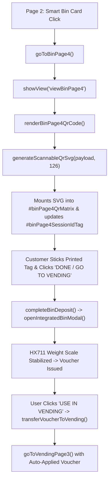

# Function: `BinKiosk_renderPage4QrInstructions`

- **Module / File**: `run-all.html` / `index.html`
- **Component**: `Collection Bin Frontend / Master Kiosk Host`
- **Author / Agent**: `Antigravity`
- **Date Created**: `2026-11-16`
- **Date Updated**: `2026-11-16 (Neon & Cream Stitch Layout Integration)`

---

## 1. Why Was This Function Added? (Rationale)
Renders the dedicated Page 4 interface for the Smart Diaper Collection Unit overhauled to match `PICS/stitch_neon_binpage4 (1)/code.html`. Replaces the legacy dark interface with the warm cream (`#faf3dd`), deep forest green (`#0f2c1c`), and vibrant chartreuse (`#ccff33` / `#9ef01a`) aesthetic. Displays the customer's unique dynamic QR disposal transaction token alongside animated thermal printer sticker feedback (`.animate-paper-feed`), plus 2-step visual disposal instructions (Stick QR on Plastic via `PICS/stick_qr_bag.png` and Drop into Auto-Sensing Bin Hatch).

---

## 2. Importance & Criticality
- **System Role**: Transaction token issuance, visual compliance guidance, and physical disposal trigger.
- **Direct Navigation**: Following removal of Bin Page 3, this screen is reached directly from Page 2 Mode Selection (`btn-select-smart-bin`), simplifying customer interaction down to one direct disposal instruction screen.
- **Impact of Failure**: If this view fails to render, customers cannot receive their QR token or learn how to properly bag and deposit diapers.
- **SLA / Performance Requirement**: Instant rendering (<16ms) with responsive visual indicators and 60fps thermal feed animation.

---

## 3. Function Signature & Contracts

```typescript
export function renderBinPage4QrCode(): void
```

### Parameters
None (retrieves `currentSessionId`, `binDepositTransactionToken`, and diaper breakdown directly from reactive kiosk session memory).

### Payload Encoded in SVG QR
```text
SDDS-DEPOSIT
ID:${sess}
TOKEN:${token}
DIAPERS:${diaperBreakdown}
COUNT:${totalDiapers}
CAM:REC_ACTIVE
```

### Return Value
- **Type**: `void`
- **Description**: Mounts `#viewBinPage4`, calls `generateScannableQrSvg()` to render the verified 126x126px SVG QR matrix into `#binPage4QrMatrix`, updates `#binPage4SessionIdTag` with the live session identifier, displays thermal printer animated feedback, and binds `< BACK` (`returnToPage2()`), `[ ✕ END SESSION ]` (`endUserSession('USER_ABORTED')`), and `DONE / GO TO VENDING` (`completeBinDeposit()`).

---

## 4. Pipeline Integration & Connection



### Upstream Callers & Data Source
- **Trigger**: Customer clicks `btn-select-smart-bin` on Page 2 (`goToBinPage4()`).

### Downstream Targets & Consumers
- **Next Stage**: `completeBinDeposit()` actuates the physical hatch, measures mass, generates the reward voucher, and stores the code in session memory before forwarding to Neon Vending (`goToVendingPage3()`).
