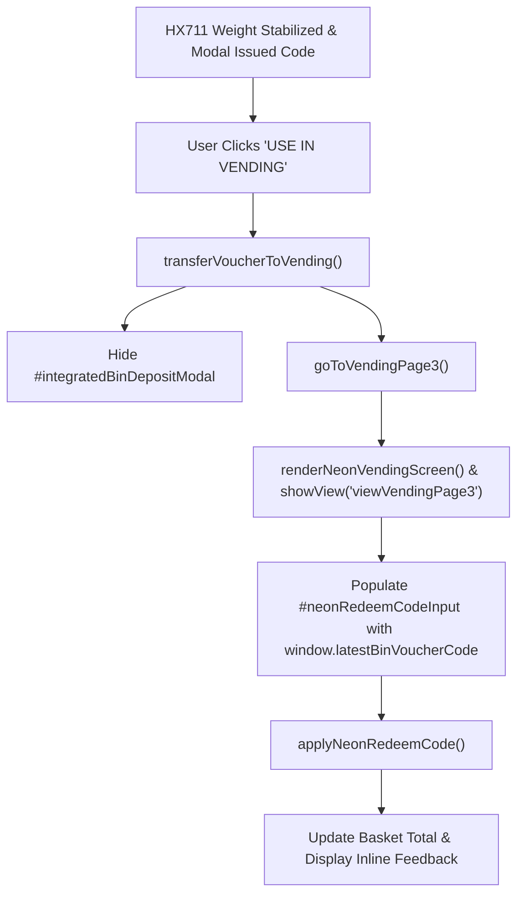

# Function Documentation: `transferVoucherToVending`

## 1. Why Added
In the SDDS integrated kiosk workflow, when a user completes a sanitary diaper disposal deposit at the Smart Bin, an Eco-Reward discount voucher (e.g., `ECO-25-ABCD`) is generated based on verified load cell weight. Previously, selecting "USE IN VENDING" navigated the customer to the deprecated dark Vending Page 4 (`goToVendingPage4()`). The user requested that Bin Page 4 redirect directly to the new, modern Neon Smart Vending Machine catalog (`goToVendingPage3()`, `#viewVendingPage3`), automatically pre-populating the voucher code into the input field (`#neonRedeemCodeInput`) and applying the discount immediately.

## 2. Importance & Criticality
- **Customer Conversion & Fluid Flow**: Eliminates friction between recycling waste and purchasing sanitized diapers. Seamlessly transitions customer context from Bin to Vending without re-typing lengthy voucher codes.
- **Architectural Modernization**: Retires legacy dark multi-page checkout in favor of the unified Neon catalog & slide-out basket architecture.
- **State Reliability**: Ensures `window.latestBinVoucherCode` is synchronized with `window.binDepositVoucherPercent` before the user interacts with the catalog.

## 3. Signature & Contracts
```typescript
function transferVoucherToVending(): void
```
- **Inputs**: None directly passed as arguments. Reads `window.latestBinVoucherCode` from global kiosk memory.
- **Outputs**: None (`void`).
- **DOM Mutations**:
  - Sets `#integratedBinDepositModal` display to `none`.
  - Sets active view to `#viewVendingPage3` via `goToVendingPage3()`.
  - Populates `#neonRedeemCodeInput.value`.
  - Calls `applyNeonRedeemCode()`.

## 4. Behavior & Logic
1. Hides the deposit modal `#integratedBinDepositModal`.
2. Invokes `goToVendingPage3()`, transitioning the kiosk display to `#viewVendingPage3` via `showView('viewVendingPage3')` with strict `!important` mutual exclusivity.
3. Inspects `window.latestBinVoucherCode`. If a valid voucher string exists:
   - Locates `#neonRedeemCodeInput` and sets its value.
   - Executes `applyNeonRedeemCode()`, parsing the percentage discount, displaying inline validation feedback in `#neonVoucherFeedback`, and applying the discount across the shopping cart basket.

## 5. Pipeline Integration & Flow


