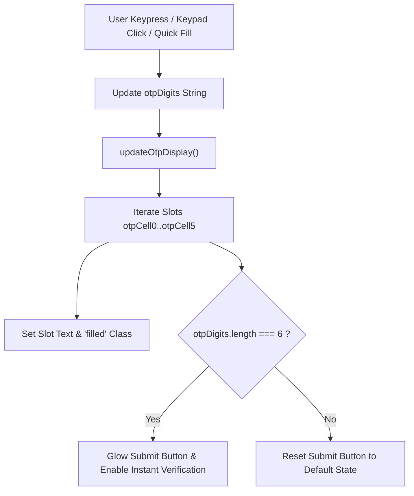

# Function: `updateOtpDisplay`

- **Module / File**: `packages/bin-frontend/public/bin-kiosk.html`
- **Component**: `Collection Bin Touchscreen Kiosk UI Subsystem`
- **Author / Agent**: `Antigravity`
- **Date Created**: `2026-11-14`

---

## 1. Why Was This Function Added? (Rationale)
In the collection bin customer authentication stage (`viewOtp`), users entering a 6-digit verification code previously had no discrete visual slot cells or feedback showing how many digits had been typed or whether cursor focus was active. `updateOtpDisplay` dynamically manages 6 individual DOM slot elements (`otpCell0` through `otpCell5`), updates their text values and CSS classes (`filled`), dynamically adjusts the button styling and active glow on `#btnSubmitOtp`, and provides immediate visual feedback on keypress.

## 2. Importance & Criticality
- **System Role**: Visual state synchronization for the 6-digit OTP entry keypad.
- **Impact of Failure**: Without this synchronization, users on public kiosks cannot see their progress, leading to repeated mis-clicks, frustration, or abandoned diaper deposits.

## 3. Function Signature & Contracts

```javascript
function updateOtpDisplay(): void
```

### Parameters
None. Reads and operates on the local state variable `otpDigits` (string with length between 0 and 6).

### Return Value
- **Type**: `void`.

### DOM Elements Affected
- `otpCell0` .. `otpCell5`: Sets inner text to either the corresponding digit or `'-'`, and adds/removes the CSS class `filled`.
- `btnSubmitOtp`: Updates opacity and emerald glow shadow when 6 digits are fully populated.

---

## 4. Pipeline Integration & Connection

### Upstream Callers & Data Source
- **Trigger**: Customer clicks numeric button on on-screen keypad (`pressOtpDigit`), presses physical keyboard key (`handleKioskKeydown`), clicks 1-tap quick fill (`quickFillOtp`), or clicks backspace/clear.
- **Caller**: `pressOtpDigit(d)`, `clearOtp()`, `backspaceOtp()`, `quickFillOtp()`, `showView('viewOtp')`.

### Downstream Targets & Consumers
- **Next Stage**: Displays active slots to user. When length reaches 6, enables instant submission via `verifyAndUnlockDoor()`.

### Integration Flow Diagram


---

## 5. Memory Alignment & Resource Optimization
- Operates strictly on existing static DOM element references with zero dynamic element allocations.
- Fixed $O(1)$ loop over 6 elements, producing zero garbage collection pressure on embedded kiosk hardware.

