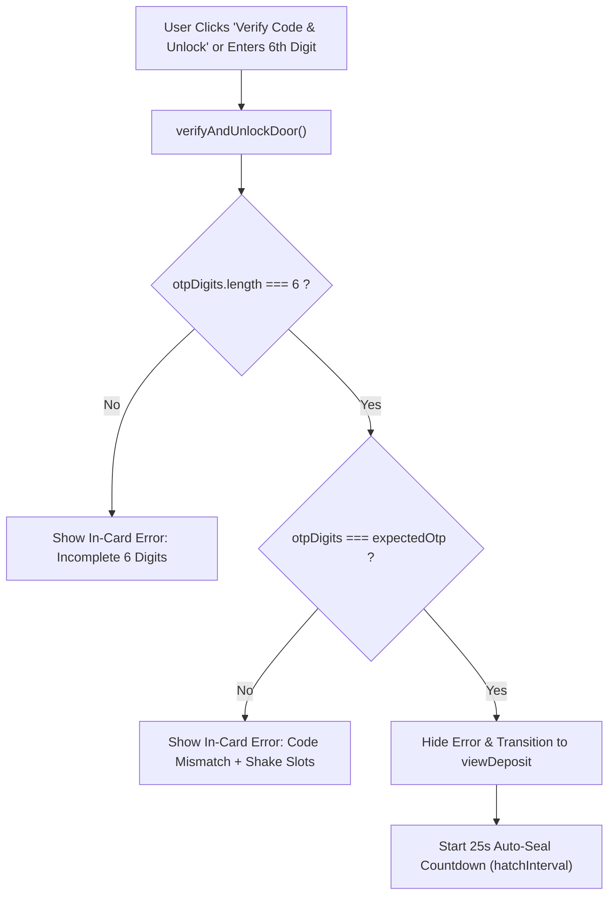

# Function: `verifyAndUnlockDoor`

- **Module / File**: `packages/bin-frontend/public/bin-kiosk.html`
- **Component**: `Collection Bin Touchscreen Kiosk UI Subsystem`
- **Author / Agent**: `Antigravity`
- **Date Created**: `2026-11-14`

---

## 1. Why Was This Function Added? (Rationale)
Previously, `verifyAndUnlockDoor()` used a modal browser `alert()` upon verification code mismatch, which blocks the UI thread, breaks fullscreen kiosk mode, and often gets silently suppressed or causes browser lockups inside iframes in multi-terminal layouts. Furthermore, clicking the submit button before entering 6 digits was swallowed with zero user feedback due to hard DOM disabling. `verifyAndUnlockDoor` was refactored to provide non-blocking, in-card animated feedback (`#otpErrorBanner`), dynamic input validation, and automatic transition to the physical hatch chamber view (`viewDeposit`).

## 2. Importance & Criticality
- **System Role**: Authorizes deposit stage and triggers physical intake hatch unlock sequence.
- **Impact of Failure**: If this fails or hangs via `alert()`, the user cannot deposit diapers and cannot progress to the reward voucher generation step.

## 3. Function Signature & Contracts

```javascript
function verifyAndUnlockDoor(): void
```

### Parameters
None. Compares local `otpDigits` against `expectedOtp`.

### Return Value
- **Type**: `void`.

### Verification Logic & Edge Cases
1. **Incomplete Input (`otpDigits.length < 6`)**: Displays inline notice: `"Please enter all 6 digits of the verification code."` without blocking the screen.
2. **Code Mismatch (`otpDigits !== expectedOtp`)**: Displays inline error banner: `"Verification code does not match. Please use the code displayed above."`, triggers CSS shake animation on the OTP slots container, and retains input for correction.
3. **Successful Match (`otpDigits === expectedOtp`)**: Hides any error banner, transitions to `viewDeposit`, and initializes the 25-second hatch auto-seal safety countdown timer.

---

## 4. Pipeline Integration & Connection

### Upstream Callers & Data Source
- **Trigger**: User clicks `#btnSubmitOtp`, hits `Enter` key, or triggers `quickFillOtp()`.
- **Caller**: `btnSubmitOtp.onclick`, `handleKioskKeydown(Enter)`, `quickFillOtp()`.

### Downstream Targets & Consumers
- **Next Stage**: Displays `#viewDeposit` (Stage 3: Deposit Chamber Open) and starts `hatchInterval` countdown.

### Integration Flow Diagram


---

## 5. Memory Alignment & Resource Optimization
- Cancels previous intervals prior to allocating new interval timers.
- Avoids thread-blocking native `alert()` calls, preserving smooth 60fps animations.

