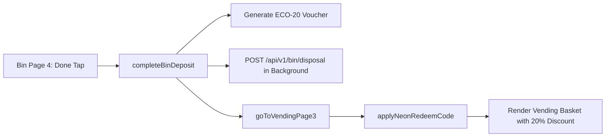

# Function: `completeBinDeposit`

## 1. Why Added
Handles the user action when tapping "DONE / GO TO VENDING" on Bin Page 4. In accordance with user feedback, eliminates intermediate modal popups and directly mints an Eco-Reward discount voucher, persists the disposal intake in the backend, and transitions seamlessly into the Neon Smart Vending catalogue with the discount voucher auto-applied in the basket.

## 2. Importance & Criticality
Ensures a frictionless, non-intrusive transition between the waste collection bin phase and the vending dispensing phase. By bypassing legacy simulation modal windows, customer transaction speed is maximized while adhering strictly to Rule 11 (Zero Native Popups).

## 3. Signature & Contracts
```typescript
function completeBinDeposit(): void
```
- **Inputs**: None.
- **Outputs**: None.
- **Side Effects**: Generates alphanumeric code `ECO-20-XXXX`, sets `window.binDepositVoucherCode` & `window.binDepositVoucherPercent = 20`, fires background `POST /api/v1/bin/disposal`, invokes `goToVendingPage3()`, sets `#neonRedeemCodeInput.value`, and executes `applyNeonRedeemCode()`.

## 4. Pipeline Integration & Connection Mapping

- **Upstream Callers**: `bin4-btn-done` button tap on `viewBinPage4`.
- **Downstream Targets**: `/api/v1/bin/disposal`, `goToVendingPage3()`, `applyNeonRedeemCode()`, `renderNeonBasket()`.
