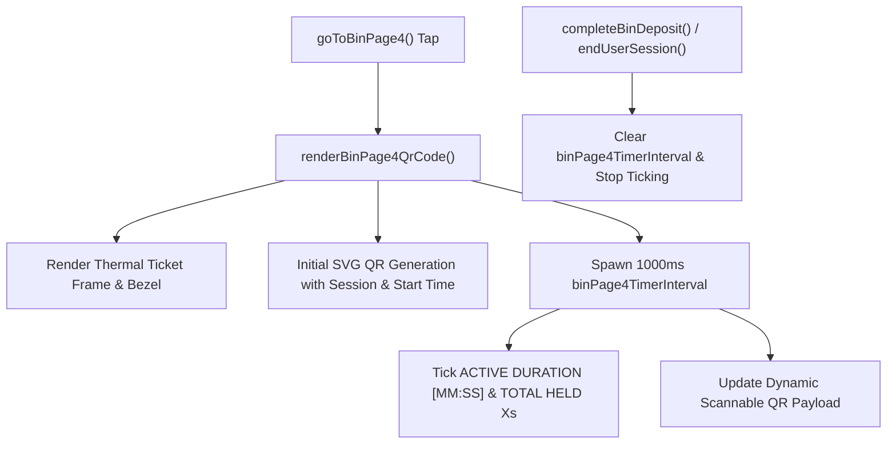

# Function Documentation: `renderBinPage4QrCode`

## 1. Why Added
Provides an authentic, tactile physical simulation of a hardware thermal ticket printer dispensing an adhesive QR disposal tag on Smart Bin Page 4 (`viewBinPage4`). Rather than displaying a generic static QR code, the interface visually presents a hardware printer mouth with a status LED and a realistically styled thermal paper receipt physically emerging downwards via `@keyframes printEmerge`.

Crucially, the ticket continuously updates and displays the customer's live interaction duration and held seconds from start to finish (`SESSION START`, `ACTIVE DURATION: [MM:SS]`, `TOTAL HELD: Xs`) both visually on the ticket face and cryptographically encoded into the scannable SVG QR payload.

## 2. Importance & Criticality
- **Customer Feedback & Transparency**: Customers clearly understand that a physical adhesive tag is being prepared by the terminal for peeling and sticking onto their diaper pouch.
- **Session Duration Tracking**: The live timer records the customer's total held interaction time, ensuring complete traceability for waste collection and recycling incentives.
- **Mobile Scannability**: Generates a standard-compliant, high-contrast SVG QR matrix encoding session ID, start timestamp, active duration, diaper breakdown, and station ID.

## 3. Signature & Contracts
```typescript
function renderBinPage4QrCode(): void
```
- **Inputs**: None. Reads `currentSessionId`, `sessionStartTime`, and `binState`.
- **Outputs**: None (`void`). Directly mutates `#binPage4QrMatrix`, `#binPage4SessionIdTag`, `#binPage4StartTime`, `#binPage4Duration`, and `#binPage4HeldSeconds`.
- **State Mutated**: Sets up `binPage4TimerInterval` which fires every 1000ms until the view is closed or session terminates.

## 4. Behavior & Logic
1. **Container Lookup**: Finds `#binPage4QrMatrix`. If not present in DOM, exits cleanly.
2. **Interval Management**: Clears any pre-existing `binPage4TimerInterval`.
3. **Ticket Update Routine**:
   - Calculates `elapsedSec` from `sessionStartTime`.
   - Computes `mm:ss` formatted duration.
   - Formats payload string:
     `SDDS-DEPOSIT\nID:${sess}\nTOKEN:${token}\nSTART:${startStr}\nDURATION:${durationFormatted}\nHELD_SEC:${elapsedSec}\nDIAPERS:${diaperBreakdown}\nCOUNT:${totalDiapers}\nSTATION:BIN-01`
   - Generates SVG QR code via `generateScannableQrSvg(payload, 136)`.
   - Populates `#binPage4StartTime`, `#binPage4Duration`, and `#binPage4HeldSeconds`.
4. **Live Interval**: Ticks every second while `#viewBinPage4` retains the `.kiosk-view-active` class.

## 5. Pipeline Integration & Flow Mapping


