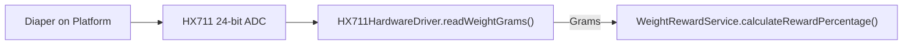

# Function: `HX711HardwareDriver.readWeightGrams`

- **Module / File**: `packages/bin-backend/src/hardware/hx711-driver.ts`
- **Component**: `Collection Bin Hardware Layer`
- **Author / Agent**: `Antigravity`
- **Date Created**: `2026-11-11`

---

## 1. Why Was This Function Added? (Rationale)
Reads the 24-bit analog-to-digital converter (ADC) differential voltage from the strain gauge load cell mounted beneath the deposit platform, converts raw digital counts into grams using the calibration factor, and validates that the weight is within safe physical bounds.

## 2. Importance & Criticality
- **System Role**: Core physical sensor input determining reward percentage discounts.
- **Impact of Failure**: Miscalculating weight could result in issuing excessive discounts or rejecting valid diaper deposits.

## 3. Function Signature & Contracts

```typescript
public async readWeightGrams(): Promise<number>
```

### Parameters
- None.

### Return Value
- **Type**: `Promise<number>` (Measured mass in grams, rounded to nearest integer).

### Thrown Exceptions
- `ValidationError`: If negative weight is detected (indicating sensor displacement or scale needing tare).
- `HardwareError`: If reading exceeds the 5 kg physical bin safety ceiling.

---

## 4. Pipeline Integration & Connection

### Upstream Callers & Data Source
- **Trigger**: Customer closes the disposal hatch or taps "I Have Deposited".
- **Caller**: `WeightRewardService.processDisposalAndIssueReward()` $\rightarrow$ `POST /api/v1/bin/weigh`

### Downstream Targets & Consumers
- **Next Stage**: Passes weight in grams to `WeightRewardService.calculateRewardPercentage()`.

### Integration Flow Diagram


---

## 5. Memory Alignment & Resource Optimization
- Operates directly over GPIO buffer inputs without intermediary cloning.
- Strict sensor bounds checks prevent integer overflow.

