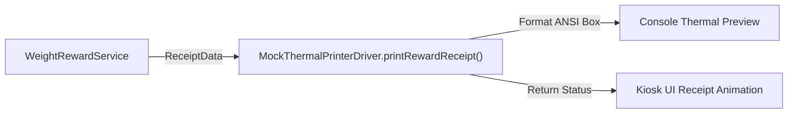

# Function: `MockThermalPrinterDriver.printRewardReceipt`

- **Module / File**: `packages/bin-backend/src/hardware/thermal-printer.ts`
- **Component**: `Collection Bin Hardware Layer`
- **Author / Agent**: `Antigravity`
- **Date Created**: `2026-11-11`

---

## 1. Why Was This Function Added? (Rationale)
Provides an idempotent, simulated thermal printer driver for local development, automated testing, and CI pipelines, printing high-fidelity formatted receipt previews to the terminal console without requiring a physical 58mm/80mm ESC/POS hardware printer connected.

## 2. Importance & Criticality
- **System Role**: Simulates receipt printing and validates payload structure before transmission.
- **Impact of Failure**: Developer cannot verify thermal receipt content or ticket generation latency.

## 3. Function Signature & Contracts

```typescript
public async printRewardReceipt(
  data: ReceiptData
): Promise<{ success: boolean; bytesWritten: number }>
```

### Parameters
| Name | Type | Required | Description | Constraints / Validation |
| :--- | :--- | :--- | :--- | :--- |
| `data` | `ReceiptData` | Yes | Customer name, masked phone, weight, discount %, barcode, expiry | All fields required |

### Return Value
- **Type**: `Promise<{ success: boolean, bytesWritten: number }>`

---

## 4. Pipeline Integration & Connection

### Upstream Callers & Data Source
- **Caller**: `WeightRewardService.processDisposalAndIssueReward()`

### Downstream Targets & Consumers
- **Next Stage**: Result returned to `BinController` to confirm receipt delivery on Kiosk screen.

### Integration Flow Diagram


---

## 5. Memory Alignment & Resource Optimization
- Operates on static string templates and small memory footprints.
- Releases timers and references immediately upon promise resolution.

