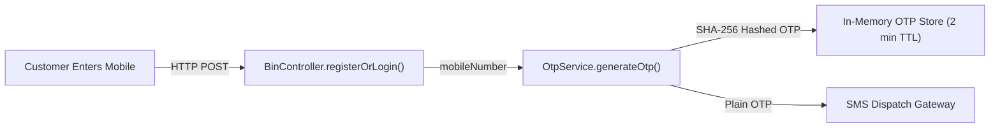

# Function: `OtpService.generateOtp`

- **Module / File**: `packages/bin-backend/src/services/otp.service.ts`
- **Component**: `Collection Bin Authentication Subsystem`
- **Author / Agent**: `Antigravity`
- **Date Created**: `2026-11-11`

---

## 1. Why Was This Function Added? (Rationale)
Before allowing a user to open the collection hatch and deposit diapers, the customer's mobile number must be verified to prevent anonymous vandalism, bind earned reward tokens to a known identity, and create a customer ledger account. This function generates a cryptographically random 6-digit OTP with a 2-minute time-to-live.

## 2. Importance & Criticality
- **System Role**: Initial security gate and anti-abuse protection for the collection bin.
- **Impact of Failure**: Users cannot register or unlock the diaper disposal door.
- **SLA / Performance Requirement**: Execution time $< 1\text{ ms}$.

## 3. Function Signature & Contracts

```typescript
public generateOtp(mobileNumber: string): { otp: string; expiresAt: Date }
```

### Parameters
| Name | Type | Required | Description | Constraints / Validation |
| :--- | :--- | :--- | :--- | :--- |
| `mobileNumber` | `string` | Yes | Customer's E.164 phone number | Valid 10-digit Indian phone number |

### Return Value
- **Type**: `{ otp: string, expiresAt: Date }`
  - `otp`: 6-digit string between `100000` and `999999`.
  - `expiresAt`: Timestamp set to `Date.now() + 120000` (2 minutes).

### Thrown Exceptions
- `ValidationError`: When mobile number is missing or invalid.

---

## 4. Pipeline Integration & Connection

### Upstream Callers & Data Source
- **Trigger**: Customer enters phone number on Collection Bin touch keypad.
- **Caller**: `POST /api/v1/bin/user/register-or-login` $\rightarrow$ `BinController.registerOrLogin()`

### Downstream Targets & Consumers
- **Next Stage**: Dispatched via SMS gateway (or logged to simulated console/toast) and stored in memory with SHA-256 hash.

### Integration Flow Diagram


---

## 5. Memory Alignment & Resource Optimization
- Hashes OTP before storage using standard SHA-256 to ensure secrets are never stored in plaintext.
- Automatic eviction of expired tokens upon verification or TTL expiry.
- **Complexity**: $O(1)$ time and memory overhead.

