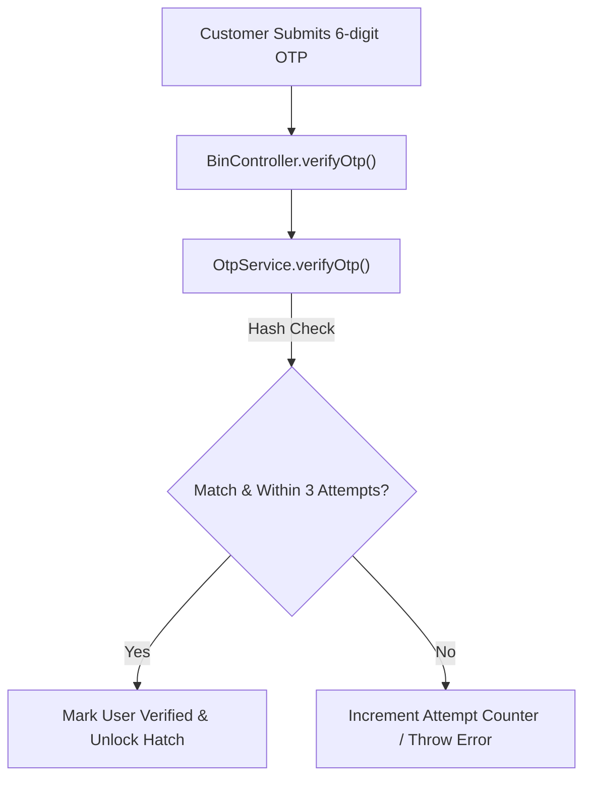

# Function: `OtpService.verifyOtp`

- **Module / File**: `packages/bin-backend/src/services/otp.service.ts`
- **Component**: `Collection Bin Authentication Subsystem`
- **Author / Agent**: `Antigravity`
- **Date Created**: `2026-11-11`

---

## 1. Why Was This Function Added? (Rationale)
Verifies the customer's submitted 6-digit OTP against the stored SHA-256 hash. Enforces strict rate limiting (maximum 3 failed attempts before token revocation) and single-use consumption to prevent replay and brute-force attacks.

## 2. Importance & Criticality
- **System Role**: Authorizes camera inspection and unsealing of the physical disposal hatch.
- **Impact of Failure**: Unauthorized users could gain access to the collection bin or brute force tokens.

## 3. Function Signature & Contracts

```typescript
public verifyOtp(mobileNumber: string, submittedOtp: string): boolean
```

### Parameters
| Name | Type | Required | Description | Constraints / Validation |
| :--- | :--- | :--- | :--- | :--- |
| `mobileNumber` | `string` | Yes | Target customer phone number | Valid 10-digit Indian phone number |
| `submittedOtp` | `string` | Yes | 6-digit OTP code entered on kiosk | Exactly 6 numeric digits |

### Return Value
- **Type**: `boolean` (`true` if valid).

### Thrown Exceptions
- `AppError` (`NOT_FOUND`): When no OTP exists for this mobile number.
- `ValidationError`: When OTP has expired or code does not match.
- `AppError` (`UNAUTHORIZED`): When max attempts ($>3$) exceeded.

---

## 4. Pipeline Integration & Connection

### Upstream Callers & Data Source
- **Trigger**: Customer enters 6-digit code on kiosk keypad.
- **Caller**: `POST /api/v1/bin/otp/verify` $\rightarrow$ `BinController.verifyOtp()`

### Downstream Targets & Consumers
- **Next Stage**: Marks user as `isVerified: true` in MongoDB and triggers `BinController.openHatch()`.

### Integration Flow Diagram


---

## 5. Memory Alignment & Resource Optimization
- Consumes and deletes OTP record immediately upon successful match, releasing map memory.
- **Complexity**: $O(1)$ time and memory overhead.

