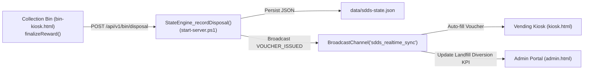

# Function: `StateEngine_recordDisposal`

- **Module / File**: `start-server.ps1` (`POST /api/v1/bin/disposal`)
- **Component**: `Collection Bin Subsystem & Environmental Tracking Engine`
- **Author / Agent**: `Antigravity`
- **Date Created**: `2026-11-14`

---

## 1. Why Was This Function Added? (Rationale)
Enables cross-subsystem environmental reconciliation. When a patron disposes of used diapers at the Collection Unit, this function tracks cumulative recovered waste weight and issued discount vouchers, broadcasting the voucher code to the Vending Kiosk and updating the Admin Portal's sustainability KPIs.

---

## 2. Importance & Criticality
- **System Role**: Circular Economy Reconciliation & Waste Diversion Tracker.
- **Impact of Failure**: Inability to quantify kilograms of waste diverted; disconnection between bin voucher generation and operator analytics.
- **SLA / Performance Requirement**: Execution latency $< 30$ ms.

---

## 3. Function Signature & Contracts

```typescript
export async function recordDisposal(
  payload: DisposalRecordPayload
): Promise<DisposalRecordResponse>
```

### Parameters
| Name | Type | Required | Description | Constraints |
| :--- | :--- | :--- | :--- | :--- |
| `weightGrams` | `number` | Yes | Mass measured by HX711 strain gauge load cell | $50 \le w \le 5000$ |
| `rewardPercentage`| `number` | Yes | Calculated discount percentage | $5 \le p \le 25$ |
| `redeemCode` | `string` | Yes | Tamper-proof voucher code (e.g. `ECO-09-A4F2`) | `ECO-{pct}-{hex}` |

### Return Value
JSON payload containing:
- `disposal`: Stamped disposal audit record with ID, weight, discount %, code, and time.
- `totalWeightCollectedGrams`: Updated cumulative waste weight in grams.
- `totalWeightKg`: Formatted waste weight in kilograms.
- `totalVouchersIssued`: Cumulative voucher count.

---

## 4. Pipeline Integration & Connection

### Upstream Callers & Data Source
- **Trigger**: Collection Unit receipt finalization (`finalizeReward` in `bin-kiosk.html`).
- **Preceding Function**: Load cell weight stabilization & reward formula calculation.

### Downstream Targets & Consumers
- **Next Stage**: Persisted in `data/sdds-state.json`.
- **Consumers**: Administrator Dashboard (`admin.html`) displays updated landfill diversion tonnage; Vending Kiosk (`kiosk.html`) automatically populates the voucher in the customer's cart.

### Integration Flow Diagram


