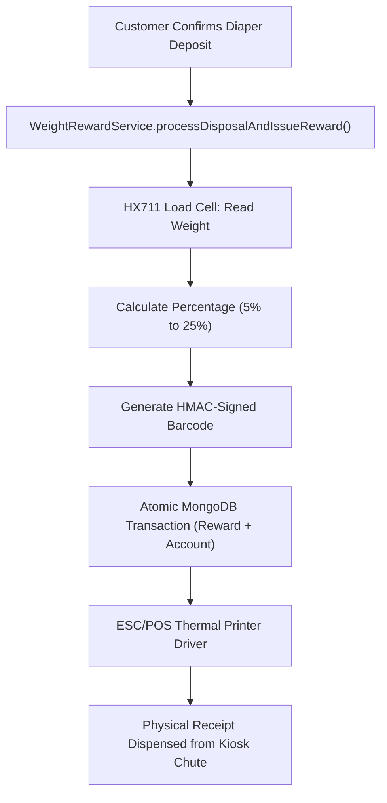

# Function: `WeightRewardService.processDisposalAndIssueReward`

- **Module / File**: `packages/bin-backend/src/services/weight-reward.service.ts`
- **Component**: `Collection Bin Reward Issuance Orchestrator`
- **Author / Agent**: `Antigravity`
- **Date Created**: `2026-11-11`

---

## 1. Why Was This Function Added? (Rationale)
Coordinates the complete diaper disposal workflow: querying the load cell reading, calculating the earned percentage discount, generating an HMAC-signed Code 128 barcode token with a strict 7-day TTL, saving records atomically to MongoDB, and triggering the ESC/POS thermal printer.

## 2. Importance & Criticality
- **System Role**: Core business logic transaction of the diaper collection bin.
- **Impact of Failure**: Customer deposits a diaper but receives no barcode, leading to user dissatisfaction and loss of trust in the eco-reward program.

## 3. Function Signature & Contracts

```typescript
public async processDisposalAndIssueReward(
  binId: string,
  userId: string
): Promise<IssuedRewardResult>
```

### Parameters
| Name | Type | Required | Description | Constraints / Validation |
| :--- | :--- | :--- | :--- | :--- |
| `binId` | `string` | Yes | Unique identifier of this collection bin unit | Non-empty string |
| `userId` | `string` | Yes | Registered customer account ID | Must exist in `users` collection |

### Return Value
- **Type**: `Promise<IssuedRewardResult>`
  - `barcode`: `string` (e.g. `SDDS-19A62B-20PCT`)
  - `weightGrams`: `number`
  - `rewardPercentage`: `number`
  - `expiresAt`: `Date` (+7 days)
  - `accumulatedTotalPercentage`: `number`
  - `printed`: `boolean`

### Thrown Exceptions
- `AppError` (`NOT_FOUND`): If `userId` does not exist.
- `ValidationError`: If diaper weight is below 50g.

---

## 4. Pipeline Integration & Connection

### Upstream Callers & Data Source
- **Trigger**: Customer closes hatch and taps "Confirm Deposit" on kiosk screen.
- **Caller**: `POST /api/v1/bin/reward/generate` $\rightarrow$ `BinController.generateReward()`

### Downstream Targets & Consumers
- **MongoDB**: Atomically writes to `rewards` and `reward_accounts`.
- **Thermal Printer**: Dispatches ESC/POS print stream.
- **Vending Machine**: Customer later scans the generated barcode at vending kiosk checkout.

### Integration Flow Diagram


---

## 5. Memory Alignment & Resource Optimization
- Releases load cell and printer handles cleanly.
- Executes within an atomic MongoDB transaction session with guaranteed `session.endSession()` cleanup.

