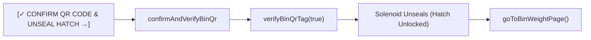

# Function Documentation: `confirmAndVerifyBinQr`

## 1. Why Added
Enables customer-driven manual confirmation on the dedicated QR Scanner page (`#viewBinScanPage`). Replaces the automatic 2.4-second auto-verify timer so the customer has full control over aligning their QR bag and clicking confirm when ready.

## 2. Importance & Criticality
Ensures customers can visually review the camera aperture, align the adhesive tag on their plastic diaper bag, inspect the pictorial guidelines, and explicitly confirm before the intake hatch solenoid unseals.

## 3. Signature & Contracts
```typescript
function confirmAndVerifyBinQr(): void
```
- **Inputs**: None.
- **Outputs**: None.
- **State Changes**: Cancels any standing scanner timers, invokes `verifyBinQrTag(true)`, updates hatch pill to `✓ HATCH UNLOCKED`, and advances to `viewBinWeightPage`.

## 4. Pipeline Integration


## 5. Behavior & Logic
1. If `binScannerTimeout` exists, cancels it with `clearTimeout`.
2. Calls `verifyBinQrTag(true)` indicating manual user confirmation.
3. Updates UI notice: `✓ VALIDATED: TAG #SESS-XXXX MATCHED • UNSEALING HATCH...`.
4. Changes hatch indicator to green `✓ HATCH UNLOCKED`.
5. Transitions to `#viewBinWeightPage` for diaper mass intake and reward calculation.
