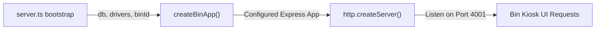

# Function: `createBinApp`

- **Module / File**: `packages/bin-backend/src/app.ts`
- **Component**: `Collection Bin Express Application Factory`
- **Author / Agent**: `Antigravity`
- **Date Created**: `2026-11-11`

---

## 1. Why Was This Function Added? (Rationale)
Factory function that decouples the Collection Bin Express API server setup, CORS configuration, body limits, route controllers, and centralized error handling from network port binding, enabling isolated automated testing and clean dependency injection.

## 2. Importance & Criticality
- **System Role**: Core API server factory for the Diaper Collection Bin.
- **Impact of Failure**: Collection bin API cannot initialize or handle kiosk requests.

## 3. Function Signature & Contracts

```typescript
export function createBinApp(
  db: Db,
  hatchDriver: IHatchDriver,
  cameraDriver: ICameraDriver,
  loadCellDriver: ILoadCellDriver,
  printerDriver: IThermalPrinterDriver,
  binId: string
): Express
```

### Parameters
| Name | Type | Required | Description | Constraints / Validation |
| :--- | :--- | :--- | :--- | :--- |
| `db` | `Db` | Yes | Connected MongoDB instance | Valid active connection |
| `hatchDriver` | `IHatchDriver` | Yes | Solenoid door controller | Implements `IHatchDriver` |
| `cameraDriver` | `ICameraDriver` | Yes | Inspection camera controller | Implements `ICameraDriver` |
| `loadCellDriver` | `ILoadCellDriver` | Yes | HX711 weight sensor driver | Implements `ILoadCellDriver` |
| `printerDriver` | `IThermalPrinterDriver` | Yes | ESC/POS thermal printer driver | Implements `IThermalPrinterDriver` |
| `binId` | `string` | Yes | Unique ID of this collection bin | Non-empty string |

### Return Value
- **Type**: `Express` application instance ready to mount on HTTP server.

---

## 4. Pipeline Integration & Connection

### Upstream Callers & Data Source
- **Trigger**: Server bootstrap in `packages/bin-backend/src/server.ts` or test suite.

### Downstream Targets & Consumers
- **Next Stage**: Serves REST requests from the Collection Bin kiosk frontend.

### Integration Flow Diagram


---

## 5. Memory Alignment & Resource Optimization
- Limits body JSON payload strictly to 256KB to guard against memory exhaustion attacks (Rule 3 & 8).
- Centralized error boundary prevents memory leaks from unhandled promise rejections.

