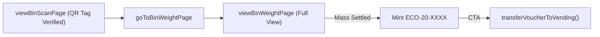

# Function Documentation: `goToBinWeightPage`

## 1. Why Added
Navigates the customer to the dedicated full-screen Diaper Mass Weighing & Reward Calculation page (`viewBinWeightPage`) following successful optical QR tag verification.

## 2. Importance & Criticality
Replaces legacy overlay modals with a dedicated full-screen view (Rule 11 Zero Popups), ensuring complete visual focus on load cell mass stabilization, dynamic reward calculation, and the action to transfer the voucher to the Vending Machine.

## 3. Signature & Contracts
```typescript
function goToBinWeightPage(): void
```
- **Inputs**: None (reads global `binState` to calculate target mass trajectory).
- **Outputs**: None (switches kiosk view).
- **State Transition**: Activates `#viewBinWeightPage`, initializes load cell counting animation, and commits disposal to backend.

## 4. Pipeline Integration


## 5. Behavior & Logic
1. Executes `showView('viewBinWeightPage')`.
2. Resets weight display to `0 g` and sets hatch status to `✓ INTAKE HATCH UNLATCHED • PLACE DIAPERS ON TRAY`.
3. Samples target weight (e.g., 420g) and animates count-up trajectory.
4. Executes dynamic formula: `min(25%, 5% + floor((w - 50)/50)) = 20%`.
5. Mints unique voucher code `ECO-20-XXXX` and dispatches `POST /api/v1/bin/disposal`.
6. Reveals primary call-to-action button: `TRANSFER REWARD TO VENDING MACHINE (20% OFF) →`.
