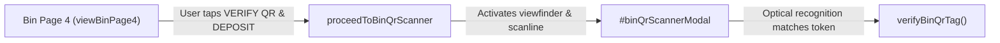

# Function Documentation: `proceedToBinQrScanner`

## 1. Why Added
Enforces the mandatory physical verification stage in the Smart Diaper Collection Bin. After the customer fills in diaper details on Bin Page 4 and prints the thermal ticket, the system must not jump directly to vending or scale weighing. It must transition to an optical scanning stage to verify the adhesive QR ticket.

## 2. Importance & Criticality
Prevents unverified deposits, fraudulent vouchers, and out-of-order mechanical execution. Guarantees that the intake hatch remains securely latched until optical computer vision or an optical scanner verifies the session ticket.

## 3. Signature & Contracts
```typescript
function proceedToBinQrScanner(): void
```
- **Inputs**: None (reads global `binSessionCode` or generates fallback `TKN-XXXX`).
- **Outputs**: None (transitions UI view/modal).
- **Errors**: Non-throwing; defensive fallbacks ensure touch kiosk responsiveness.

## 4. Pipeline Integration


## 5. Behavior & Logic
1. Reads the current active ticket session token (`binTicketSessionId` or generated hash).
2. Clears previous verification timers and sets scanner status to active.
3. Opens `#binQrScannerModal` with smooth CSS transition.
4. Initializes animated laser scanline over the simulated optical camera reticle.
5. Initiates optical tag detection routine.
