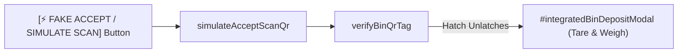

# Function Documentation: `simulateAcceptScanQr`

## 1. Why Added
Enables immediate optical QR tag acceptance and hatch solenoid actuation from the dedicated scanner page (`viewBinScanPage`), designed for fast demonstration, client walkthroughs, and automated testing without requiring a physical barcode printout.

## 2. Importance & Criticality
Ensures smooth kiosk demos and guarantees testability even in headless environments where optical camera hardware is simulated or unavailable.

## 3. Signature & Contracts
```typescript
function simulateAcceptScanQr(): void
```
- **Inputs**: None.
- **Outputs**: None.
- **Side Effects**: Sets scanner feedback to verified, triggers hatch unlock animation, dispatches verification telemetry, and transitions to the HX711 Load Cell Weight stage.

## 4. Pipeline Integration


## 5. Behavior & Logic
1. Cancels active auto-detection timers to prevent race conditions.
2. Changes status badge to `✓ QR TAG VERIFIED`.
3. Highlights targeting frame in neon green (`#9ef01a`).
4. Updates daemon telemetry: `[CV_SCANNER] Tag #SESS-XXXX validated. Unlatching hatch...`.
5. After 500ms visual confirmation, transitions directly to `openIntegratedBinModal()` for mass weighing.
