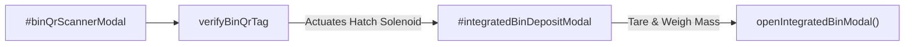

# Function Documentation: `verifyBinQrTag`

## 1. Why Added
Simulates optical camera / computer vision recognition of the thermal printed adhesive QR ticket held up to the kiosk's scanner sensor, verifying the cryptographic token before actuating the bin intake hatch solenoid.

## 2. Importance & Criticality
Ensures physical intake integrity: only when a valid token is scanned does the hatch unlock and the HX711 load cell initialize for mass weighing.

## 3. Signature & Contracts
```typescript
function verifyBinQrTag(manualOverride?: boolean): void
```
- **Inputs**: Optional `manualOverride` boolean for testing.
- **Outputs**: None.
- **State Transition**: Unlocks intake hatch, logs verification event, closes `#binQrScannerModal`, and launches `#integratedBinDepositModal`.

## 4. Pipeline Integration


## 5. Behavior & Logic
1. Highlights optical reticle with success green glow (`#9ef01a`).
2. Updates scanner telemetry to `✓ QR TAG VERIFIED! UNSEALING INTAKE HATCH...`.
3. Dispatches verification event to backend / BroadcastChannel.
4. After 600ms grace period, hides `#binQrScannerModal` and opens `#integratedBinDepositModal` for real-time load cell weighing.
