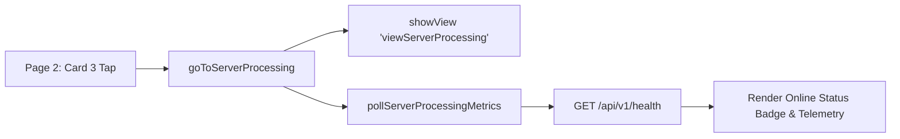

# Function: `goToServerProcessing`

## 1. Why Added
Provides an interactive client-facing demonstration mode accessible directly from Page 2 (Area Selector). It allows clients, auditors, and staff to inspect real-time internal server processing, microservices communication, HX711 load cell readings, Razorpay webhook telemetry, and stepper motor coil actuation.

## 2. Importance & Criticality
In kiosk environments, internal operations (sensor tare, voucher formula calculations, cryptographic validation, GPIO pulses) are usually invisible to users. This dedicated mode enables stakeholders to view the entire hardware-to-cloud execution pipeline live without needing SSH, external consoles, or debug builds.

## 3. Signature & Contracts
```typescript
function goToServerProcessing(): void
```
- **Inputs**: None (invoked by user tap on Page 2 Option 3 card `btn-select-server-processing`).
- **Outputs**: None.
- **Side Effects**: Activates `viewServerProcessing`, hides other views, updates `currentTerminalMode` to `'server_processing'`, and triggers `pollServerProcessingMetrics()` to query `/api/v1/health`.

## 4. Pipeline Integration & Connection Mapping

- **Upstream Callers**: User tap on `btn-select-server-processing` on Page 2 (`run-all.html`).
- **Downstream Targets**: `showView('viewServerProcessing')`, `pollServerProcessingMetrics()`, REST API `/api/v1/health`.
