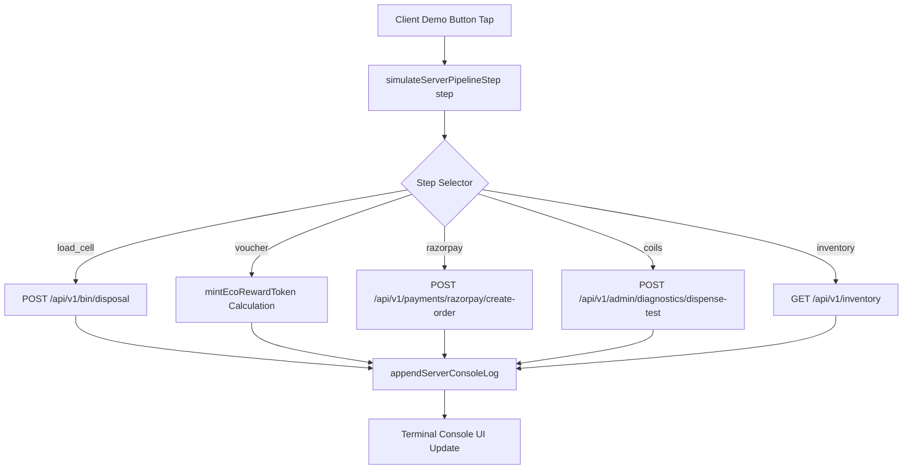

# Function: `simulateServerPipelineStep`

## 1. Why Added
Enables client-side demonstration of key server-side routines (HX711 load cell tare & intake, dynamic Eco-Reward voucher minting, Razorpay webhook creation/verification, GPIO stepper coil actuation, and inventory query) with real-time terminal output and animated pipeline node highlighting.

## 2. Importance & Criticality
Provides instant, tactile validation of edge server processing. Every action triggers real HTTP REST calls to the backend on port 3000, displaying exact JSON payloads, latencies, and HTTP response codes.

## 3. Signature & Contracts
```typescript
async function simulateServerPipelineStep(step: 'load_cell' | 'voucher' | 'razorpay' | 'coils' | 'inventory'): Promise<void>
```
- **Inputs**:
  - `step`: string identifier representing which pipeline subsystem to exercise.
- **Outputs**: None.
- **Side Effects**: Flashes DOM pipeline node (`.active-flash`), executes corresponding `fetch()` call, and logs structured entry to `#serverConsoleBox`.

## 4. Pipeline Integration & Connection Mapping

- **Upstream Callers**: Client tap on any of the 5 interactive buttons in `viewServerProcessing`.
- **Downstream Targets**: Local Express/PowerShell server endpoints on port 3000 and `#serverConsoleBox`.
