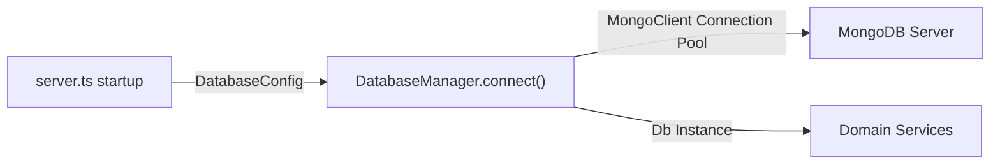

# Function: `DatabaseManager.connect`

- **Module / File**: `packages/shared/src/database/connection.ts`
- **Component**: `Shared Database Subsystem`
- **Author / Agent**: `Antigravity`
- **Date Created**: `2026-11-11`

---

## 1. Why Was This Function Added? (Rationale)
Both the Collection Bin and Vending Machine share one common MongoDB database. This function establishes a singleton connection pool with automatic retry and structured error handling.

## 2. Importance & Criticality
- **System Role**: Foundational database connection layer.
- **Impact of Failure**: Total system inability to authenticate users, store diaper weights, validate rewards, or record orders.

## 3. Function Signature & Contracts

```typescript
public async connect(config: DatabaseConfig): Promise<Db>
```

### Parameters
| Name | Type | Required | Description | Constraints / Validation |
| :--- | :--- | :--- | :--- | :--- |
| `config` | `DatabaseConfig` | Yes | URI, dbName, pool sizes | Valid MongoDB connection string |

### Return Value
- **Type**: `Promise<Db>` (Active MongoDB Db handle).

---

## 4. Pipeline Integration & Connection

### Upstream Callers & Data Source
- **Trigger**: Server boot sequence in `vending-backend/src/server.ts` or `bin-backend/src/server.ts`.
- **Caller**: Main application entrypoint.

### Downstream Targets & Consumers
- **Next Stage**: Serves DB instance to all domain repositories and services.

### Integration Flow Diagram


---

## 5. Memory Alignment & Resource Optimization
- Reuses singleton instance `DatabaseManager.instance`.
- Manages connection pool boundaries (`minPoolSize: 5`, `maxPoolSize: 20`) to prevent socket exhaustion on Raspberry Pi.

