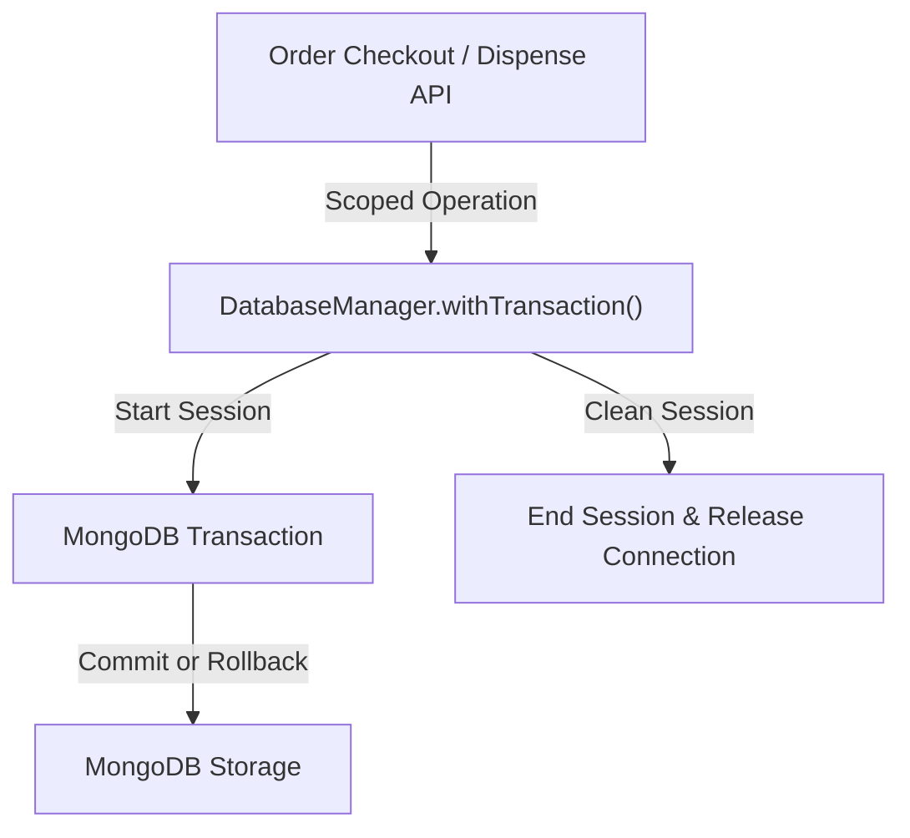

# Function: `DatabaseManager.withTransaction`

- **Module / File**: `packages/shared/src/database/connection.ts`
- **Component**: `Shared Database Subsystem`
- **Author / Agent**: `Antigravity`
- **Date Created**: `2026-11-11`

---

## 1. Why Was This Function Added? (Rationale)
In vending operations, redeeming a reward, decrementing physical slot inventory, and updating order status must happen atomically. If dispensing or payment fails, any reward redemption or inventory reservation must be completely rolled back.

## 2. Importance & Criticality
- **System Role**: Guarantees ACID transactional integrity.
- **Impact of Failure**: Race conditions could allow double-spending of discounts or negative machine inventory.

## 3. Function Signature & Contracts

```typescript
public async withTransaction<T>(
  operation: (session: ClientSession, db: Db) => Promise<T>,
  options?: TransactionOptions
): Promise<T>
```

### Parameters
| Name | Type | Required | Description | Constraints / Validation |
| :--- | :--- | :--- | :--- | :--- |
| `operation` | `Function` | Yes | Callback function performing DB writes with session | Async function |
| `options` | `TransactionOptions` | No | Read/write concerns | Standard MongoDB options |

### Return Value
- **Type**: `Promise<T>` (Result of the atomic operation).

### Thrown Exceptions
- `AppError` (`DATABASE_TRANSACTION_FAILED`): When transaction is aborted due to conflicts or errors.

---

## 4. Pipeline Integration & Connection

### Upstream Callers & Data Source
- **Trigger**: Checkout and Dispense Authorization workflows.
- **Callers**: `OrderService.checkout()`, `DispensingService.completeDispense()`.

### Downstream Targets & Consumers
- **Next Stage**: Commits writes across `orders`, `inventory`, and `rewards` collections.

### Integration Flow Diagram


---

## 5. Memory Alignment & Resource Optimization
- Guaranteed cleanup in `finally` block: calls `session.endSession()` to prevent cursor and connection leaks (Rule 3).

