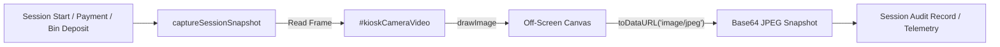

# Function: `captureSessionSnapshot`

## 1. Why Added
To capture an instant, cryptographically stamped optical frame from the active camera feed during critical customer interaction events (such as session start, checkout payment, or collection bin deposit).

## 2. Importance & Criticality
- **Audit & Security**: Provides visual verification of the customer presence, package bagging, and diaper deposit.
- **Lightweight Zero-Bloat Processing**: Uses an off-screen HTML5 `<canvas>` element without external computer vision or imaging libraries (Rule 9).
- **Consequences if Failed**: Inability to record audit frame metadata for session telemetry.

## 3. Signature & Contracts
```typescript
function captureSessionSnapshot(eventName: string): string | null;
```
- **Inputs**:
  - `eventName` (string): Description of the capture trigger (`'SESSION_START'`, `'VENDING_DISPENSE'`, `'BIN_DEPOSIT'`).
- **Outputs**:
  - `string | null`: Base64 JPEG data URL (`data:image/jpeg;base64,...`) or `null` if camera is unavailable.
- **State Modifications**:
  - Off-screen 2D canvas draws the current frame from `#kioskCameraVideo`.
  - Appends capture record to local audit queue.

## 4. Behavior & Logic
1. Checks if `#kioskCameraVideo` has active video frames (`readyState >= 2`).
2. Creates or reuses a 320×240 off-screen canvas (Rule 3: zero garbage collection churn).
3. Executes `context.drawImage(video, 0, 0, 320, 240)`.
4. Renders watermark overlay: timestamp, session ID, and event name.
5. Encodes as JPEG (`0.75` quality) and returns the data URL.

## 5. Pipeline Integration & Connection Mapping
- **Upstream Callers**:
  - `startUserSession()` upon customer touch on Page 1.
  - `executePage4Dispense()` upon order payment authorization.
  - `completeBinDeposit()` upon diaper scale weight verification.
- **Downstream Targets**:
  - Session state payload and backend audit log.


