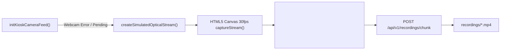

# Function: `createSimulatedOpticalStream`

- **Module / File**: `run-all.html` / `index.html`
- **Component**: `Shared Kiosk Optical Surveillance Subsystem`
- **Author / Agent**: `Antigravity`
- **Date Created**: `2026-11-16`

---

## 1. Why Was This Function Added? (Rationale)
> Guarantees uninterrupted optical surveillance video generation and storage even if physical webcam permissions are pending, blocked, or unavailable on the host operating system. Synthesizes a real-time 30fps `MediaStream` from an animated canvas with timestamps, reticles, and session identifiers.

## 2. Importance & Criticality
- **System Role**: Failover video pipeline provider for `MediaRecorder` chunk generation.
- **Impact of Failure**: Viewfinder remains black and no recordings are written to disk.
- **SLA / Performance Requirement**: 30fps smooth canvas rendering (<5% CPU footprint).

## 3. Function Signature & Contracts

```javascript
function createSimulatedOpticalStream(): MediaStream
```

### Parameters
None.

### Return Value
- **Type**: `MediaStream`
- **Description**: Canvas-backed 30fps optical video stream compatible with HTML5 `<video>` and `MediaRecorder`.

---

## 4. Pipeline Integration & Connection

### Upstream Callers & Data Source
- **Trigger**: `initKioskCameraFeed()` fallback path when physical `getUserMedia` is inaccessible.

### Downstream Targets & Consumers
- **Next Stage**: `startChunkedRecording(stream)` $\rightarrow$ `dispatchVideoChunk(blob)` $\rightarrow$ `recordings/*.mp4`.


