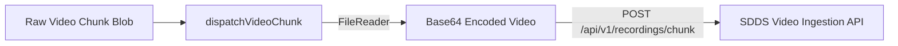

# Function: `dispatchVideoChunk`

## 1. Why Added
To convert raw binary video blobs emitted by `MediaRecorder` into a structured payload and asynchronously transmit them to the backend video storage API.

## 2. Importance & Criticality
- **Non-Blocking Operation**: Uses asynchronous `FileReader` and non-blocking `fetch` so that video encoding and transmission never stutter the kiosk UI or 60fps animations.
- **Data Integrity**: Attaches sequential chunk numbers, timestamps, and active `sessionId` for deterministic reconstruction.

## 3. Signature & Contracts
```typescript
function dispatchVideoChunk(blob: Blob): Promise<void>;
```
- **Inputs**:
  - `blob` (`Blob`): WebM video chunk produced by `MediaRecorder`.
- **Outputs**: `Promise<void>`.
- **State Modifications**:
  - Increments `videoChunkSequence` by 1.
- **Side Effects**:
  - Fires HTTP `POST /api/v1/recordings/chunk` with JSON payload `{ sessionId, chunkIndex, timestamp, dataBase64, mimeType }`.

## 4. Behavior & Logic
1. Filters out empty blobs (`blob.size === 0`).
2. Increments sequence counter.
3. Uses `FileReader.readAsDataURL(blob)` to extract base64 bytes.
4. Prepares metadata: `sessionId` (or `'IDLE_MONITORING'`), `chunkIndex`, `timestamp`.
5. Dispatches `fetch('/api/v1/recordings/chunk')` with retry/error tolerance.

## 5. Pipeline Integration & Connection Mapping
- **Upstream Caller**: `MediaRecorder.ondataavailable` event handler.
- **Downstream Target**: Backend REST API endpoint `/api/v1/recordings/chunk`.


