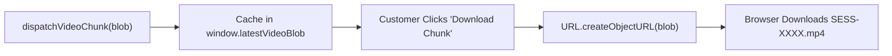

# Function: `downloadLatestVideoChunk`

- **Module / File**: `run-all.html` / `index.html`
- **Component**: `Shared Kiosk Optical Surveillance Subsystem`
- **Author / Agent**: `Antigravity`
- **Date Created**: `2026-11-16`

---

## 1. Why Was This Function Added? (Rationale)
> Provides 1-click client-side download capability for the latest recorded optical video chunk directly from the kiosk HUD interface.

## 2. Importance & Criticality
- **System Role**: Immediate audit review, inspection, and proof-of-recording verification.
- **Impact of Failure**: User cannot download the recorded video chunk locally via browser.
- **SLA / Performance Requirement**: Instant execution (<50ms).

## 3. Function Signature & Contracts

```javascript
function downloadLatestVideoChunk(): void
```

---

## 4. Pipeline Integration & Connection

### Upstream Callers & Data Source
- **Trigger**: Click on `[⬇ Download Chunk]` button in optical camera HUD.
- **Preceding Function**: `dispatchVideoChunk(blob)`.

### Downstream Targets & Consumers
- **Next Stage**: Browser Downloads folder (`Blob URL` anchor click).


