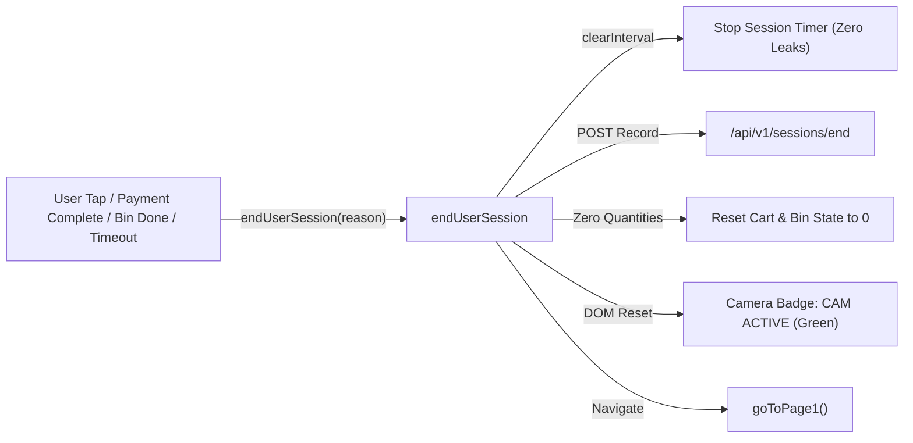

# Function: `endUserSession`

## 1. Why Added
Provides a deterministic termination method for active customer kiosk interactions. Customers must be able to cancel or abort transactions cleanly at any stage prior to order placement or bin deposit, or have the session terminate automatically upon successful payment or deposit completion.

## 2. Importance & Criticality
- **Privacy & Security**: Ensures customer carts, discount codes, and sensitive transaction state are wiped clean upon exit.
- **Resource Hygiene (Rule 3)**: Explicitly clears background timer intervals (`clearInterval`) to prevent memory leaks and zombie CPU cycles.
- **Audit Completeness**: Logs the terminal reason (`USER_ABORTED`, `COMPLETED_VENDING`, `COMPLETED_BIN`, or `TIMEOUT`) and calculates total duration for footage synchronization.

## 3. Signature & Contracts
```typescript
function endUserSession(reason: 'USER_ABORTED' | 'COMPLETED_VENDING' | 'COMPLETED_BIN' | 'TIMEOUT'): void;
```
- **Inputs**:
  - `reason` (string): Enumerated termination trigger.
- **Outputs**: None. Mutates session state and DOM.
- **State Modifications**:
  - `sessionTimerInterval`: Cleared via `clearInterval`.
  - `vendingState` & `binState`: All size counters reset to 0.
  - Camera Status Badge: Reverts to `CAM ACTIVE • MONITORING` (green dot).
  - "END SESSION" Button: Hidden (`display: none`).
  - View Navigation: Dispatches `goToPage1()`.

## 4. Behavior & Logic
1. Checks if `currentSessionId` exists; if none, gracefully returns.
2. Halts `sessionTimerInterval` using `clearInterval()`.
3. Computes elapsed duration in seconds between `sessionStartTime` and `new Date()`.
4. Asynchronously posts termination record to `/api/v1/sessions/end` with `{ sessionId, endTime, durationSeconds, reason }`.
5. Clears all itemized diaper counters in both Smart Bin and Vending Machine states.
6. Hides `#btnEndSession` and updates `#cameraStatusBadge` back to standby surveillance mode.
7. Calls `goToPage1()` to return the kiosk to the idle screen.

## 5. Pipeline Integration & Connection Mapping
- **Upstream Callers**:
  - Click on `#btnEndSession` ("END SESSION" button in header) with reason `USER_ABORTED`.
  - `executePage4Dispense()` upon successful payment with reason `COMPLETED_VENDING`.
  - `completeBinDeposit()` / `closeIntegratedBinModal()` upon diaper intake with reason `COMPLETED_BIN`.
  - Inactivity watchdog timer with reason `TIMEOUT`.
- **Downstream Targets**:
  - Backend API endpoint `/api/v1/sessions/end`.
  - UI State reset and `goToPage1()`.


