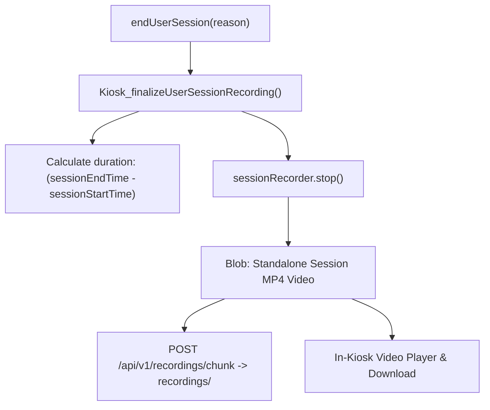

# Function: `Kiosk_finalizeUserSessionRecording`

## 1. Why Added
Concludes the session-specific optical video recording when the customer interaction finishes (order completion, diaper drop verification, or session timeout). Computes the exact start-to-end duration and compiles a standalone, 100% playable `.mp4` file containing the customer's interaction.

## 2. Importance & Criticality
Prevents corrupt 36-byte chunk fragments. By calling `.stop()` and aggregating all accumulated buffers inside `onstop`, this function ensures that the finalized video file contains complete file container headers (`ftyp`), time indexing metadata (`moov`), and media samples (`mdat`), making the video file instantly viewable in the kiosk video player or playable on any media player.

## 3. Signature & Contracts
```typescript
function finalizeUserSessionRecording(reason: string = 'COMPLETED'): void
```
- **Inputs**: `reason: string` (e.g., `COMPLETED_BIN`, `COMPLETED_VENDING`, `USER_ABORTED`, `TIMEOUT`).
- **Outputs**: `void`.

## 4. Behavior & Logic
1. Checks if `sessionRecorder` is active.
2. Marks `sessionEndTime = new Date()`.
3. Calculates total session duration: `durationSec = Math.round((sessionEndTime - sessionStartTime) / 1000)`.
4. Invokes `sessionRecorder.stop()`.
5. Inside `onstop`:
   - Compiles complete `Blob`: `new Blob(sessionRecordedChunks, { type: activeMimeType })`.
   - Sends payload to `/api/v1/recordings/chunk` as `${currentSessionId}_INTERACTION_${durationSec}s_${timestamp}.mp4`.
   - Stores blob in `window.latestSessionVideoBlob`.
   - Updates HUD status: `SESSION VIDEO SAVED (${sizeMB} MB)`.
6. Frees session recorder instance to prevent memory leaks (Rule 3).

## 5. Pipeline Integration & Mapping

