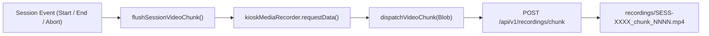

# Function: `flushSessionVideoChunk`

- **Module / File**: `run-all.html` / `index.html`
- **Component**: `Shared Kiosk Optical Surveillance Subsystem`
- **Author / Agent**: `Antigravity`
- **Date Created**: `2026-11-16`

---

## 1. Why Was This Function Added? (Rationale)
> Resolves premature session termination data loss. During customer sessions lasting less than the background 60,000ms chunk timeslice, in-progress video recordings remained trapped in browser memory. `flushSessionVideoChunk()` forces `MediaRecorder.requestData()` to immediately slice and transmit recorded frames upon session start, completion, or user abort.

## 2. Importance & Criticality
- **System Role**: Surveillance audit integrity and dispute verification.
- **Impact of Failure**: Loss of video audit trail for transactions shorter than 60 seconds.
- **SLA / Performance Requirement**: Instant non-blocking execution (<1ms).

## 3. Function Signature & Contracts

```javascript
function flushSessionVideoChunk(): void
```

### Parameters
None.

### Return Value
- **Type**: `void`
- **Description**: Triggers asynchronous `ondataavailable` dispatch of the current recording buffer.

### Thrown Exceptions / Errors
- Handled internally with try/catch; logs warning if `requestData()` is called while recorder is inactive.

---

## 4. Pipeline Integration & Connection

### Upstream Callers & Data Source
- **Trigger**: `startUserSession()`, `endUserSession()`, or `navigatePage1ToPage2()`.
- **Preceding Function**: Customer interaction or session transition.

### Downstream Targets & Consumers
- **Next Stage**: `kioskMediaRecorder.ondataavailable` $\rightarrow$ `dispatchVideoChunk(blob)` $\rightarrow$ `POST /api/v1/recordings/chunk` $\rightarrow$ Disk storage in `recordings/`.



---

## 5. Internal Logic & Implementation Details
1. Verifies that `kioskMediaRecorder` exists and its state is `'recording'`.
2. Dispatches `kioskMediaRecorder.requestData()`.
3. Slices all recorded frames since the last boundary into an independent `Blob`.
4. Emits `ondataavailable`, triggering Base64 encoding and asynchronous POST to `/api/v1/recordings/chunk`.
