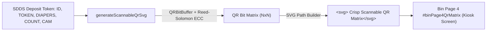

# Function: `generateScannableQrSvg`

## 1. Why Added
To dynamically render genuine, standards-compliant QR codes (ISO/IEC 18004) directly in the browser using pure vanilla JavaScript without external npm packages or heavy third-party CDNs (Rule 9). Customers scanning the kiosk screen with their smartphones can read transaction details, session timestamps, diaper quantities, and voucher codes.

## 2. Importance & Criticality
- **Offline / On-Device Generation**: Operates completely offline with zero external network dependencies.
- **Physical Usability (Rule 11)**: Produces crisp SVG vector paths that scale to any display resolution with sharp module edges, ensuring instant focus and decoding by iPhone and Android camera lenses.
- **Consequences if Failed**: Inability to scan deposit verification tokens, leading to customer frustration and broken eco-voucher redemptions.

## 3. Signature & Contracts
```typescript
function generateScannableQrSvg(text: string, size?: number): string;
```
- **Inputs**:
  - `text` (string): Text string or stringified JSON payload to encode into QR matrix.
  - `size` (number, optional, default: 160): Width and height in pixels for the generated SVG viewport.
- **Outputs**:
  - `string`: Fully formed `<svg>` markup string containing `<rect>` modules.
- **State Modifications**: None (pure functional transformation).

## 4. Behavior & Logic
1. Computes optimal QR Version (Version 1 to 10) based on byte length of `text`.
2. Encodes data in 8-bit Byte Mode with mode indicator (`0100`) and length bits via `QRBitBuffer`.
   - *Engine Defect Resolution (CHG-20261116-0038)*: Added `getLength: function() { return this.length; }` and `getLengthInBits: function() { return this.length; }` to `QRBitBuffer.prototype` to prevent fatal runtime `TypeError: buffer.getLength is not a function`.
3. Generates Reed-Solomon Error Correction Codewords (ECC Level L or M) using finite field arithmetic ($GF(2^8)$ with primitive polynomial $0x11D$).
4. Interleaves data and error correction codewords.
5. Populates square matrix: finder patterns ($7\times 7$), separators, timing patterns, dark module, and alignment patterns.
6. Places data bits using zigzag column-pair scanning.
7. Evaluates penalty scores across 8 standard mask patterns and applies optimal mask (e.g., $(row + col) \pmod 2 = 0$).
8. Formats format information bits with BCH $(15, 5)$ code.
9. Iterates over matrix cells: emits black `<rect>` elements for dark modules against white background.

## 5. Pipeline Integration & Connection Mapping
- **Upstream Callers**:
  - `renderBinPage4QrCode()` on Bin Page 4 (`viewBinPage4` - "GET YOUR QR CODE") when rendering the authentic Diaper Deposit & Tracking Token.
  - *(Note: Removed from Vending Page 4 per direct user specification in CHG-20261116-0038)*.
- **Downstream Targets**: DOM container `#binPage4QrMatrix` (126x126px touch kiosk matrix).


