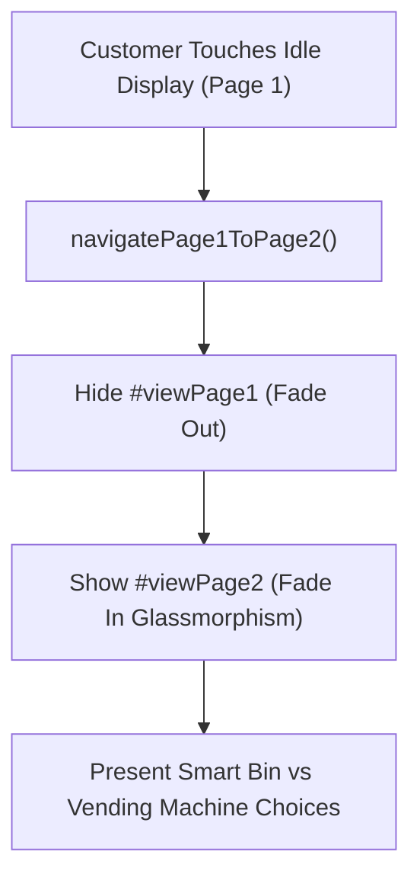

# Function: `navigatePage1ToPage2`

- **Module / File**: `run-all.html` / `index.html`
- **Component**: `Master Kiosk State Machine (Page 1 Welcome & Page 2 Mode Selection)`
- **Author / Agent**: `Antigravity`
- **Date Created**: `2026-11-15`

---

## 1. Why Was This Function Added? (Rationale)
Recreates the exact visual entry experience specified in `PICS/PAGE1.png`. In public kiosk deployment, the terminal rests in a fullscreen ambient idle state displaying *"TOUCH THE DISPLAY"* with an animated hand cursor. Touching or clicking the screen invokes `navigatePage1ToPage2()` to transition smoothly to the primary area selection screen (`PICS/PAGE2.png`).

## 2. Importance & Criticality
- **System Role**: Initial entry gate for user interaction on the kiosk touchscreen display.
- **Impact of Failure**: If this fails, customers remain locked on the idle screen and cannot access the Smart Bin or Vending Machine.

## 3. Function Signature & Contracts

```javascript
function navigatePage1ToPage2(): void
```

### Parameters
None.

### Return Value
- **Type**: `void`.

### State Mutations & DOM Changes
- Hides `#viewPage1` with a fade-out animation.
- Displays `#viewPage2` with a fade-in scale animation.
- Updates active state indicators and prepares mode selection cards (`SMART BIN` and `VENDING MACHINE`).

---

## 4. Pipeline Integration & Connection

### Upstream Callers & Data Source
- **Trigger**: Customer touches or clicks anywhere on `#viewPage1` or presses `Enter` / `Space` on physical keyboard.
- **Caller**: `viewPage1.onclick`, `window.onkeydown`.

### Downstream Targets & Consumers
- **Next Stage**: Displays `#viewPage2`, awaiting user selection of `selectTerminalMode('bin')`, `selectTerminalMode('vending')`, or `selectTerminalMode('admin')`.

### Integration Flow Diagram


---

## 5. Memory Alignment & Resource Optimization
- Operates strictly on CSS display and opacity transitions.
- Zero DOM element recreation or dynamic script compilation.
