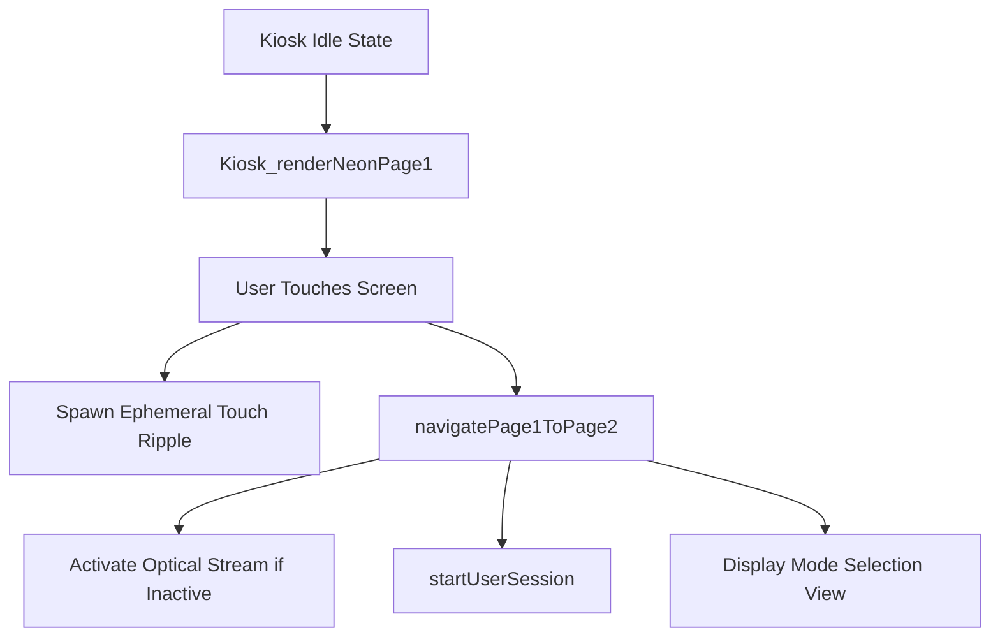

# Function: `Kiosk_renderNeonPage1`

## 1. Why Added
Replaces the legacy dark Page 1 welcome screen with the modern, touch-optimized, cream-and-neon kiosk interface defined in `PICS/stitch_neon_page1(1)/code.html` and `DESIGN.md`. Eliminates remote raster image pixelation by utilizing an infinite-resolution multi-layer SVG wave artwork, and centers the hero title and ripple touch anchor in close vertical proximity.

## 2. Importance & Criticality
As the primary customer-facing entry point (State 0 / Idle State of the Kiosk State Machine per Rule 11), this view must:
1. Attract users with high-visibility pulsating cues (`TOUCH THE DISPLAY` with animated concentric ripple rings).
2. Guarantee 100% vector sharpness across all display sizes (1080p, 2K, 4K, retina touch monitors) with zero pixelation or raster artifacts.
3. Maintain active webcam surveillance integration and optical monitoring in the background.
4. Handle seamless pointer down tactile ripple animations without memory leaks.
5. Deterministically transition into Page 2 (`navigatePage1ToPage2()`) on any user tap.
If this fails, users cannot initiate sessions or access either the diaper collection bin or the diaper vending system.

## 3. Signature & Contracts
```typescript
function Kiosk_renderNeonPage1(): void
```
- **Inputs**: None.
- **Outputs**: None (DOM manipulation of `#viewPage1` and associated CSS keyframe animations).
- **Errors Handled**: Graceful degradation if live clock element `#system-clock` or background SVGs fail to load.

## 4. Behavior & Logic
1. Displays an ambient illuminated background with soft radial gradients (`#ffffff`, `#faf3dd`, `#9ef01a`) and a subtle dot-matrix texture (`.bg-dot-matrix`).
2. Renders the main frosted glass container (`.glass-card`, full-screen edge-to-edge 100vw × 100vh) without letterboxing boundaries or outer padding clipping.
3. Features a header bar with brand icon (forest square with glowing neon diamond), `WELCOME • Hygiene Care Kiosk` title, live system clock (`01:55 PM`), and language switch pill (`EN`).
4. Vertically centers the hero title **`TOUCH THE DISPLAY`** in multi-stop forest green gradient with drop shadow, paired with triple-ring pulsating concentric ripples (`ripple-1`, `ripple-2`, `ripple-3`) and a tactile hand cursor icon in close vertical proximity (12px gap).
5. Displays the authentic 2400×1792 high-resolution green wave artwork (`PICS/intoimage.png`) grounded at the bottom using `mix-blend-mode: multiply` and vertical gradient fade mask (`mask-image: linear-gradient(to top, rgba(0,0,0,0.85) 0%, rgba(0,0,0,0.4) 60%, transparent 100%)`).
6. Listens for user touches/taps across `#kiosk-touch-area` / `#viewPage1`:
   - Spawns a lightweight glowing touch ripple at the exact touch coordinates (`(x, y)`).
   - Automatically cleans up ripple DOM nodes after 700ms.
   - Invokes `navigatePage1ToPage2()` to activate the customer session and transition to Page 2.

## 5. Pipeline Integration (Rule 2)

- **Upstream Callers**: Idle timeout reset (`goToPage1()`), initial page load (`index.html` / `run-all.html`).
- **Downstream Targets**: `navigatePage1ToPage2()`, `startUserSession()`, `requestPhysicalWebcam()`.
