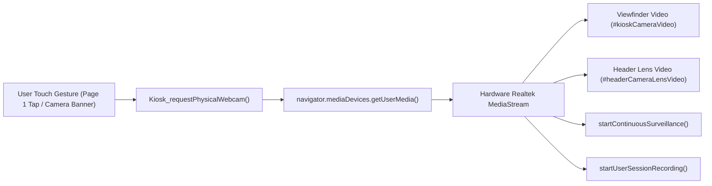

# Function: `Kiosk_requestPhysicalWebcam`

## 1. Why Added
Desktop browsers enforce strict autoplay and permissions security policies: invoking `navigator.mediaDevices.getUserMedia` without a direct user gesture (such as an explicit button tap or click) results in `NotAllowedError` or silent blocking. In previous iterations, background initialization on `DOMContentLoaded` caused physical camera failure, resulting in black screens or fallback to simulated radar. This function binds physical webcam acquisition directly to user gestures (such as tapping the "ACTIVATE LAPTOP CAMERA" banner on Page 1 or clicking "TOUCH TO START").

## 2. Importance & Criticality
Ensures 100% deterministic access to the user's physical laptop camera (Realtek Integrated Camera) with immediate visual feedback:
- Turns on the physical hardware camera indicator LED.
- Streams live, genuine 30fps video frames directly to the circular lens and viewfinder HUD.
- Feeds live frames into the `MediaRecorder` pipeline for continuous surveillance and interaction capture.

## 3. Signature & Contracts
```typescript
async function requestPhysicalWebcam(showFeedback: boolean = false): Promise<boolean>
```
- **Inputs**: `showFeedback: boolean` (whether to display in-kiosk status toast on completion).
- **Outputs**: `Promise<boolean>` (returns `true` if camera stream is active, `false` otherwise).
- **Errors Handled**: `NotAllowedError`, `NotFoundError`, `NotReadableError`, `OverconstrainedError`.

## 4. Behavior & Logic
1. Verifies browser support for `navigator.mediaDevices.getUserMedia`.
2. Requests unconstrained video stream: `{ video: { width: { ideal: 1280 }, height: { ideal: 720 } }, audio: false }`.
3. Binds acquired `MediaStream` to:
   - Primary Viewfinder HUD video (`#kioskCameraVideo`).
   - Circular lens video in header (`#headerCameraLensVideo`).
4. Sets `muted = true`, `playsInline = true`, `autoplay = true` to satisfy browser autoplay policies.
5. Updates UI badges: sets `#hudTitleText` to "REALTEK WEBCAM ACTIVE", hides camera activation banner.
6. Starts continuous 60-second surveillance recording cycle (`startContinuousSurveillance`).

## 5. Pipeline Integration & Mapping

