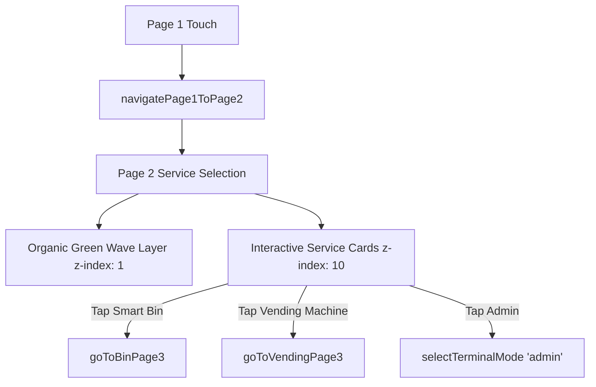

# Function: `selectTerminalMode`

- **Module / File**: `run-all.html` / `index.html`
- **Component**: `Master Kiosk State Machine (Page 2 Area Selector)`
- **Author / Agent**: `Antigravity`
- **Date Created**: `2026-11-15`
- **Last Updated**: `2026-11-16` (Organic Green Wave Grounding Layer Integration)

---

## 1. Why Was This Function Added? (Rationale)
Implements the service selection interface specified in `PICS/stitch_neon_page2(1)` and `PICS/PAGE2.png`. The user is presented with two primary touch cards: `"SMART BIN"` and `"VENDING MACHINE"`, as well as a discrete `"ADMIN"` access trigger. 
An organic green wave artwork is integrated as a grounding backdrop anchored to the bottom of the viewport using `mix-blend-mode: multiply`, vertical gradient masking, and 45% opacity, maintaining visual consistency with Page 1 and Vending Page 3.

---

## 2. Importance & Criticality
- **System Role**: Master router connecting customer intent with the specific kiosk terminal interface.
- **Layering & Touch Accessibility (Rule 11)**: Wave grounding sits at `z-index: 1` with `pointer-events: none;`, guaranteeing that interactive touch cards at `z-index: 10` are 100% unobstructed.
- **Impact of Failure**: If routing fails, customers cannot enter their chosen disposal or purchasing experience.

---

## 3. Function Signature & Contracts

```javascript
function selectTerminalMode(mode: 'bin' | 'vending' | 'admin' | 'split'): void
```

### Parameters
| Name | Type | Required | Description | Constraints |
| :--- | :--- | :--- | :--- | :--- |
| `mode` | `string` | Yes | Target subsystem mode | One of `'bin'`, `'vending'`, `'admin'`, `'split'` |

### Return Value
- **Type**: `void`.

### State Mutations & DOM Changes
- Hides `#viewPage2`.
- When `mode === 'admin'`, activates administrative terminal authentication modal.
- When `mode === 'bin'`, directly invokes `goToBinPage3()` for seamless touchless recycling.
- When `mode === 'vending'`, directly invokes `goToVendingPage3()` for instant diaper selection and cart checkout.

---

## 4. Grounding Layer Layout & CSS Architecture
1. **Stacking Context**:
   - Background grounding wave container: `position: absolute; bottom: 0; left: 0; right: 0; height: clamp(240px, 36vh, 340px); z-index: 1; pointer-events: none; overflow: hidden;`.
   - Interactive surface: `position: relative; z-index: 10; width: 100%; height: 100%; display: flex; flex-direction: column; justify-content: space-between;`.
2. **Blending & Masking**:
   - `mix-blend-mode: multiply;` turns artwork white margins transparent against the warm cream backdrop (`#faf3dd`).
   - `mask-image: linear-gradient(to top, rgba(0,0,0,0.85) 0%, rgba(0,0,0,0.4) 60%, transparent 100%);` dissolves the upper wave crests smoothly into the background without harsh cutoff edges.
   - Opacity: calibrated to `0.45` (45%) for subtle atmospheric depth.

---

## 5. Pipeline Integration & Connection

### Upstream Callers & Data Source
- **Trigger**: Customer taps the `SMART BIN` card, `VENDING MACHINE` card, or `ADMIN` button on Page 2.
- **Caller**: `btnCardBin.onclick`, `btnCardVending.onclick`, `btnAdmin.onclick`.

### Downstream Targets & Consumers
- **Next Stage**: `goToBinPage3()` or `goToVendingPage3()` with real-time stock allocation and camera session recording.

### Integration Flow Diagram

