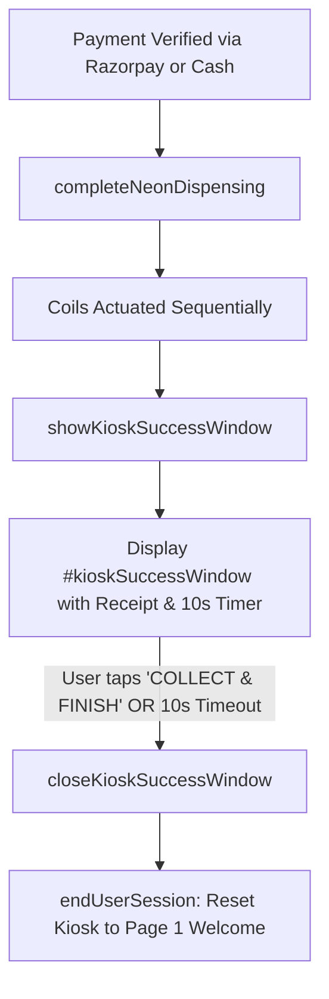

# Function: Kiosk_showSuccessWindow

## 1. Why Added
Replaces invasive browser `alert()` popups following order payment and dispensing with a dedicated, touch-optimized kiosk success modal. In unattended public kiosks, native browser dialogs halt execution, look amateurish, block touch gestures, and risk kiosk locking. `Kiosk_showSuccessWindow` provides an immersive, high-contrast confirmation state with animated visual feedback, itemized receipts, hatch status, and an automated countdown timer.

## 2. Importance & Criticality
- **Kiosk Ergonomics**: Guarantees zero blocking browser alert boxes, satisfying Rule 11.
- **Physical Guidance**: Informs the user in real-time that dispensing coils have completed actuation and unlocks physical retrieval instructions.
- **Session Hygiene**: Automatically initiates an active 10-second auto-return countdown timer to prevent screen abandonment and reset the kiosk for the next customer.

## 3. Signature & Contracts
```typescript
interface OrderSuccessDetails {
  payableAmount: number;
  paymentTxId: string;
  items?: Array<{ name: string; quantity: number; slotId?: string }>;
  slotsDispensed?: string[];
}

function showKioskSuccessWindow(details: OrderSuccessDetails): void;
function closeKioskSuccessWindow(): void;
```
- **Inputs**: `details` object containing transaction amount, transaction ID, dispensed slot identifiers, and items.
- **Outputs**: None (`void`). Manipulates DOM element `#kioskSuccessWindow`.
- **Errors Thrown**: Safe; catches DOM lookup errors and falls back gracefully.

## 4. Behavior & Logic
1. Obtains reference to `#kioskSuccessWindow`. If not present, creates container dynamically.
2. Formats `payableAmount` to Indian Rupee (`₹`) string.
3. Renders high-contrast animated checkmark icon, payment reference, and dispensed items list.
4. Starts an interval countdown ticker (10 seconds) displayed in `#kioskSuccessCountdown`.
5. Binds "COLLECT & FINISH" touch CTA button to `closeKioskSuccessWindow()`.
6. When countdown reaches 0 or user taps CTA, cancels interval, hides window, and calls `endUserSession('TRANSACTION_COMPLETE')` to transition back to Page 1.

## 5. Pipeline Integration & End-to-End Mapping

