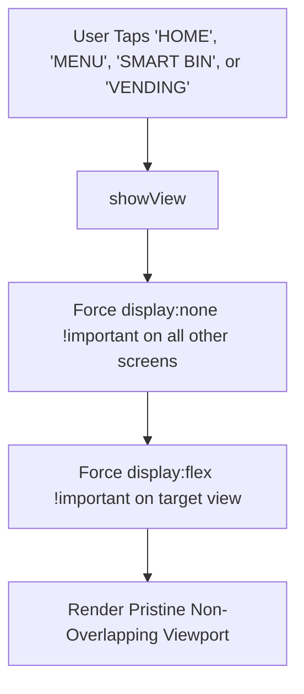

# Function: Kiosk_showView

## 1. Why Added
Eliminates screen overlapping, visual bleeding, and ghost touch interactions across Page 1, Page 2, and the Vending Machine screens. In complex single-page touchscreen applications, relying on uncoordinated inline `style.display` changes causes CSS specificity conflicts and stacking context traps. `showView(viewId)` enforces strict atomic mutual exclusivity.

## 2. Importance & Criticality
- **Zero-Overlap Guarantee (Rule 11)**: Assures that only the single active screen is rendered, while all other screens are completely suppressed from both layout and touch event handling.
- **Touch Ergonomics**: Prevents background buttons from receiving phantom touch events.
- **Fail-Safe Recovery**: Clears transient modals and restores master container transparency on every view transition.

## 3. Signature & Contracts
```typescript
function showView(viewId: string): void;
```
- **Inputs**: `viewId` (`string`), corresponding to the target `<section>` element ID (e.g. `'viewPage1'`, `'viewPage2'`, `'viewVendingPage3'`, `'viewBinPage3'`).
- **Outputs**: `void`.
- **Side Effects**: Enforces `!important` display, visibility, and pointer-event properties across all managed view nodes.

## 4. Behavior & Logic
1. Iterates over all known kiosk views:
   `['viewPage1', 'viewPage2', 'viewBinPage3', 'viewVendingPage3', 'viewBinPage4', 'viewVendingPage4', 'viewTerminalStage']`.
2. For every view not matching `viewId`:
   - Applies `display: none !important;`
   - Applies `visibility: hidden !important;`
   - Applies `pointer-events: none !important;`
   - Removes `.active-view` class.
3. For the target view matching `viewId`:
   - Applies `display: flex !important;`
   - Applies `visibility: visible !important;`
   - Applies `pointer-events: auto !important;`
   - Adds `.active-view` class.
4. Suppresses all transient modals (`#integratedCartModal`, `#integratedBinDepositModal`).

## 5. Pipeline Integration (Rule 2)

