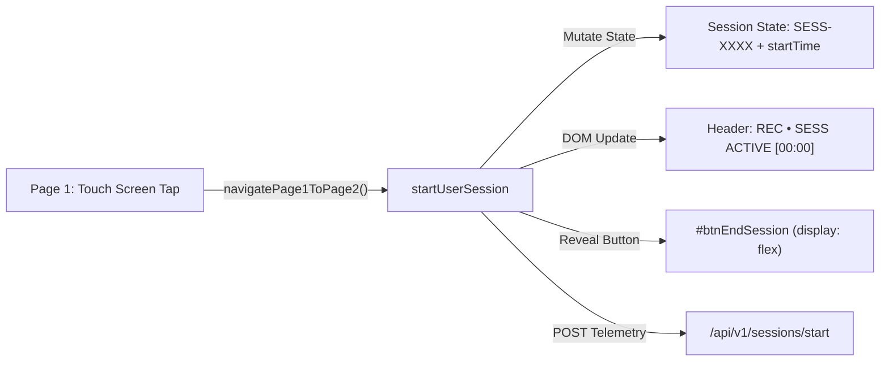

# Function: `startUserSession`

## 1. Why Added
In a public unattended IoT kiosk (Smart Diaper Collection & Vending Machine), optical surveillance, fraud prevention, and session auditing are essential. Previously, user touches on the idle welcome screen transitioned directly to mode selection without recording an immutable session start event or initiating footage indexing. `startUserSession` establishes an explicit temporal boundary and generates a unique session identifier upon user initiation.

## 2. Importance & Criticality
- **Hardware & Security Audit**: Associates continuous camera surveillance footage with an indexed session ID and exact start timestamp.
- **Session State Machine (Rule 11)**: Activates session timers, reveals the "END SESSION" escape button, and enables idle timeout counters.
- **Consequences if Failed**: Lack of interaction audit trails, inability to correlate camera footage with fraudulent or abnormal behavior, and orphaned shopping cart state.

## 3. Signature & Contracts
```typescript
function startUserSession(): void;
```
- **Inputs**: None.
- **Outputs**: None. Mutates global session state (`currentSessionId`, `sessionStartTime`, `sessionTimerInterval`).
- **State Modifications**:
  - `currentSessionId`: Assigned `'SESS-' + Date.now().toString(36).toUpperCase()`.
  - `sessionStartTime`: Assigned `new Date()`.
  - Master Header Camera Badge: Transitions from `CAM ACTIVE • MONITORING` to `REC • SESS ACTIVE` with pulsing red dot.
  - "END SESSION" Button: Set to `display: flex`.
- **Side Effects**:
  - Initiates 1000ms `setInterval` for elapsed session time rendering.
  - Fires non-blocking asynchronous `POST` to `/api/v1/sessions/start`.

## 4. Behavior & Logic
1. Generates unique session identifier using cryptographic base-36 timestamp encoding.
2. Captures high-precision start timestamp.
3. Sets active camera monitoring visual indicator in the master header with pulsing red status dot.
4. Un-hides the prominent touch-friendly "END SESSION" button in the kiosk navigation header.
5. Starts the seconds counter interval, updating `sessionTimerText` every 1000ms.
6. Dispatches telemetry payload `{ sessionId, startTime, device: 'KIOSK-01', cameraActive: true }` to `/api/v1/sessions/start`.

## 5. Pipeline Integration & Connection Mapping
- **Upstream Caller**: `navigatePage1ToPage2()` triggered by user touching the display on Page 1.
- **Downstream Targets**:
  - Top master header badge DOM elements (`#cameraStatusBadge`, `#sessionTimerText`, `#btnEndSession`).
  - Backend API endpoint `/api/v1/sessions/start`.


